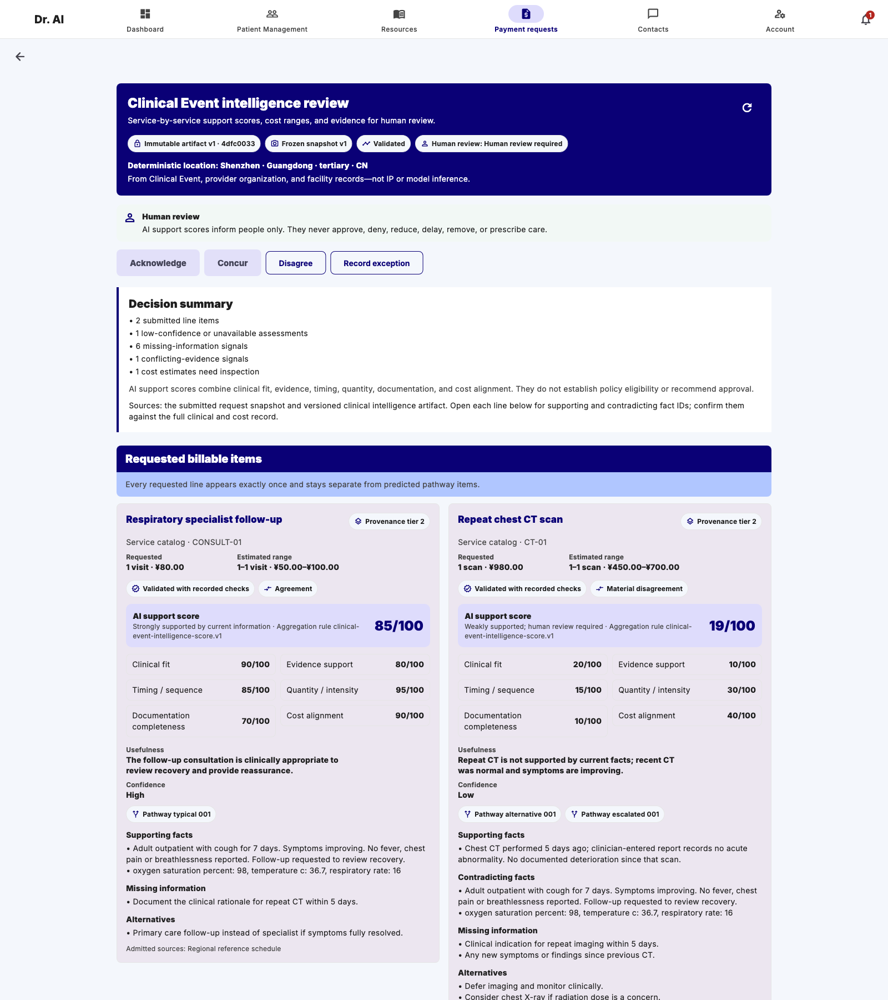
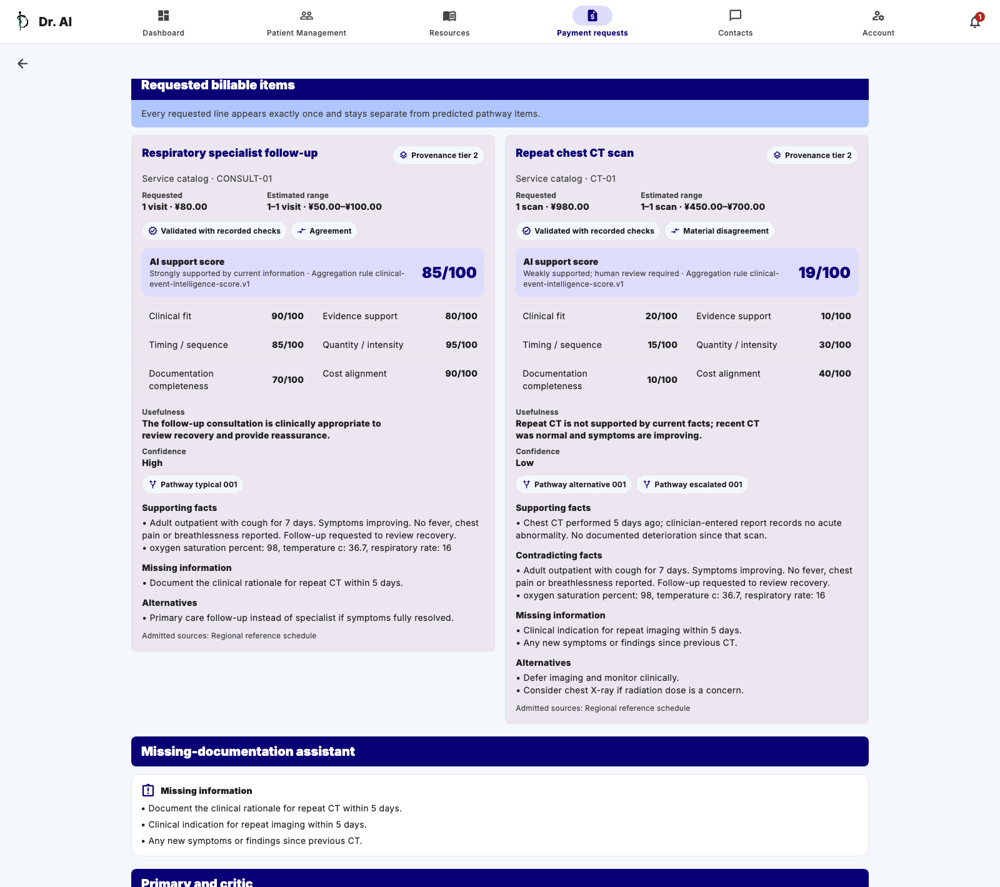
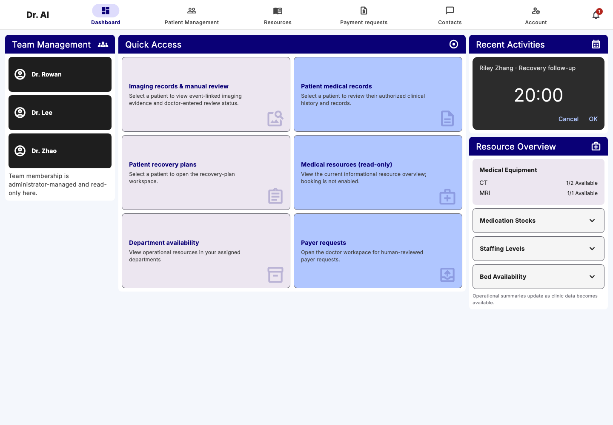
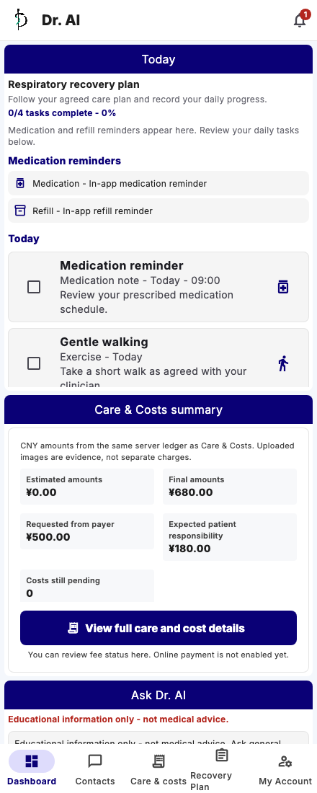
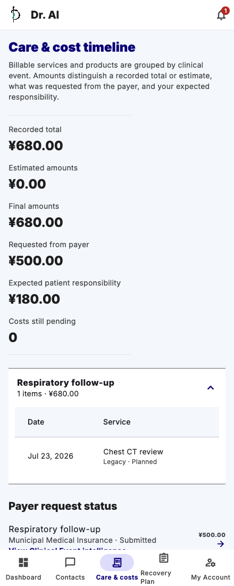
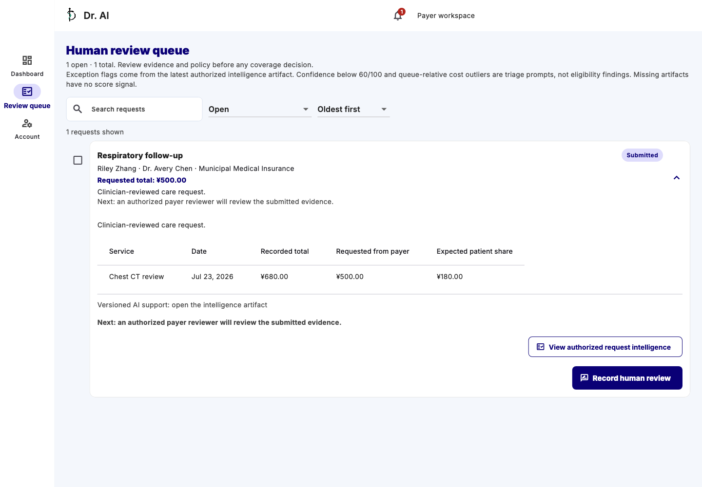
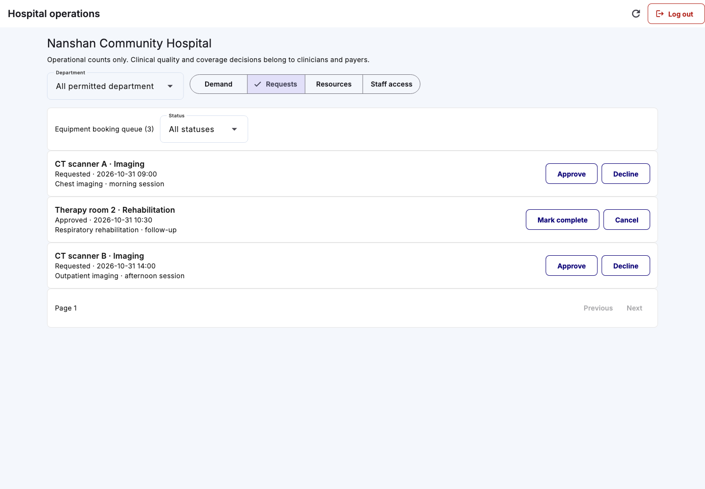

# Dr. AI

**AI-supported cost grading, care coordination, and cost transparency.**

Dr. AI brings patients, doctors, and payer reviewers together around a clearer
record of care: what happened, which services were requested or delivered, what
they cost, and what needs attention next. Built with a focus on healthcare in
China, its central feature is AI-supported grading of requested services and
costs: explainable support scores, estimated ranges, and evidence gaps for human
review. Daily recovery support and clinical records connect that analysis to
the rest of the care journey, in English and Simplified Chinese.

## A workspace for each part of care

| Who it serves | What they can do |
| --- | --- |
| **Patients** | Follow recovery plans, track daily tasks, view medical and imaging records, understand recorded costs and review progress, and ask health-education questions. |
| **Doctors** | Manage assigned patients, review medical histories and imaging, maintain medications and recovery plans, document clinical events and services, and prepare payer requests. |
| **Payer reviewers** | Work through organization-scoped requests, inspect submitted service and cost details, compare supporting evidence, and record human review outcomes. |
| **Hospital administrators** | Monitor appointment and equipment demand, handle equipment bookings, update resource availability, and manage doctors’ department access. |

## A look inside

### AI-supported cost grading

Clinical Event Intelligence assesses each requested service against the case
record and admitted reference information. It shows an overall AI support score
and six dimensions: **clinical fit, evidence support, timing, quantity,
documentation, and cost alignment**. Requested amounts appear alongside
estimated cost ranges, with missing information and uncertainty kept visible.

The example below uses a fresh AI analysis of a fictional respiratory follow-up
case and fictional reference prices. A specialist visit and a repeat chest CT
are assessed separately; the displayed scores are calculated by the backend
from the validated model output. An independent AI critic checks the analysis,
and its agreement or disagreement remains visible. See the
[capture record](docs/screenshots/ai-cost-grading-run.json) for run provenance.

The detailed view connects each grade to its scoring dimensions, supporting
and contradicting facts, cost context, and questions that need clarification.
These are review signals; clinical decisions and payer outcomes remain human
actions.

### The doctor’s workspace

A shared starting point for patient records, recovery plans, medical resources,
payer requests, and hospital availability.

### Day-to-day care for patients

Patients can see their recovery tasks and progress alongside a record of
services, costs, and payer-review status.

### Evidence for payer review

Reviewers can open requests linked to clinical events, examine the submitted
cost breakdown, and record an attributable decision. Request snapshots preserve
what was submitted for review.

### Hospital operations

Administrators can review department-scoped equipment requests and scheduling
status. Availability, booking transitions, and staff-access changes have
explicit permissions and audit records.

## How the pieces connect

A **clinical event** groups the reason for care, related records, and services.
Those services connect to recorded costs and payer requests, so each role can
follow the same case through its own authorized view. Recovery plans turn
follow-up care into patient tasks, while an in-app notification inbox brings
relevant updates back into the workflow.

AI assistance supports this record rather than making final decisions. The
patient assistant provides bounded health education and question preparation.
Expected-care and Clinical Event Intelligence workflows can present care
pathways, cost context, missing information, and role-specific explanations.
Versioned evidence, deterministic checks, and preserved analysis history support
review; clinician positions and payer decisions remain separate, attributable
records. AI capabilities are independently controlled and require compatible
configuration and releases.