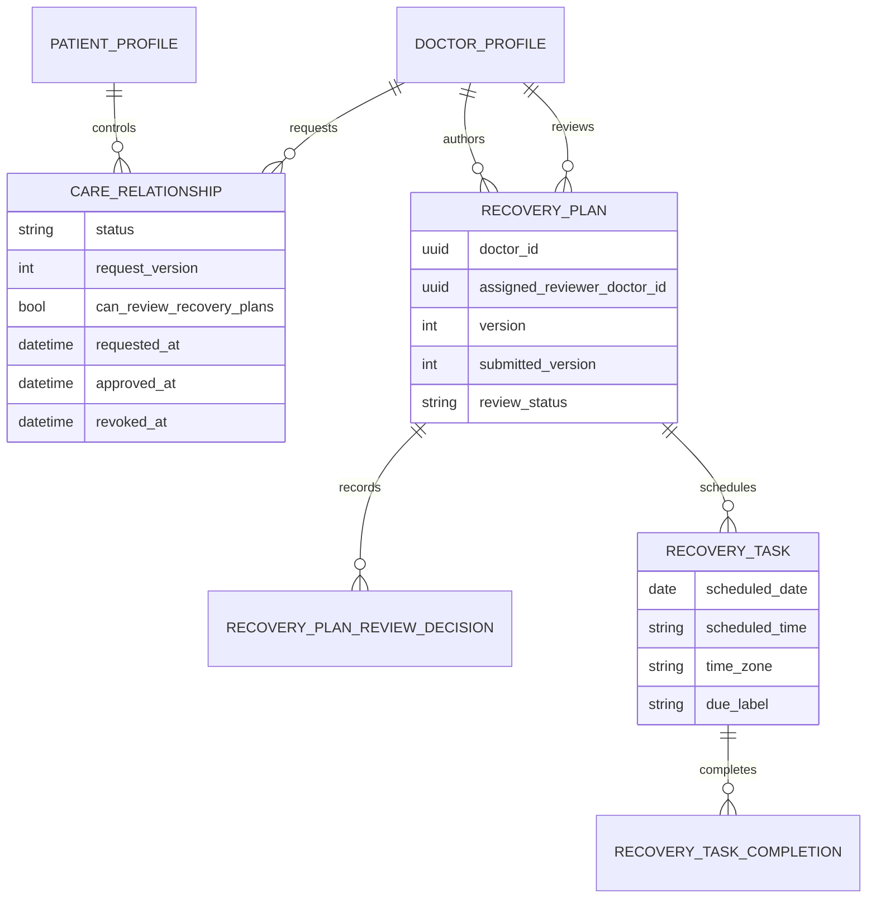

# Dr. AI v1.0 AI Platform Architecture

Status: approved implementation architecture

Owner: Harry Cao

Last updated: 2026-08-01

Applies to: patient, doctor, and authorized payer-reviewer AI workflows
Initial model provider: DeepSeek through a provider-neutral server adapter

## 1. Purpose

This document defines how AI may support the entire Dr. AI platform without
becoming the authority for clinical care, prices, coverage, reimbursement,
fraud, or punitive action. It consolidates the shared AI architecture while
preserving the stricter workflow-specific contracts for the patient chatbot
and governed medical knowledge.

The implemented, default-off AI capability is a **Clinical Event Intelligence
Engine**. For every
requested medication, imaging check, laboratory test, consultation, surgery,
or other billable item, it produces a versioned, location-aware analysis from
the exact Clinical Event snapshot. It proposes multiple plausible care
pathways, compares each requested item with those pathways, estimates quantity
and cost ranges, calculates transparent multidimensional support scores,
identifies missing information and alternatives, and presents role-appropriate
explanations to patients, doctors, and authorized payer reviewers.

DeepSeek is the current production inference provider for this advisory
purpose and a replaceable placeholder for a future purpose-built cost model.
It is not the authority for diagnosis, medical necessity, price truth, payer
approval, denial, or care restriction. A clinician may append an attributable
position or exception but cannot edit, reject, or hide the immutable AI
artifact. A payer resolution remains an attributable human action.

This file is an implementation source of truth alongside:

- `Dr_AI_Product_Requirements_Document_v1.0.md`
- `docs/Dr_AI_v1.0_Implementation_Plan.md`
- `docs/Dr_AI_v1.0_ERD.md`
- `docs/Dr_AI_v1.0_API_Contract.md`
- `docs/Dr_AI_v1.0_Product_Quality_Gate.md`
- `docs/periodic_dev_docs/Phase_3_Chatbot_Intended_Use_and_Safety_Boundary.md`
- `docs/periodic_dev_docs/Phase_3_Chatbot_RAG_Agentic_Architecture_and_Knowledge_Base.md`

The API contract must describe only implemented routes and fields. Planned
contracts in this document are conceptual until their persistence,
authorization, state, and migration boundaries are implemented.

## 2. Product Boundary

Dr. AI is an explainable care-and-cost transparency and utilization-review
platform with bounded AI assistance. The platform has three primary parties:

- patients, who need understandable education, care status, and cost context;
- doctors, who retain clinical judgment and review AI-assisted drafts; and
- authorized payer reviewers, who retain reimbursement and escalation
  decisions within organization- and case-scoped access.

AI may:

- retrieve and explain admitted medical education;
- identify missing structured information;
- draft questions or summaries for human review;
- draft a sourced expected-care candidate;
- explain deterministic cost or utilization comparisons from validated facts;
- produce role-specific language after field-level access filtering; and
- assist governed translation or corpus preparation outside the live
  inference path.

AI may not:

- diagnose or rule out a diagnosis;
- select, stop, delay, or restrict care;
- invent a service code, price, policy, source, or clinical fact;
- establish medical necessity;
- determine eligibility, coverage, reimbursement, denial, payment, or final
  patient responsibility;
- label fraud, abuse, waste, over-treatment, poor care, or clinician quality;
- rank clinicians or patients;
- execute payer, clinical, account, or financial actions; or
- bypass human review, deterministic validation, authorization, or release
  gates.

## 3. Current Verified State And Planned State

### 3.1 Implemented foundations

- The Clinical Event Intelligence Engine is implemented end to end through
  migration `20260801_0055`, purpose-isolated DeepSeek adapters, deterministic
  validation/reconciliation, role-authorized APIs, responsive bilingual
  Flutter surfaces, and a wholly synthetic evaluation package. Activation and
  real-world authorization remain separate gates.

- Provider-neutral, server-side DeepSeek adapters implement independently gated
  semantic routing, symptom differential planning, and final patient-chat
  generation.
- Authentication, authorization, privacy, prompt-injection, medication-change,
  and a small high-confidence deterministic emergency backstop run before model
  calls. Otherwise semantic routing may upgrade the request to the same
  server-owned emergency response after one call and before retrieval or final
  generation.
- Patient chat separates `approved_evidence`, `general_model_knowledge`, and
  `fixed_safety_response`.
- Governed knowledge has source rights, review, release, retrieval, citation,
  validation, and rollback concepts.
- Provider failure, malformed output, unsupported citations, and insufficient
  evidence fail into bounded server-controlled behavior.
- Patient, doctor, and payer roles, organization-scoped payer memberships,
  Clinical Events, Clinical Services, source-linked care-cost companions,
  immutable payer-request lines, and human payer-review outcomes exist.
- Money uses integer minor units and server-owned reconciliation.
- Clinical records may be saved with `pending_cost`; financial incompleteness
  must not block clinically necessary documentation.
- Slice B persists provider-neutral, versioned scenario definitions, care
  plans/items, pricing references, and utilization rules through a shared
  governed-release contract with provenance, source and payload checksums,
  effective intervals, freshness, rights, named review, append-only activation,
  supersession, and rollback evidence. Activated release content is protected
  from update/delete at the database boundary.
- Slice C provides a model-free deterministic engine for applicability,
  reference, code, unit, quantity, currency, facility, date, range, total,
  comparison, exception, missing-information, and suppression validation.
  Every persisted evaluation stores the exact structured input snapshot,
  release IDs/versions/checksums, result checksum, reason codes, and an optional
  predecessor without rewriting earlier results.

### 3.2 Implemented expected-care candidate purpose

Slice D now implements the internal expected-care candidate portion of this
workflow:

1. retrieve admitted clinical/utilization rules and pricing references;
2. ask DeepSeek for a schema-constrained candidate only when the required
   structured inputs and reference release are available;
3. deterministically validate the candidate;
4. preserve a content-free run record and immutable candidate version;
5. leave the workflow usable when the AI provider is unavailable.

The implementation is an internal service with no public HTTP route or UI. It
uses a separate purpose, contract, schema, prompt, configuration, provider
protocol, kill switch, idempotency boundary, and immutable request/attempt/result
records. The model receives no patient/event identifier, free-text Clinical
Event content, attachments, payer notes, unrelated history, or confidential
reference content. The first persisted test fixture is wholly synthetic
rehabilitation; an unrelated wholly synthetic laboratory scenario proves the
same contract is configuration-driven. All provider tests use deterministic
stubs.

Slice E now adds a distinct immutable published-baseline domain, append-only
clinician responses, authorized product routes, and role-filtered Flutter
presentation. It never changes or relabels the candidate, and no clinician can
control baseline publication or continued visibility. Explanation generation
and comparison against delivered/submitted facts remain later slices.

### 3.3 Implemented immutable baseline and role presentation

Migration `20260726_0042` introduced the append-only Slice E audit foundation.
Migration `20260726_0043` preserves those records as legacy history and permits
a separate system-published baseline whose exact items and totals copy the
validated candidate without modification. The append-only clinician-response
ledger records `acknowledge`, `concur`, `disagree`, or `exception`; a narrow
mutable response head exists only as the database-safe compare-and-swap guard.
Migration `20260726_0044` backfills that baseline for pre-existing validated
candidates only when their persisted item sums still reconcile exactly; read
routes do not create or mutate clinical artifacts.

Immediately before accepting a clinician response, the service re-authorizes
the exact doctor, patient, Clinical Event, and optional immutable payer request;
resolves the exact active releases; compares release IDs and checksums; re-runs
the model-free validator; and reconciles every item and total with integer
minor-unit arithmetic. Responses may reference admitted item keys and carry
attributable rationale, but they cannot submit replacement items, quantities,
codes, units, currency, reference selection, amounts, or totals.

Authenticated routes provide doctor baseline list/history and append-only
response submission, patient-safe baseline readback, and payer readback through
the exact organization-scoped payer request. The patient sees a safe baseline
even when no doctor response exists. The payer sees the same baseline,
clinician position, submitted facts, and payer state as separate evidence.
Reviewer-only notes, diagnostic codes, confidential rate identifiers, raw
provider content, and inappropriate controls remain excluded. No provider call
is made in Slice E.

### 3.4 Not yet implemented

- DeepSeek Vision / multimodal imaging observation drafts. As verified against
  the official DeepSeek documentation on 2026-07-27, DeepSeek V4 is text-only
  and the public API does not accept image inputs. A non-DeepSeek vision proxy
  would violate the v1 DeepSeek-only provider contract, so no Vision prompt,
  schema, validator, release, route, or draft persistence is enabled. This is an
  external provider-capability block, not a completed product purpose.
- production coverage enrollment and policy evaluation;
- reviewed and rights-cleared live China pricing-reference and
  utilization-rule release content;
- formal claim and immutable claim-line revisions;
- live hospital, payer, eligibility, claim, payment, denial, or appeal
  integration; and
- authorization for real-patient or real-claim use.

No UI, API, documentation, or showcase may present these as current
functionality before implementation and verification.

## 4. Shared AI Control Plane

Each AI purpose is a separate bounded workflow, not a single autonomous agent.
Every workflow must declare:

- `purpose_code`
- `contract_version`
- `prompt_version`
- `provider`
- `model`
- `model_configuration_version`
- allowed input fields and their provenance
- allowed retrieval release types
- output JSON Schema
- deterministic validators
- human-review requirement
- role visibility policy
- timeout, retry, and cost budget
- fallback behavior
- kill switch
- evaluation suite and release gate

The current DeepSeek integration may be reused at the transport and usage
accounting layers. Medical chat, cost-envelope generation, and explanation
generation must not share prompts, schemas, validators, telemetry semantics,
or activation controls merely because they use the same provider.

Flutter never calls DeepSeek, an embedding service, or a reranker directly.
FastAPI selects the purpose, fields, evidence, model contract, and fallback.
The model cannot choose tools, query arbitrary databases, browse the public
web, change workflow state, or perform product actions.

## 5. AI Workflow Portfolio

### 5.1 Patient educational chat

State: implemented foundation; production evidence gates remain open.

The existing Phase 3 intended-use, RAG, retrieval, evidence, privacy, citation,
and safety documents remain authoritative. Cost-envelope work must not weaken
those controls or turn patient chat into a diagnosis or coverage interface.

Generated answers are a separately governed
`patient_chat_generated_answer` purpose. DeepSeek is its only v1 provider.
Purpose enablement and a default-on kill switch are independent of the other AI
purposes. An exact checksum-compatible active release with all mandatory gates
must exist before generation can run. Immutable releases and transition events
retain provider/model, prompt/schema/contract/evaluation checksums and exact
predecessor lineage; only the advisory-locked active pointer is mutable.
Activation and rollback cannot affect emergency routing, fixed fallback, or
the availability of the rest of FastAPI.

### 5.2 Doctor evidence support

State: governed knowledge and doctor resources foundation implemented.

Future doctor-facing AI may summarize admitted sources or surface missing
questions, but every clinical statement must retain source lineage and visible
AI origin. A doctor-facing output does not become a clinical fact unless the
doctor records it through an authorized clinical workflow.

### 5.3 Expected-care and cost-envelope assistance

State: the narrower schema-constrained candidate, immutable baseline,
three-role presentation, and deterministic comparison are implemented with
synthetic verification. The broader Clinical Event Intelligence Engine defined
below is also implemented and locally verified with wholly synthetic data;
its three purpose releases remain default-off and unactivated.

DeepSeek may draft plausible categories and quantities. Any range presented as
reference-backed must come only from admitted, effective,
jurisdiction-compatible releases; a tier-5 model-only range follows the
separate exploratory contract in Section 6.5 and cannot cite those releases.
Deterministic validation is mandatory before baseline publication and
comparison. Clinician response is separate evidence: it is never a prerequisite
for baseline display or deterministic comparison, and it cannot edit, reject,
or hide either artifact.

### 5.4 Validated explanation generation

State: implemented as the independent `expected_care_role_explanation`
purpose for wholly synthetic development and controlled staging. Pending v3
remains kill-switched; future real-world gates remain separate.

An explanation call receives only a server-built, role-filtered fact object.
DeepSeek selects admitted fact IDs, controlled claim types, and allow-listed
connectives. It cannot independently narrate protected values.

Migrations `20260726_0045` through `0047` add immutable comparison
versions/items/events, role-specific explanation requests/attempts/artifacts,
monotonic governed explanation-release events, exact stage-status storage, and
database-level append-only care releases. The model-free comparison binds the exact patient,
Clinical Event, baseline, payer request when present, delivered Clinical
Services/CareCostItems, immutable submitted lines, reference-release
checksums, and integer-minor-unit totals. It appends a new version only when
the admitted snapshot changes and uses neutral range labels without converting
numeric variance into a clinical, misconduct, coverage, reimbursement,
payment, or liability conclusion.

Before DeepSeek, the server constructs a role allow-listed fact object with
opaque fact IDs. Patient facts omit service codes, reviewer notes, confidential
references, and authorization-only identifiers. Payer facts require the exact
immutable request and active organization membership. Output is a canonical
claim graph. The server interpolates currency, integer-minor-unit amounts,
quantities, units, dates, percentages, codes, comparison labels, names, and
identifiers into English and Simplified Chinese from the same claims. Exact
reconstruction validation rejects independent prose, protected-value mutation,
unsupported names, prohibited conclusions/identifiers, bilingual disagreement,
prompt injection, and role leakage.
Deterministic rejection always wins; invalid output becomes a fixed structured
fallback while the baseline and comparison remain visible.

### 5.5 Translation and knowledge preparation

State: implemented as a governed offline/research workflow.

DeepSeek-generated translations or summaries remain derived artifacts. They
require the configured rights, medical, native-language, readability,
jurisdiction, and product reviews before retrieval eligibility or activation.
The offline workflow must remain separate from live patient inference.

### 5.6 Research assessment and future multimodal models

State: simulated/research-only unless separately validated and approved.

Assessment results must retain model version, run status, limitations, and
review state. Research output does not automatically enter the commercial
care-and-cost workflow or serve as a diagnosis.

## 6. Expected-Care Envelope: Authoritative Inputs

AI cost assistance must not start from an unstructured question alone. The
server builds an exact Clinical Event-scoped, bounded, checksum-protected fact
snapshot from:

- patient and Clinical Event identifiers used only for authorization and exact
  database scope, never model narration;
- doctor-recorded symptoms and event context;
- relevant patient history, active allergies and chronic conditions, and
  current medications;
- event-linked records, imaging metadata, and immutable AI observation drafts
  when that separately governed purpose becomes available;
- doctor-confirmed findings and diagnoses;
- prescriptions, medications taken, recovery tasks and completion state;
- consultations, laboratory, imaging, treatment, and rehabilitation service
  records, quantities, dates, and financial companions;
- structured scenario family and encounter type;
- applicable population constraints required by the scenario definition;
- proposed care-plan or service categories;
- region and jurisdiction;
- hospital or clinic level where the admitted reference requires it;
- currency;
- reference effective date;
- admitted clinical/utilization-rule release ID;
- admitted pricing-reference release ID;
- allowed service code systems, codes, units, and quantities;
- known coverage context only when a production coverage contract exists;
- explicitly recorded missing information; and
- input checksum and schema version.

Each category is explicitly classified as used, not used, or missing with
server-owned provenance and selection reason. Only fields necessary for the
purpose may be transmitted. Direct identifiers, contact/account fields,
storage keys, attachments, provider names, doctor free-text notes,
reviewer-only content, unrelated medical history, and credentials are
excluded. Patient-wide records that cannot be bound to the exact Clinical Event
are shown as not used rather than silently transmitted. Synthetic data remains
mandatory until the real-data and live-use gates close.

### 6.1 Immutable Clinical Event intelligence snapshot

The server freezes one versioned input snapshot before retrieval or inference.
It contains, when relevant and authorized:

- symptoms, duration, severity, and recorded progression;
- the doctor's diagnosis, differential, rationale, and confirmed findings;
- relevant medical history, allergies, contraindications, chronic conditions,
  current prescriptions, medicines taken, and adherence facts;
- laboratory and imaging reports, while raw-image recognition remains a
  separately governed later capability;
- planned, ordered, administered, delivered, and billed treatments as distinct
  states;
- every requested payer item with item type, code, label, quantity, unit,
  requested amount, and currency;
- hospital, department, facility level, city, province, jurisdiction, encounter
  date, and service date; and
- missing, conflicting, stale, or unverified facts.

Location is resolved deterministically from the Clinical Event, provider
organization, and facility records. DeepSeek must never infer the patient's or
hospital's location from IP data or free text. The frozen snapshot, selection
reasons, schema version, and checksum remain attached to every resulting
artifact.

### 6.2 Server-directed retrieval

Before the model call, the server retrieves only applicable, admitted material:

- facility or payer prices where the product is authorized to use them;
- official regional fee schedules and service-code catalogs;
- clinical guidelines and reasonable care pathways;
- payer policy when a future production coverage contract permits it; and
- comparable reviewed or synthetic cases, clearly distinguished from
  authoritative references.

Retrieval remains server-directed and authorization-scoped. DeepSeek may flag
an unresolved question, but it cannot browse freely, choose arbitrary patient
records, expand the case scope, or decide which confidential source becomes
admitted evidence.

### 6.3 Multiple pathways and requested-item comparison

The engine must not imply that one treatment sequence is the uniquely correct
answer. It generates, when supported by the facts, at least:

- a typical or first-line pathway;
- a reasonable alternative pathway; and
- an escalated pathway for documented severity, failed first-line care, or
  another explicit trigger.

Predicted pathway items remain separate from doctor-requested items. Each
requested item is mapped to zero, one, or multiple plausible pathways, with
unmatched items retained for explanation rather than silently removed.

### 6.4 Multidimensional item assessment

Every requested item receives a non-empty assessment. The item profile contains
independent 0-100 dimensions for:

- `clinical_fit`: consistency with the event facts and plausible pathways;
- `evidence_support`: strength and applicability of admitted evidence;
- `timing_sequence`: appropriateness of timing and sequence;
- `quantity_intensity`: support for quantity, frequency, duration, or
  intensity;
- `documentation_completeness`: whether the current record supports review;
  and
- `cost_alignment`: relationship to the best available location- and
  facility-aware cost range.

The system may also calculate a clearly explained aggregate **AI support
score**, never an approval score or medical-necessity score. Default display
bands are:

- 80-100: strongly supported by the current information;
- 60-79: plausible;
- 40-59: materially uncertain or clarification recommended; and
- 0-39: weakly supported by the current information and requires human review.

No band automatically approves, denies, reduces, delays, or removes an item.
Documentation completeness remains a separate dimension so missing records do
not masquerade as evidence that the requested care is clinically inappropriate.

### 6.5 Cost provenance and universal coverage

Every billable requested item receives an estimated quantity range and cost
range. The result records one visible provenance tier:

1. authoritative facility or payer price;
2. official regional reference;
3. comparable regional or hospital reference;
4. analogous item or pathway estimate; or
5. DeepSeek-only exploratory estimate.

Tier 5 exists so every case receives useful output even when governed price
data is incomplete. It must use a visibly wide uncertainty range, state that it
is based on general model knowledge rather than an admitted price source, and
carry materially less or zero weight in `cost_alignment`. It never becomes an
official price, negotiated rate, deterministic reference, reimbursement amount,
or training label merely because it was displayed.

### 6.6 Shared artifact and role-filtered views

All three parties see the same artifact identity, snapshot version, requested
item set, score dimensions, aggregate support score, estimated quantity and
cost ranges, provenance tiers, uncertainty, and lifecycle state. Field-level
authorization then produces different explanations:

- patients see plain-language purpose, usefulness, ranges, uncertainty,
  missing information, and human review status;
- doctors see full pathway mappings, supporting and contradicting facts,
  alternatives, missing documentation, provenance, and attributable
  agree/disagree/exception actions; and
- authorized payer reviewers see the itemized requested-versus-estimated
  comparison, quantity and cost flags, provenance, clarification needs, and
  separate human-resolution controls.

Reviewer-private notes, confidential rates, unrelated history, hidden prompts,
and raw reasoning are never promoted into the shared artifact.

### 6.7 Item artifact

Each requested-item assessment preserves:

- requested label/code, quantity, amount, currency, and intended purpose;
- mapped pathway IDs and the item's expected usefulness in each pathway;
- all score dimensions, aggregate support score, score version, and concise
  factor explanations;
- estimated quantity and cost ranges, provenance tier, source IDs when
  available, reference date, geography, facility level, and confidence;
- supporting facts, contradicting facts, missing information, assumptions,
  and reasonable alternatives;
- deterministic validation results and model-disagreement state; and
- patient, doctor, and payer explanation artifacts generated only from the
  frozen shared facts.

## 7. Reference And Scenario Foundation

The AI envelope cannot be trustworthy without an authoritative reference
layer. Before live DeepSeek cost generation, implement:

- versioned `care_scenario_definitions`;
- scenario applicability and coverage-matrix releases;
- structured `care_encounters` and `care_plan_items`;
- immutable `pricing_reference_sets` and items;
- immutable `utilization_rule_sets` and rules;
- jurisdiction, region, facility level, currency, effective dates, review
  state, activation state, provenance, rights, and rollback;
- code-system, service-code, quantity, and unit validation;
- stale, unavailable, conflicting, and superseded reference states; and
- a frozen representative synthetic/de-identified scenario suite.

The first China-first scenario is a complete vertical implementation slice,
not a condition-specific application-code fork or the product boundary. Select
it based on the availability of sufficiently trustworthy and usable clinical,
utilization, and price references. An outpatient or imaging-centered episode
is a practical candidate because the current product already persists
consultations, medications, imaging services, costs, and payer requests.

## 8. Expected-Care Candidate Contract

The exact persisted/API schemas are fixed during implementation, but the
provider-neutral candidate must conceptually contain:

- scenario definition and reference-release identifiers;
- jurisdiction, region, facility-level applicability, currency, and effective
  date;
- candidate-level assumptions;
- candidate-level missing information;
- bounded confidence category with an explicit definition;
- one or more reasonable pathway alternatives when the admitted rules support
  materially different care pathways;
- envelope items containing admitted category and service-code references;
- expected quantity or low/high quantity;
- estimated low/high amount in integer minor units;
- the exact pricing-reference and utilization-rule IDs supporting each item;
- limitations and unresolved conflicts; and
- no final coverage, allowed, paid, or patient-responsibility decision.

The model may not omit a requested item. When authoritative references are
insufficient, it must still return an assessment, explicit missing information,
and a tier-5 exploratory cost range. General model knowledge is never presented
as an admitted reference and cannot satisfy deterministic reference validation.

## 9. Deterministic Authority And Validation

Before any model candidate can be stored as displayable AI output, the server
must verify:

- the response matches the purpose-specific JSON Schema;
- all identifiers exist in the selected active releases;
- every code is allowed for the scenario and jurisdiction;
- every cited source/rule is effective on the reference date;
- every amount is supported or derivable under the referenced price rule;
- currency and amount types are consistent;
- integer-minor-unit arithmetic is exact;
- low values do not exceed high values;
- quantities and units are compatible;
- patient, event, service, organization, and review scopes are authorized;
- no confidential or role-prohibited field appears;
- missing information and conflicts are not silently erased;
- the input checksum and release versions are retained; and
- retries cannot overwrite an earlier immutable candidate or human decision.

The server additionally validates score bounds, required factor explanations,
coverage of every requested item, pathway/request separation, cost-provenance
tier, and consistency between the aggregate support score and its versioned
deterministic aggregation rule. DeepSeek may propose dimension scores and
evidence mappings; the server owns normalization, aggregation, bands, arithmetic,
and lifecycle state.

The deterministic engine, not DeepSeek, calculates totals and comparisons. It
owns duplicate, unusual quantity/duration, price-range, service-mix, missing
documentation, stale-reference, and reconciliation checks.

Validation failure yields a fixed structured fallback. The product must not
relax a validator merely to increase the percentage of AI answers displayed.

## 10. Human Review And State Model

The UI and stored records must distinguish at least:

- `not_evaluated`
- `ai_candidate_generated`
- `ai_candidate_validation_failed`
- `generated_pending_validation`
- `validated_baseline_published`
- `system_suppressed_invalid`
- `doctor_acknowledged`
- `doctor_concurred`
- `doctor_disagreed`
- `doctor_exception_recorded`
- `superseded_by_new_baseline`
- `delivered`
- `submitted`
- `human_payer_reviewed`

Names may be refined when the database and API contract are implemented, but
the semantic separation must remain.

Deterministic validation, not a clinician, controls whether a candidate becomes
a presentable immutable baseline. Only system-controlled invalidity, staleness,
privacy, authorization, or compatibility rules may suppress presentation, and
the suppression remains auditable. An authorized doctor may acknowledge,
concur, disagree, or record a justified clinical exception. Every response is
attributable and append-only; it never changes the baseline or its visibility.

Clinician concurrence does not make the baseline clinically correct or a
coverage decision. Payer reviewers retain separate reimbursement actions and
cannot edit the clinical baseline or treat a variance as proof of misconduct.

## 11. Role-Specific Presentation

### Patient

Show:

- a plain-language immutable baseline range;
- currency, amount type, source/effective date, and major assumptions;
- what is planned, delivered, submitted, and currently unresolved;
- professional uncertainty and missing-information copy; and
- the responsible human next action.

Do not show:

- reviewer-only notes;
- confidential negotiated rates without permission;
- suspicion, fraud, clinician-ranking, or hidden risk labels; or
- an AI range as the amount the patient will owe.

### Doctor

Show:

- the AI candidate and exact references;
- item-level low/high ranges and assumptions;
- missing/conflicting information;
- validation outcomes;
- acknowledge/concur/disagree/exception-rationale actions with no baseline
  edit or rejection control; and
- immutable candidate, baseline, and clinician-response history.

### Payer reviewer

Show:

- only organization- and case-authorized submitted records;
- the immutable system baseline, deterministic comparisons, exact releases,
  reason codes, and separate clinician rationale;
- clear separation between AI, deterministic, clinician, and payer states; and
- only human resolution actions.

## 12. DeepSeek Call Policy

### 12.1 Expected-care candidate call

Use DeepSeek's higher-capability configured model for pathway generation and
item assessment after deterministic snapshot construction and retrieval. The
request contains only allowed structured inputs and admitted reference facts,
with a separate explicitly labeled general-knowledge boundary for tier-5
exploratory estimates. Apply explicit timeout, token, retry, and monetary
budgets.

A retry is allowed only for transport failure or narrowly defined malformed
structured output. A retry does not broaden evidence, change purpose, or
create an unbounded repair loop.

### 12.2 Bounded critic and reconciliation

After schema validation, one independent critic call may inspect the frozen
snapshot and proposed structured artifact for omitted requested items,
contradictions, unsupported claims, implausible quantity/cost ranges, and score
inconsistency. The server deterministically reconciles the primary and critic
outputs and stores a visible agreement, partial-disagreement, or
material-disagreement indicator. The critic cannot approve its own output,
change source admission, or trigger an open-ended debate loop.

### 12.3 Explanation call

An optional later call may generate role-specific language only after the
candidate, arithmetic, comparison, and access-filtered fact object pass
validation. It is a different purpose, schema, prompt, and kill switch.

Role explanations use a lower-latency configured DeepSeek model and receive
only the frozen, validated, role-filtered facts. They cannot recalculate scores,
costs, quantities, or pathway membership.

### 12.4 Calls that are prohibited

- unconditional or unbounded multiple-model loops beyond the single governed
  critic pass;
- asking the same model to declare its unsupported output correct;
- arbitrary tool use or public-web browsing;
- model-selected patient-record retrieval;
- transmission of entire records “just in case”;
- model-owned arithmetic or financial state transitions; and
- silent provider/model changes without versioned evaluation and deployment.

## 13. Failure And Offline Behavior

The platform must remain clinically and financially usable when AI is
unavailable.

Required outcomes include:

- missing admitted price references: return a visibly labeled tier-5
  exploratory range with wide uncertainty, identify the missing reference
  boundary, and preserve ordinary clinical documentation;
- insufficient structured input: assess every requested item from what is
  known, explicitly list the missing fields, lower the relevant confidence or
  documentation dimension, and request clarification without inventing facts;
- provider timeout/quota/outage: preserve `pending_cost`, manual entry, and
  human workflows;
- malformed or unsupported model output: reject it and show fixed status copy;
- conflicting references: present the conflict for human resolution without
  selecting a convenient value;
- stale release: refuse a current estimate and identify the stale effective
  date;
- explanation failure: show the validated structured facts without generated
  prose; and
- deterministic/model disagreement: deterministic validation wins and the
  disagreement is recorded using content-free diagnostics.

No provider failure may block patient care, clinical record saving, payer
clarification, or a permitted human decision.

## 14. Privacy, Security, And Authorization

- Apply least-privilege, purpose-specific field selection before provider
  transmission.
- Keep provider keys server-side and out of Flutter, logs, telemetry, and
  persisted run payloads.
- Do not store raw prompts or raw model output in ordinary operational logs.
- Persist only the governed candidate artifact required for the product
  workflow, with source lineage and access control.
- Use content-free diagnostic and usage telemetry.
- Preserve patient, doctor, organization, membership, case, field, and
  reviewer-note isolation.
- Record model purpose, versions, release IDs, validation result, latency,
  provider-reported token usage, configured-price cost, fallback, and review
  transition.
- Complete provider-region, data-residency, retention, no-training, security,
  privacy, legal, and regulatory review before real-data transmission.

## 15. Evaluation And Release Gates

Each AI purpose has an independent frozen suite and release decision.
Chatbot success does not activate cost AI, and cost-envelope success does not
validate chatbot answers or clinical models.

The expected-care suite must include:

- materially different scenario families;
- multiple regions/facility levels where supported;
- alternative clinically reasonable pathways;
- justified exceptions;
- missing and conflicting information;
- stale and unavailable references;
- unsupported code and amount attempts;
- mixed currency and arithmetic failures;
- provider timeout, quota, and malformed output;
- cross-patient and cross-payer access attempts;
- patient/doctor/payer field-visibility checks; and
- adversarial prompts embedded in free text or reference content.

Measure at least:

- schema-valid candidate rate;
- exact source/rule citation validity;
- unsupported-code and unsupported-amount rejection;
- deterministic arithmetic reconciliation;
- reference/jurisdiction/effective-date correctness;
- clinician acknowledgement, concurrence, disagreement, and exception rates;
- per-scenario alert precision, recall, and false-positive rate;
- explanation factual consistency and forbidden-field leakage;
- p50/p95 latency, provider failures, provider-reported tokens, and cost;
- fallback success and ordinary workflow availability during outage; and
- no automated clinical, coverage, payment, fraud, or punitive action.

Machine gates do not replace named clinical, native Simplified Chinese,
pricing/reference, product, privacy, security, legal, payer-workflow, and
stakeholder review. Synthetic results must not be reported as real-world
savings, fraud reduction, clinical benefit, or reimbursement accuracy.

## 16. Implementation Sequence

### Slice A: freeze the first scenario and reference boundary

- select one China-first vertical scenario based on usable evidence;
- define its scenario applicability and known reasonable alternatives;
- define code systems, region, facility level, currency, and effective dates;
- identify rights-cleared clinical/utilization and pricing sources;
- obtain named domain review; and
- freeze synthetic/de-identified fixtures and expected labels.

Slice A's 2026-07-25 audit and frozen boundary are recorded in
`Dr_AI_v1.0_First_Scenario_Reference_Boundary.md`. The strongest candidate is a
Shanghai-public-institution adult outpatient single-region CT plain-scan
service episode, but its release is explicitly blocked: source reuse rights,
named clinical/pricing/legal review, and an actual-price or defensible-range
source remain unresolved. No reference data is admitted to runtime.

### Slice B: implement the authoritative data foundation

State: implemented locally and verified on 2026-07-25; exact database-backed
active-bundle resolution, supersession, and rollback are covered. Only a
wholly synthetic local bundle was activated; no live release content was
admitted or activated.

- add versioned scenario, care-plan, pricing-reference, and utilization-rule
  persistence;
- add review, activation, rollback, provenance, and checksum controls;
- preserve existing Clinical Event, Clinical Service, CareCostItem,
  payer-request, and immutable snapshot semantics; and
- reconcile PRD, ERD, migrations, API contract, seed fixtures, and audit tests.

### Slice C: implement the deterministic engine

State: implemented locally and verified on 2026-07-25 without a model call.
The internal orchestration authorizes the doctor, patient, Clinical Event, and
optional immutable payer request before resolving exact active releases,
running the engine, and appending the evaluation plus content-free audit
metadata. The engine remains an internal service boundary; no public HTTP
route or UI was added in this slice.

- validate codes, units, currencies, dates, and reference applicability;
- calculate line and total ranges with integer minor units;
- implement transparent comparison reason codes;
- support missing information, justified exceptions, suppression reasons, and
  immutable re-evaluation; and
- verify behavior without any model call.

### Slice D: add DeepSeek expected-care candidates

State: implemented locally and verified on 2026-07-25 with deterministic
provider stubs only. Migration `20260725_0041` persists append-only candidate
requests, attempts, and results with exact purpose/configuration and release
lineage. The feature defaults off, is limited to local/test synthetic use, and
has no public route or UI. No live or paid provider call was made.

- define the purpose-specific structured contract;
- reuse the provider transport but add separate prompt/schema/configuration;
- implement minimum-necessary input selection;
- validate and persist immutable AI candidates;
- add timeout, retry, budget, telemetry, kill switch, and fixed fallbacks; and
- keep the feature disabled outside approved local/synthetic environments.

### Slice E: add immutable baseline and three-party presentation

State: revised locally on 2026-07-26. Migrations `20260726_0043` and
`20260726_0044` build on the append-only `0042` foundation, preserve prior
doctor-controlled artifacts as legacy history, publish an exact immutable
baseline immediately after successful deterministic validation, and safely
backfill qualifying pre-existing validated candidates. Authenticated doctor,
patient, and payer routes and responsive bilingual Flutter surfaces are
present. The idempotent local/test-only bootstrap provides one payer-linked
baseline with clinician concurrence and one baseline without a clinician
response. Verification uses only an in-process deterministic fixture; Slice E
makes no external/provider call.

- publish the validated baseline independently of clinician response;
- implement acknowledge/concur/disagree/exception history without edit,
  rejection, or concealment authority;
- add visible AI/baseline/clinician/delivered/submitted/payer states;
- add patient-safe and payer-authorized views;
- inspect Simplified Chinese and English desktop/mobile rendering; and
- preserve manual and `pending_cost` workflows.

### Slice F: deterministic comparison and validated explanations

State: implemented and locally verified.

- persisted immutable server-calculated delivered/submitted comparisons;
- exact patient, event, baseline, payer scope, record snapshot, release, and
  checksum binding with append-only predecessor differences;
- server-owned doctor/patient/payer fact objects;
- independent DeepSeek explanation contract, schema, prompt, model
  configuration, timeout/retry, idempotency, telemetry, and kill switch;
- deterministic bilingual validation and structured fallback; and
- separate responsive role presentation for baseline, comparison, clinician
  response, AI explanation, submitted facts, and human payer state.

### Slice G: evaluate, release, and govern

State: complete for wholly synthetic development and controlled staging;
pending releases remain kill-switched.

- every machine metric is calculated from executable mutation, failure,
  authorization, visibility, fallback, arithmetic, and concurrency cases;
- failed and deterministic runs are retained; corrected paid Slice F and
  separate Slice D runs passed their independent mandatory gates;
- v2 remains immutable and is marked unsuitable by append-only evidence;
  predecessor-linked pending v3 and a separate pending Slice D release are
  registered;
- current-stage requirements are truthfully recorded as product-owner waivers,
  never as external approvals, while future real-world gates remain separate;
- runtime activation fails closed and the purpose kill switch remains on;
- content-free health/telemetry and fixed provider fallback are implemented;
- operational transitions use advisory locks, exact expected versions,
  content-bound idempotency, checksums, mandatory gates, and explicit rollback;
  and
- the controlled-staging package remains synthetic-only and default-off.

### Future specialized cost model transition

The persisted artifact and three-role API remain provider-neutral. DeepSeek is
the current inference provider, not the domain contract. The platform captures
the frozen snapshot, requested items, immutable AI artifact, clinician
response, human payer action, and permitted later outcomes as separately
provenanced evaluation assets. DeepSeek output is never treated as ground truth
without independent human or outcome review.

A purpose-built cost model must first run in shadow mode against frozen cases,
produce the same structured contract, pass deterministic validators and
purpose-specific release gates, and demonstrate acceptable subgroup,
jurisdiction, calibration, stability, cost, and latency performance. Promotion,
rollback, and kill-switch state are independent of DeepSeek. Replacing the
model must not rewrite historical artifacts, score definitions, authorization,
or the patient/doctor/payer presentation contract.

## 17. Definition Of Done

The platform-wide AI foundation is ready for controlled synthetic stakeholder
use only when:

- each AI purpose has its own contract, model configuration, validation,
  telemetry, kill switch, evaluation, and fallback;
- the patient chatbot retains its independent safety and retrieval gates;
- an expected-care candidate cites only admitted effective references, while
  any uncited tier-5 model-only range is visibly separated as exploratory;
- deterministic validation rejects every unsupported code and amount;
- all money reconciles using integer minor units;
- baseline display and deterministic comparison do not require clinician
  concurrence; any clinician response remains separate evidence;
- all three roles see only authorized facts and clearly separated states;
- provider outage leaves clinical and human-review workflows usable;
- the frozen multi-scenario suite passes without condition-specific code forks;
- rendered bilingual UX passes human inspection;
- immutable release, audit, rollback, backup, and operational evidence exist;
  and
- documentation distinguishes engineering readiness, controlled synthetic use,
  and externally gated real-world authorization.

## 18. Explicit Non-Goals

This architecture does not authorize:

- an autonomous medical or payer agent;
- AI diagnosis or treatment selection;
- a single “correct” cost;
- live eligibility or claim submission;
- automatic approval, denial, payment, or patient-obligation calculation;
- fraud or abuse determination;
- clinician ranking;
- hidden scoring;
- unrestricted web retrieval;
- real-patient or real-claim provider transmission; or
- public production activation.

## 19. Phase 6 notification authority boundary

Notification scheduling, missing-field checks, cost variance warnings,
allocation checks, payer transitions, recipient authorization, deep-link
resolution, suppression, and retry are deterministic application functions.
DeepSeek is not invoked to decide whether a notification exists, who receives
it, how severe it is, whether a payer action is valid, or whether care should
change.

An AI-derived artifact may become a source fact only after its purpose-specific
schema, validator, release, and human-review gates have already produced an
authorized persisted record. The notification then references a generic
allow-listed event template and rechecks the authoritative record. Provider
payloads, analytics, logs, and deduplication keys never receive prompt text,
generated prose, medical content, identity, or confidential payer material.

## 20. Phase 7 controlled-staging release result

Slice D, Slice F, chatbot generation, and imaging remain four independent
purposes. Phase 7 proved governed activation, product-path use, kill-switch
disablement, and exact-predecessor recovery for Slice D and Slice F; chatbot v1
was activated through its own release and then killed with its active pointer
cleared. No purpose borrowed another purpose's checksums, evaluation, active
pointer, fallback, or evidence.

The selected DeepSeek V4 endpoint is text-only according to current primary
documentation and rejected a bounded genuine synthetic image-input probe.
Imaging release registration therefore remains fail-closed. This is a provider
capability result, not permission to label a text request as multimodal or to
substitute a different provider.

Final controlled-staging readiness has every generative purpose disabled.
Health exposes only content-free environment, schema, deployment identity,
purpose readiness/release version, imaging capability category, worker state,
and channel readiness. Provider prompts/responses, clinical content, imaging
content, identities, message bodies, device endpoints, receipts, credentials,
and tokens are excluded.

## 21. Clinical Event Intelligence local-synthetic activation

On 2026-08-02 the three independent Clinical Event Intelligence purposes were
activated for `controlled_synthetic_staging` through immutable, checksum-bound
v5 releases. Primary and critic use `deepseek-v4-pro`; role explanation uses
`deepseek-v4-flash`. Runtime access still requires the purpose enable flag, a
clear kill switch, an exact active release pointer, matching source/evaluation
checksums, transmission eligibility, and an effective synthetic-only scope.
The verified v5-to-v4 rollback and v5 restoration are append-only events; no
release was edited in place. Exact identities and evidence are recorded in the
dated CEI implementation record and activation result JSON.

This activation authorizes only wholly synthetic local development. It does not
authorize real-patient transmission, live payer use, clinical reliance, public
production, or any legal, privacy, security, regulatory, or commercial claim.

## 22. Clinical workflow integrity boundary (2026-08-02)

`clinical_services` and `consultation_requests` hold clinical truth. A unique
`care_cost_items` companion holds financial truth for each billable source;
appointments, notes, messages, uploads, reports, diagnoses, and recovery text
are never priced. Imaging uploads reference an imaging service as evidence.
Payer request lines copy an immutable submission snapshot and do not dereference
mutable source values for historical readback.

Prescription and recovery-plan aggregates use database-backed actor-scoped
idempotency keys and version/supersession lineage. Finalized prescriptions and
published recovery plans reject mutation. Recovery task completions are
separate append-oriented patient progress records. The Flutter client stages
draft medication lines and calendar phases locally, but only FastAPI performs
authorization, validation, atomic persistence, pricing synchronization, audit,
and provider calls.

The client exposes two consultation contexts. The Consultation section remains
an asynchronous specialist-referral request surface. Ordinary treating-doctor
consultations, encounter updates, and diagnoses are appended and read back
under the selected Clinical Event. Only the ordinary consultation may resolve a
billable consultation service/cost companion; updates and diagnoses remain
unpriced clinical content.

Patient chat routing is: deterministic safety and authorization, approved
retrieval, independently governed patient-chat release, then structured fixed
fallback on provider/release failure. `general_model_knowledge` is visibly
distinct from retrieved evidence and cannot claim record access or citations.

## 23. Consent, independent review, and scheduled-task integrity (2026-08-16)

`care_relationships` is patient controlled: pending approval, active, rejected,
or revoked. Code entry owns no clinical authorization. Existing active rows
backfill to active with review authority; inactive rows backfill to revoked.
Audits and privacy-safe notifications contain no record text, codes, or secrets.

`recovery_plans.doctor_id` is the author. A second, independently authorized
doctor is the assigned reviewer. The submitted version is frozen, decisions
are append-only, and activation rechecks approval and live reviewer authority.

Recovery task display labels remain separate from structured schedule date,
time, and IANA zone. Today computes local-date categories across all active
plans, while one persisted completion record feeds every recovery read model.

