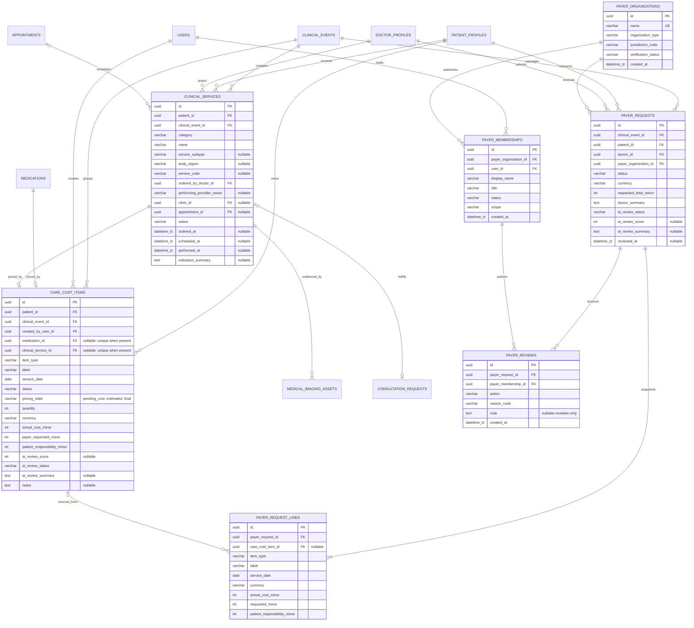
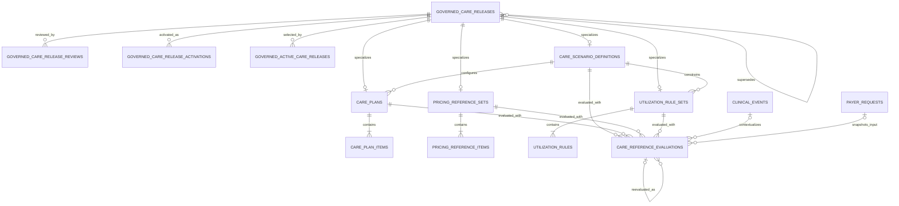
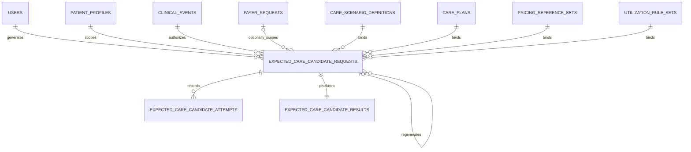

# Dr. AI v1.0 Database ERD

Status: implemented-schema map through Phase 6 plus planned production-ready care-and-cost target
Last updated: 2026-07-30
Implemented source: `services/api/app/models.py` and current Alembic migrations
Planned source: `Dr_AI_Product_Requirements_Document_v1.0.md` and
`docs/Dr_AI_v1.0_Implementation_Plan.md`
AI architecture source: `docs/Dr_AI_v1.0_AI_Platform_Architecture.md`

This file has three deliberately separate layers:

1. **Implemented foundation:** the existing patient/doctor, clinical,
   messaging, knowledge, billing-foundation, and administration tables. The
   full field-level diagram below must not be read as proof that every table has
   a finished product surface.
2. **Implemented care-and-cost and reference foundation:** payer organizations and
   memberships; Clinical Event-linked Clinical Services; source-linked
   financial companions for supported medications, consultations, and imaging
   procedures; submitted immutable request snapshots; and
   membership-attributed human reviews added through migration
   `20260724_0038`. Migration `20260725_0040` adds governed release metadata,
   scenario definitions, care plans/items, pricing-reference sets/items,
   utilization-rule sets/rules, review/activation/rollback history, active
   pointers, and append-only deterministic evaluations. Migration
   `20260725_0041` adds immutable expected-care candidate requests,
   content-free provider attempts, and candidate results. Migration
   `20260726_0042` adds the doctor-review transition guard, immutable doctor
   clinician responses, immutable baselines/items, clinical rationales, and lifecycle
   events. Coverage, claims, reviewed-envelope comparison, and generated
   explanations remain planned.
3. **Planned production-ready v1.0 target:** the additive, multi-scenario payer,
   encounter, claim, expected-care-envelope, variance-review,
   clinician-rationale, and human-review domain specified later in this
   document. These planned entities do not exist until a migration and
   implementation evidence say they do.

This separation preserves the real schema while making the new three-party
product direction implementable without pretending that planned payer features
are already available.

## Legend

- `PK`: primary key.
- `FK`: foreign key.
- `UK`: unique key or unique column.
- `IDX`: indexed column.
- `nullable`: optional column.
- `jsonb`: PostgreSQL `JSONB`.
- `datetime_tz`: timezone-aware SQLAlchemy `DateTime`.
- `uuid`: PostgreSQL UUID.
- `varchar_N`: string column with length `N`.

## Full Field-Level ERD

```mermaid
erDiagram
  HOSPITALS {
    uuid id PK
    varchar_160 name
    varchar_240 legal_name "nullable"
    varchar_40 status
    jsonb metadata_json
    datetime_tz created_at
    datetime_tz updated_at
  }

  USERS {
    uuid id PK
    varchar_320 email UK "IDX nullable"
    varchar_40 phone_number UK "IDX nullable"
    varchar_255 password_hash
    enum_user_role role
    boolean is_active
    datetime_tz last_active_at "nullable"
    datetime_tz created_at
    datetime_tz updated_at
  }

  CHAT_RATE_LIMITS {
    uuid user_id PK,FK
    datetime_tz window_start
    integer message_count
    datetime_tz updated_at
  }

  CLINICS {
    uuid id PK
    uuid hospital_id FK
    varchar_160 name
    varchar_80 timezone
    varchar_40 status
    jsonb metadata_json
    datetime_tz created_at
    datetime_tz updated_at
  }

  DASHBOARD_SNAPSHOTS {
    uuid id PK
    uuid user_id FK,UK
    jsonb payload
    datetime_tz updated_at
  }

  DOCTOR_PROFILES {
    uuid id PK
    uuid user_id FK,UK
    varchar_120 display_name
    varchar_160 title
    varchar_160 hospital_name
    date birth_date "nullable"
    varchar_40 gender "nullable"
    varchar_40 contact_phone "nullable"
    text avatar_url "nullable"
    varchar_80 country "nullable"
    varchar_80 province "nullable"
    varchar_80 city "nullable"
    varchar_120 specialty "nullable"
    varchar_120 department "nullable"
    varchar_80 preferred_language "nullable"
  }

  PATIENT_PROFILES {
    uuid id PK
    uuid user_id FK,UK
    varchar_120 display_name
    varchar_80 synthetic_identifier UK "IDX"
    date birth_date "nullable"
    integer birth_year "nullable"
    varchar_40 sex "nullable"
    varchar_40 gender "nullable"
    varchar_40 contact_phone "nullable"
    varchar_120 emergency_contact_name "nullable"
    varchar_40 emergency_contact_phone "nullable"
    varchar_80 preferred_language "nullable"
    varchar_80 contact_preference "nullable"
    text avatar_url "nullable"
    varchar_80 country "nullable"
    varchar_80 province "nullable"
    varchar_80 city "nullable"
    varchar_240 home_address "nullable"
    float height_cm "nullable"
    float weight_kg "nullable"
    varchar blood_type "nullable; Unknown/A+/A-/B+/B-/AB+/AB-/O+/O-"
    int systolic_blood_pressure "nullable"
    int diastolic_blood_pressure "nullable"
    varchar smoking_status "nullable"
    varchar alcohol_consumption "nullable"
    text heart_history "nullable"
    text endocrine_history "nullable"
    text neuro_history "nullable"
    text digestive_history "nullable"
    text respiratory_history "nullable"
    text kidney_history "nullable"
    text cancer_history "nullable"
    text patient_reported_medications "nullable"
    text surgery_history "nullable"
    text family_history "nullable"
    text lifestyle_notes "nullable"
    varchar pregnancy_status "nullable"
    boolean medical_history_setup_completed
  }

  REFRESH_SESSIONS {
    uuid id PK
    uuid family_id
    uuid user_id FK "nullable before registration"
    varchar_64 token_hash UK "IDX"
    datetime_tz expires_at
    datetime_tz created_at
    datetime_tz used_at "nullable"
    datetime_tz revoked_at "nullable"
    uuid replaced_by_id FK "nullable"
  }

  PHONE_VERIFICATION_CHALLENGES {
    uuid id PK
    uuid user_id FK
    varchar_40 phone_number "IDX"
    varchar_40 purpose "IDX"
    varchar_64 code_hash
    integer attempts
    datetime_tz expires_at
    datetime_tz consumed_at "nullable"
    datetime_tz created_at "IDX"
  }

  CARE_RELATIONSHIPS {
    uuid id PK
    uuid doctor_id FK
    uuid patient_id FK
    boolean is_active
    datetime_tz created_at
    datetime_tz revoked_at "nullable"
  }

  CLINICAL_EVENTS {
    uuid id PK
    uuid patient_id FK
    uuid doctor_id FK "nullable"
    varchar_160 title
    varchar_240 chief_complaint
    text symptom_summary "nullable"
    text diagnosis_summary "nullable"
    date onset_date "nullable"
    varchar_40 status
    jsonb metadata_json
    datetime_tz created_at
    datetime_tz updated_at
  }

  CLINICAL_EVENT_UPDATES {
    uuid id PK
    uuid patient_id FK
    uuid clinical_event_id FK
    uuid submitted_by_user_id FK
    varchar_60 update_type
    text summary
    datetime_tz occurred_at
    datetime_tz created_at
  }

  MEDICAL_RECORDS {
    uuid id PK
    uuid patient_id FK
    varchar_160 title
    varchar_80 category
    text summary
    datetime_tz recorded_at
    datetime_tz created_at
  }

  MEDICAL_HISTORY_REVIEWS {
    uuid id PK
    uuid patient_id FK
    uuid doctor_id FK "nullable"
    varchar_40 target_type
    uuid target_id
    varchar_40 action
    text amendment_summary "nullable"
    text correction_request "nullable"
    datetime_tz created_at
  }

  PATIENT_ALLERGIES {
    uuid id PK
    uuid patient_id FK
    varchar_160 label
    varchar_240 reaction "nullable"
    varchar_40 severity
    varchar_40 status
    uuid recorded_by_user_id FK
    datetime_tz created_at
    datetime_tz updated_at
  }

  CHRONIC_DISEASES {
    uuid id PK
    uuid patient_id FK
    varchar_160 name
    varchar_40 status
    date diagnosed_on "nullable"
    text notes "nullable"
    uuid recorded_by_user_id FK
    datetime_tz created_at
    datetime_tz updated_at
  }

  VISIT_HISTORY {
    uuid id PK
    uuid patient_id FK
    uuid clinical_event_id FK "nullable"
    varchar_80 visit_type
    varchar_160 title
    text summary
    datetime_tz occurred_at
    varchar_160 clinician_label "nullable"
    uuid recorded_by_user_id FK
    datetime_tz created_at
    datetime_tz updated_at
  }

  DIAGNOSES {
    uuid id PK
    uuid patient_id FK
    uuid clinical_event_id FK "nullable"
    varchar_160 label
    varchar_40 status
    date diagnosed_on "nullable"
    text notes "nullable"
    uuid recorded_by_user_id FK
    datetime_tz created_at
    datetime_tz updated_at
  }

  MEDICATIONS {
    uuid id PK
    uuid patient_id FK
    uuid clinical_event_id FK "nullable"
    varchar_160 name
    varchar_120 dosage
    varchar_160 schedule
    varchar_40 status
    text note
    datetime_tz created_at
  }

  PRESCRIPTIONS {
    uuid id PK
    uuid patient_id FK
    uuid clinical_event_id FK "nullable"
    uuid prescribed_by_user_id FK
    varchar_40 status
    datetime_tz issued_at "nullable"
    text notes "nullable"
    datetime_tz created_at
    datetime_tz updated_at
  }

  PRESCRIPTION_MEDICATIONS {
    uuid id PK
    uuid prescription_id FK
    uuid medication_id FK "nullable"
    varchar_160 name
    varchar_120 dosage
    varchar_160 schedule
    date start_date "nullable"
    date end_date "nullable"
    jsonb metadata_json
  }

  MEDICATION_REMINDERS {
    uuid id PK
    uuid patient_id FK
    uuid clinical_event_id FK "nullable"
    uuid medication_id FK "nullable"
    uuid prescription_medication_id FK "nullable"
    varchar_160 schedule_label
    varchar_40 channel
    varchar_40 status
    datetime_tz next_due_at "nullable"
    datetime_tz last_sent_at "nullable"
    jsonb metadata_json
    datetime_tz created_at
    datetime_tz updated_at
  }

  NOTIFICATIONS {
    uuid id PK
    uuid user_id FK
    uuid patient_id FK "nullable"
    uuid clinical_event_id FK "nullable"
    varchar_80 notification_type
    varchar_40 channel
    varchar_40 status
    datetime_tz scheduled_for "nullable"
    datetime_tz sent_at "nullable"
    jsonb metadata_json
    datetime_tz created_at
    datetime_tz updated_at
  }

  DOCTOR_NOTES {
    uuid id PK
    uuid patient_id FK
    uuid doctor_id FK
    uuid clinical_event_id FK "nullable"
    varchar_160 title
    text body
    datetime_tz created_at
    datetime_tz updated_at
  }

  DEMO_MEDICAL_ASSETS {
    uuid id PK
    uuid patient_id FK
    uuid uploaded_by_user_id FK
    varchar_160 filename
    varchar_80 content_type
    integer size_bytes
    varchar_240 object_key UK
    varchar_40 status
    datetime_tz created_at
    datetime_tz expires_at
  }

  MEDICAL_IMAGING_ASSETS {
    uuid id PK
    uuid patient_id FK
    uuid clinical_event_id FK "nullable"
    uuid uploaded_by_user_id FK
    uuid reviewed_by_user_id FK "nullable"
    varchar_40 storage_provider
    varchar_80 content_type
    varchar_16 file_extension
    integer size_bytes
    integer uploaded_size_bytes "nullable"
    varchar_260 object_key UK
    varchar_40 upload_status
    varchar_40 review_status
    text finding_summary "nullable"
    varchar_240 measurement_summary "nullable"
    datetime_tz observed_at "nullable"
    date treatment_relevance_date "nullable"
    varchar_128 etag "nullable"
    varchar_64 checksum_sha256 "nullable"
    datetime_tz created_at
    datetime_tz updated_at
    datetime_tz expires_at
    datetime_tz uploaded_at "nullable"
    datetime_tz reviewed_at "nullable"
  }

  SIMULATED_ASSESSMENTS {
    uuid id PK
    uuid patient_id FK
    uuid actor_user_id FK
    varchar_80 fixture_id
    varchar_120 idempotency_key
    varchar_64 request_hash
    varchar_40 mode
    varchar_40 status
    varchar_40 risk_band
    varchar_12 demo_score
    varchar_40 input_completeness
    varchar_80 model_version
    jsonb limitations
    jsonb recommended_next_steps
    varchar_80 safety_label
    datetime_tz created_at
  }

  RECOVERY_PLANS {
    uuid id PK
    uuid patient_id FK
    uuid doctor_id FK
    uuid clinical_event_id FK "nullable"
    varchar_160 title
    text instructions
    varchar_40 status
    varchar_40 review_status
    varchar_120 safety_label
    uuid review_actor_user_id FK "nullable"
    datetime_tz created_at
    datetime_tz updated_at
    datetime_tz submitted_at "nullable"
    datetime_tz reviewed_at "nullable"
    datetime_tz approved_at "nullable"
    datetime_tz activated_at "nullable"
    datetime_tz completed_at "nullable"
  }

  RECOVERY_TASKS {
    uuid id PK
    uuid plan_id FK
    uuid patient_id FK
    uuid medication_id FK "nullable"
    varchar_40 category
    varchar_160 title
    text detail
    varchar_80 due_label
    varchar_20 notification_time "nullable"
    integer sort_order
    datetime_tz created_at
  }

  RECOVERY_TASK_COMPLETIONS {
    uuid id PK
    uuid task_id FK
    uuid patient_id FK
    uuid actor_user_id FK
    datetime_tz completed_at
  }

  CHAT_THREADS {
    uuid id PK
    uuid patient_id FK
    uuid doctor_id FK "nullable"
    uuid created_by_user_id FK
    varchar_80 thread_key
    varchar_40 thread_type
    varchar_160 title
    datetime_tz created_at
    datetime_tz last_message_at "nullable"
    datetime_tz retention_until "nullable; AI threads keep at least 60 days from latest exchange"
  }

  CHAT_MESSAGES {
    uuid id PK
    uuid thread_id FK
    uuid patient_id FK
    uuid actor_user_id FK "nullable for AI assistant messages"
    varchar_40 role
    text content "nullable"
    varchar_64 prompt_hash "nullable"
    integer prompt_char_count "nullable"
    varchar_80 safety_category
    varchar_80 fallback_reason "nullable"
    varchar_120 model "nullable"
    jsonb metadata_json
    datetime_tz created_at
  }

  CONSULTATION_REQUESTS {
    uuid id PK
    uuid patient_id FK
    uuid clinical_event_id FK "nullable"
    uuid requested_by_user_id FK
    varchar_120 specialty
    varchar_240 question_summary
    varchar_40 priority
    varchar_40 status
    varchar_120 safety_label
    datetime_tz created_at
    datetime_tz updated_at
  }

  AUDIT_EVENTS {
    uuid id PK
    uuid actor_user_id FK
    uuid patient_id FK "nullable"
    varchar_80 event_type
    varchar_80 resource_type
    uuid resource_id "nullable"
    jsonb metadata_json
    datetime_tz created_at
  }

  ROLE_ASSIGNMENTS {
    uuid id PK
    uuid user_id FK
    enum_user_role role
    uuid hospital_id FK "nullable"
    uuid clinic_id FK "nullable"
    uuid assigned_by_user_id FK "nullable"
    varchar_40 status
    datetime_tz created_at
    datetime_tz revoked_at "nullable"
  }

  DOCTOR_TEAMS {
    uuid id PK
    uuid clinic_id FK
    varchar_160 name
    varchar_40 status
    jsonb metadata_json
    datetime_tz created_at
    datetime_tz updated_at
  }

  DOCTOR_TEAM_MEMBERSHIPS {
    uuid id PK
    uuid team_id FK
    uuid user_id FK
    varchar_80 role
    uuid assigned_by_user_id FK "nullable"
    varchar_40 status
    datetime_tz created_at
    datetime_tz revoked_at "nullable"
  }

  CLINIC_RESOURCES {
    uuid id PK
    uuid clinic_id FK
    varchar_80 resource_type
    varchar_160 name
    varchar_40 status
    integer capacity_current "nullable"
    integer capacity_total "nullable"
    jsonb metadata_json
    datetime_tz created_at
    datetime_tz updated_at
  }

  EQUIPMENT {
    uuid id PK
    uuid clinic_id FK
    uuid resource_id FK "nullable"
    varchar_160 name
    varchar_80 equipment_type
    varchar_40 status
    varchar_160 location_label "nullable"
    jsonb metadata_json
    datetime_tz created_at
    datetime_tz updated_at
  }

  APPOINTMENTS {
    uuid id PK
    uuid clinic_id FK
    uuid patient_id FK
    uuid doctor_id FK "nullable"
    uuid specialist_user_id FK "nullable"
    varchar_40 status
    datetime_tz scheduled_start
    datetime_tz scheduled_end
    varchar_80 reason_code
    jsonb metadata_json
    datetime_tz created_at
    datetime_tz updated_at
  }

  EQUIPMENT_BOOKINGS {
    uuid id PK
    uuid equipment_id FK
    uuid appointment_id FK "nullable"
    uuid requested_by_user_id FK
    uuid patient_id FK "nullable"
    varchar_40 status
    datetime_tz start_at
    datetime_tz end_at
    varchar_160 purpose
    jsonb metadata_json
    datetime_tz created_at
    datetime_tz updated_at
  }

  INVOICES {
    uuid id PK
    uuid patient_id FK
    uuid clinic_id FK "nullable"
    varchar_40 status
    varchar_3 currency
    integer total_cents
    datetime_tz issued_at "nullable"
    datetime_tz due_at "nullable"
    jsonb metadata_json
    datetime_tz created_at
    datetime_tz updated_at
  }

  PAYMENT_STATUSES {
    uuid id PK
    uuid invoice_id FK
    varchar_80 provider
    varchar_40 status
    integer amount_cents
    jsonb metadata_json
    datetime_tz created_at
    datetime_tz updated_at
  }

  REVENUE_SUMMARIES {
    uuid id PK
    uuid clinic_id FK
    datetime_tz period_start
    datetime_tz period_end
    varchar_3 currency
    integer invoiced_cents
    integer paid_cents
    integer outstanding_cents
    jsonb metadata_json
    datetime_tz created_at
    datetime_tz updated_at
  }

  ANALYTICS_EVENTS {
    uuid id PK
    uuid actor_user_id FK "nullable"
    uuid patient_id FK "nullable"
    uuid clinic_id FK "nullable"
    varchar_120 event_type
    varchar_80 resource_type "nullable"
    uuid resource_id "nullable"
    varchar_40 role
    varchar_40 environment
    varchar_40 schema_version
    varchar_64 deduplication_key "SHA-256 of client key"
    varchar_64 event_checksum "nullable"
    varchar_40 outcome "nullable"
    varchar_60 failure_category "nullable"
    integer latency_ms "nullable"
    jsonb metadata_json
    datetime_tz occurred_at
  }

  SUPPORT_REQUESTS {
    uuid id PK
    uuid requester_user_id FK "nullable"
    uuid patient_id FK "nullable"
    varchar_40 request_type
    varchar_40 status
    varchar_32 public_reference UK
    varchar_120 idempotency_key "nullable"
    varchar_64 request_checksum "nullable"
    integer version
    varchar_80 retention_boundary_code
    varchar_160 subject
    text body_redacted
    varchar_80 source
    uuid assigned_to_user_id FK "nullable"
    jsonb audit_metadata_json
    datetime_tz withdrawn_at "nullable"
    datetime_tz created_at
    datetime_tz updated_at
  }

  SUPPORT_REQUEST_EVENTS {
    uuid id PK
    uuid support_request_id FK
    integer sequence
    varchar_60 event_type
    varchar_40 from_status "nullable"
    varchar_40 to_status
    varchar_40 actor_kind
    uuid actor_user_id FK "nullable"
    varchar_80 public_summary_code
    varchar_120 idempotency_key
    varchar_64 request_checksum
    datetime_tz created_at
  }

  USERS ||--o| DOCTOR_PROFILES : owns
  USERS ||--o| PATIENT_PROFILES : owns
  USERS ||--o{ REFRESH_SESSIONS : has
  USERS ||--o{ PHONE_VERIFICATION_CHALLENGES : verifies
  REFRESH_SESSIONS ||--o{ REFRESH_SESSIONS : replaced_by
  USERS ||--o| DASHBOARD_SNAPSHOTS : has
  USERS ||--o| CHAT_RATE_LIMITS : limited_by

  DOCTOR_PROFILES ||--o{ CARE_RELATIONSHIPS : manages
  PATIENT_PROFILES ||--o{ CARE_RELATIONSHIPS : grants_access
  DOCTOR_PROFILES ||--o{ CLINICAL_EVENTS : leads
  PATIENT_PROFILES ||--o{ CLINICAL_EVENTS : has

  PATIENT_PROFILES ||--o{ CLINICAL_EVENT_UPDATES : submits
  CLINICAL_EVENTS ||--o{ CLINICAL_EVENT_UPDATES : receives
  USERS ||--o{ CLINICAL_EVENT_UPDATES : submitted_by

  PATIENT_PROFILES ||--o{ MEDICAL_RECORDS : owns
  PATIENT_PROFILES ||--o{ MEDICAL_HISTORY_REVIEWS : reviewed
  DOCTOR_PROFILES ||--o{ MEDICAL_HISTORY_REVIEWS : performs
  PATIENT_PROFILES ||--o{ PATIENT_ALLERGIES : has
  USERS ||--o{ PATIENT_ALLERGIES : records
  PATIENT_PROFILES ||--o{ CHRONIC_DISEASES : has
  USERS ||--o{ CHRONIC_DISEASES : records
  PATIENT_PROFILES ||--o{ VISIT_HISTORY : has
  CLINICAL_EVENTS ||--o{ VISIT_HISTORY : contextualizes
  USERS ||--o{ VISIT_HISTORY : records
  PATIENT_PROFILES ||--o{ DIAGNOSES : has
  CLINICAL_EVENTS ||--o{ DIAGNOSES : contextualizes
  USERS ||--o{ DIAGNOSES : records

  PATIENT_PROFILES ||--o{ MEDICATIONS : has
  CLINICAL_EVENTS ||--o{ MEDICATIONS : contextualizes
  PATIENT_PROFILES ||--o{ PRESCRIPTIONS : has
  CLINICAL_EVENTS ||--o{ PRESCRIPTIONS : contextualizes
  USERS ||--o{ PRESCRIPTIONS : prescribes
  PRESCRIPTIONS ||--o{ PRESCRIPTION_MEDICATIONS : contains
  MEDICATIONS ||--o{ PRESCRIPTION_MEDICATIONS : may_reference
  PATIENT_PROFILES ||--o{ MEDICATION_REMINDERS : has
  CLINICAL_EVENTS ||--o{ MEDICATION_REMINDERS : contextualizes
  MEDICATIONS ||--o{ MEDICATION_REMINDERS : schedules
  PRESCRIPTION_MEDICATIONS ||--o{ MEDICATION_REMINDERS : schedules

  USERS ||--o{ NOTIFICATIONS : receives
  PATIENT_PROFILES ||--o{ NOTIFICATIONS : about
  CLINICAL_EVENTS ||--o{ NOTIFICATIONS : about
  PATIENT_PROFILES ||--o{ DOCTOR_NOTES : has
  DOCTOR_PROFILES ||--o{ DOCTOR_NOTES : writes
  CLINICAL_EVENTS ||--o{ DOCTOR_NOTES : contextualizes

  PATIENT_PROFILES ||--o{ DEMO_MEDICAL_ASSETS : has
  USERS ||--o{ DEMO_MEDICAL_ASSETS : uploads
  PATIENT_PROFILES ||--o{ MEDICAL_IMAGING_ASSETS : has
  CLINICAL_EVENTS ||--o{ MEDICAL_IMAGING_ASSETS : contextualizes
  USERS ||--o{ MEDICAL_IMAGING_ASSETS : uploads
  USERS ||--o{ MEDICAL_IMAGING_ASSETS : reviews
  PATIENT_PROFILES ||--o{ SIMULATED_ASSESSMENTS : has
  USERS ||--o{ SIMULATED_ASSESSMENTS : runs

  PATIENT_PROFILES ||--o{ RECOVERY_PLANS : has
  DOCTOR_PROFILES ||--o{ RECOVERY_PLANS : owns
  CLINICAL_EVENTS ||--o{ RECOVERY_PLANS : contextualizes
  USERS ||--o{ RECOVERY_PLANS : reviews
  RECOVERY_PLANS ||--o{ RECOVERY_TASKS : contains
  PATIENT_PROFILES ||--o{ RECOVERY_TASKS : assigned_to
  MEDICATIONS ||--o{ RECOVERY_TASKS : may_reference
  RECOVERY_TASKS ||--o{ RECOVERY_TASK_COMPLETIONS : completed
  PATIENT_PROFILES ||--o{ RECOVERY_TASK_COMPLETIONS : completes
  USERS ||--o{ RECOVERY_TASK_COMPLETIONS : acts

  PATIENT_PROFILES ||--o{ CHAT_THREADS : has
  USERS ||--o{ CHAT_THREADS : creates
  CHAT_THREADS ||--o{ CHAT_MESSAGES : contains
  PATIENT_PROFILES ||--o{ CHAT_MESSAGES : about
  USERS ||--o{ CHAT_MESSAGES : sends
  PATIENT_PROFILES ||--o{ CONSULTATION_REQUESTS : has
  CLINICAL_EVENTS ||--o{ CONSULTATION_REQUESTS : contextualizes
  USERS ||--o{ CONSULTATION_REQUESTS : requests

  USERS ||--o{ AUDIT_EVENTS : acts
  PATIENT_PROFILES ||--o{ AUDIT_EVENTS : audited_for
  USERS ||--o{ ANALYTICS_EVENTS : emits
  PATIENT_PROFILES ||--o{ ANALYTICS_EVENTS : about
  CLINICS ||--o{ ANALYTICS_EVENTS : scoped_to
  USERS ||--o{ SUPPORT_REQUESTS : requests
  USERS ||--o{ SUPPORT_REQUESTS : assigned_to
  PATIENT_PROFILES ||--o{ SUPPORT_REQUESTS : about
  SUPPORT_REQUESTS ||--o{ SUPPORT_REQUEST_EVENTS : records
  USERS ||--o{ SUPPORT_REQUEST_EVENTS : acts

  HOSPITALS ||--o{ CLINICS : contains
  HOSPITALS ||--o{ ROLE_ASSIGNMENTS : scopes
  CLINICS ||--o{ ROLE_ASSIGNMENTS : scopes
  USERS ||--o{ ROLE_ASSIGNMENTS : assigned_to
  USERS ||--o{ ROLE_ASSIGNMENTS : assigned_by
  CLINICS ||--o{ DOCTOR_TEAMS : hosts
  DOCTOR_TEAMS ||--o{ DOCTOR_TEAM_MEMBERSHIPS : includes
  USERS ||--o{ DOCTOR_TEAM_MEMBERSHIPS : member
  USERS ||--o{ DOCTOR_TEAM_MEMBERSHIPS : assigned_by
  CLINICS ||--o{ CLINIC_RESOURCES : owns
  CLINICS ||--o{ EQUIPMENT : owns
  CLINIC_RESOURCES ||--o{ EQUIPMENT : may_group
  CLINICS ||--o{ APPOINTMENTS : schedules
  PATIENT_PROFILES ||--o{ APPOINTMENTS : books
  DOCTOR_PROFILES ||--o{ APPOINTMENTS : attends
  USERS ||--o{ APPOINTMENTS : specialist
  EQUIPMENT ||--o{ EQUIPMENT_BOOKINGS : booked
  APPOINTMENTS ||--o{ EQUIPMENT_BOOKINGS : may_need
  USERS ||--o{ EQUIPMENT_BOOKINGS : requests
  PATIENT_PROFILES ||--o{ EQUIPMENT_BOOKINGS : about

  PATIENT_PROFILES ||--o{ INVOICES : billed
  CLINICS ||--o{ INVOICES : issues
  INVOICES ||--o{ PAYMENT_STATUSES : tracks
  CLINICS ||--o{ REVENUE_SUMMARIES : summarizes
```

## Implemented 2026-07-24 Clinical-Service And Care-Cost Vertical Slice

This slice establishes a real three-party workflow without pretending to be a
claims-adjudication or AI decision system. `care_cost_items` are active
financial companions created and edited through supported price-bearing
clinical records under an existing Clinical Event. Submission creates a
`payer_request` and immutable `payer_request_lines` snapshot so later source
edits do not rewrite what was reviewed. Payer actions are human-authored
through an active organization membership. AI fields default to
`not_evaluated`/`null`.



`care_cost_items` are the active financial companions used by both the patient
ledger and payer-request preparation, not free-standing clinical records. The
implemented source link is exactly one of nullable `medication_id` or
`clinical_service_id`. Foreign keys preserve deletion integrity and partial
unique indexes prevent duplicate active companions for one source. Historical
generic rows may have neither link, remain readable, and are
submission-ineligible.

Medication/product and Clinical Service records are currently price-bearing.
Specialist consultations use a one-to-one `category = consultation` service;
imaging procedures use `category = imaging`; the same authorized lifecycle now
supports `laboratory`, `treatment`, `rehabilitation`, and `other_service`.
Prescription documents reference the medication and do not create a second
charge. Uploaded imaging
assets/reports, diagnoses, history, notes, recovery artifacts, reminders, and
patient updates are evidence or documentation rather than charge sources.
Future tests and treatment sessions must be persisted as governed Clinical
Services before they can receive a financial companion.

Appointments schedule; Clinical Services represent ordered or delivered care;
imaging assets/reports evidence the service. A booking does not become
billable merely because it exists. Equipment bookings likewise remain
non-billable until an explicit rental/use/deposit/cancellation policy is
implemented. The next extension order is: imaging procedures; completed
consultation/visit plus appointment relationship; laboratory tests;
treatment/therapy sessions; governed equipment rental/use or explicit fees.

Clinical source and companion writes share one transaction. Editing the source
synchronizes the active patient-visible row. Deleting it cascades that active
companion; `payer_request_lines.care_cost_item_id` becomes null while the
snapshotted label, date, type, and amounts remain immutable historical
evidence.

`payer_requests` are review packages, not formal claims. The current slice has
no coverage decision, allowed/paid amount, expected-care envelope, public
deterministic-comparison route, appeal, or autonomous AI action.

## Implemented 2026-07-25 Governed Reference And Deterministic Foundation

Migration `20260725_0040` adds these provider-neutral internal entities. No
public route, UI, live/real source content, or model call is part of this
schema slice.

| Entity | Implemented fields and constraints |
|---|---|
| `governed_care_releases` | UUID PK; unique `(release_type, release_key, version)`; schema/lifecycle status; jurisdiction, region, facility JSON, currency; effective interval; authority, locator, retrieval timestamp, source/payload SHA-256, provenance JSON; persisted nonempty required-review types; independent rights flags; verification/review dates; self-FK supersession; creator/time. Effective and freshness intervals are checked. |
| `governed_care_release_reviews` | UUID PK; release FK; review type/decision; optional user FK plus named reviewer; reviewed payload SHA-256; rationale/time. Rows are append-only. |
| `governed_care_release_activations` | UUID PK; release FK; denormalized release type/key and scope key; `activate`, `supersede`, or `rollback`; prior-release FK; actor/reason/time. Rows are append-only. |
| `governed_active_care_releases` | UUID PK; unique release type/key/scope pointer; release and activation-event FKs; update time. Pointer changes require activation history. |
| `care_scenario_definitions` | Release PK/FK; scenario family and encounter type; applicability, required-input, and compatible-release-key JSON contracts. |
| `care_plans` | Release PK/FK; scenario-definition FK; pathway code and assumptions JSON. |
| `care_plan_items` | UUID PK; care-plan release FK; unique item key; category; code system/code; unit; positive low/high integer quantity; required flag; comparison semantics. |
| `pricing_reference_sets` | Release PK/FK; price type, amount semantics, and explicit comparability such as `range` or `ceiling_only`. |
| `pricing_reference_items` | UUID PK; pricing release FK; unique code system/code/unit/facility scope; currency; nonnegative ordered integer-minor-unit range; economic meaning; confidential flag. |
| `utilization_rule_sets` | Release PK/FK; scenario-definition FK and rule-contract version. |
| `utilization_rules` | UUID PK; rule-set FK; unique rule code; rule type, structured parameters, and rationale. |
| `care_reference_evaluations` | UUID PK; optional predecessor, Clinical Event, and immutable payer-request FKs; exact scenario/plan/pricing/rule release FKs; engine version; input/result SHA-256; status/currency; integer low/high/observed totals; reason, missing-information, exception, suppression, input-fact, and result JSON; creation time. Rows are append-only. |

Activated or superseded release metadata may change only lifecycle state.
Database triggers reject content update/delete on those releases and their
scenario, plan, price, and rule children. Reviews, activation history, and
evaluations reject every update/delete. A rollback moves the active pointer to
an earlier still-valid release and appends a new event; it never edits history.



## Implemented 2026-07-25 Expected-Care Candidate Persistence

Migration `20260725_0041` adds Slice D's internal candidate records. These
records are separate from both deterministic B/C evaluations and future
immutable expected-care baselines and separate clinician responses.

| Entity | Implemented fields and constraints |
|---|---|
| `expected_care_candidate_requests` | UUID PK; actor, patient, exact Clinical Event, optional immutable payer request, and optional predecessor FKs; unique actor/event/idempotency key; request checksum; lifecycle and validation state; independent purpose/contract/schema/prompt/model-configuration versions; configurable provider/model; exact four release FKs and release checksum lineage; minimum-necessary provider input plus checksum; output checksum; bounded attempt count and provider-reported usage/cost; creation time. Rows are append-only. |
| `expected_care_candidate_attempts` | UUID PK; request FK; unique bounded attempt number; provider/model; content-free outcome/diagnostic, latency, token/cost usage, and output checksum; creation time. No prompt, raw response, patient text, payer note, or attachment content is stored. Rows are append-only. |
| `expected_care_candidate_results` | UUID PK and unique request FK; lifecycle state; output and deterministic-result checksums; deterministic engine version; valid candidate currency and integer low/high totals when generated; governed candidate JSON and validation JSON; creation time. Rows are append-only and never represent doctor approval. |



## Planned Production-Ready v1.0 Care-And-Cost Review Target

The following broader schema is the approved multi-scenario production target.
The reference and AI-candidate entities now exist in the implemented slices
above, while coverage/claim semantics, immutable baselines, clinician responses, alerts,
rationales, transitions, and appeals remain **planned, not implemented**.
Synthetic/de-identified data should exercise the same contracts until live-data
gates close. Exact column lengths and
indexes should be finalized with the API contract and migration, but the entity
boundaries and provenance requirements are normative.

```mermaid
erDiagram
  PAYER_ORGANIZATIONS {
    uuid id PK
    varchar_160 name
    varchar_40 organization_type "public_payer, commercial_payer, demo"
    varchar_40 jurisdiction_code
    varchar_40 status
    boolean is_synthetic
    datetime_tz created_at
    datetime_tz updated_at
  }

  PAYER_MEMBERSHIPS {
    uuid id PK
    uuid payer_organization_id FK
    uuid user_id FK
    varchar_40 reviewer_role
    varchar_40 status
    uuid assigned_by_user_id FK "nullable"
    datetime_tz created_at
    datetime_tz revoked_at "nullable"
  }

  COVERAGE_ENROLLMENTS {
    uuid id PK
    uuid patient_id FK
    uuid payer_organization_id FK
    varchar_80 member_reference_token "synthetic or protected"
    varchar_120 plan_label
    varchar_40 jurisdiction_code
    varchar_40 status
    boolean is_synthetic
    date effective_from
    date effective_to "nullable"
    datetime_tz created_at
    datetime_tz updated_at
  }

  CARE_ENCOUNTERS {
    uuid id PK
    uuid patient_id FK
    uuid clinical_event_id FK
    uuid clinic_id FK "nullable"
    uuid responsible_doctor_id FK
    varchar_40 encounter_type
    varchar_40 jurisdiction_code
    varchar_40 status
    boolean is_synthetic
    datetime_tz started_at
    datetime_tz ended_at "nullable"
    datetime_tz created_at
    datetime_tz updated_at
  }

  CARE_PLAN_ITEMS {
    uuid id PK
    uuid encounter_id FK
    uuid authored_by_user_id FK
    varchar_40 item_type
    varchar_40 code_system "nullable"
    varchar_80 service_code "nullable"
    varchar_200 label
    decimal quantity
    varchar_40 unit
    varchar_40 status
    text clinical_rationale "nullable"
    datetime_tz planned_for "nullable"
    datetime_tz created_at
  }

  CARE_SCENARIO_DEFINITIONS {
    uuid id PK
    varchar_80 scenario_family_code
    varchar_160 title
    varchar_40 jurisdiction_code
    varchar_80 encounter_type
    varchar_80 version
    jsonb applicability_json
    jsonb required_input_schema_json
    varchar_40 review_status
    varchar_40 activation_status
    date effective_from
    date effective_to "nullable"
    varchar_64 content_checksum
    datetime_tz created_at
  }

  CARE_COST_REVIEW_CASES {
    uuid id PK
    uuid encounter_id FK
    uuid patient_id FK
    uuid responsible_doctor_id FK
    uuid payer_organization_id FK
    uuid coverage_enrollment_id FK "nullable"
    uuid care_scenario_definition_id FK
    varchar_40 jurisdiction_code
    varchar_3 currency
    varchar_40 status
    boolean is_synthetic
    datetime_tz opened_at
    datetime_tz closed_at "nullable"
    datetime_tz created_at
    datetime_tz updated_at
  }

  CLAIMS {
    uuid id PK
    uuid review_case_id FK
    integer submission_version
    varchar_80 external_reference "nullable synthetic"
    varchar_40 status
    varchar_3 currency
    bigint billed_minor
    bigint allowed_minor "nullable"
    bigint payer_paid_minor "nullable"
    bigint patient_responsibility_minor "nullable"
    varchar_64 lines_checksum
    datetime_tz submitted_at "nullable"
    datetime_tz created_at
  }

  CLAIM_LINES {
    uuid id PK
    uuid claim_id FK
    uuid care_plan_item_id FK "nullable"
    varchar_40 service_code_system
    varchar_80 service_code
    varchar_200 service_label
    decimal quantity
    varchar_40 unit
    date service_date
    varchar_3 currency
    bigint unit_price_minor
    bigint billed_minor
    bigint allowed_minor "nullable"
    bigint payer_paid_minor "nullable"
    bigint patient_responsibility_minor "nullable"
    varchar_80 provenance_type
    datetime_tz created_at
  }

  PRICING_REFERENCE_SETS {
    uuid id PK
    varchar_160 name
    varchar_40 jurisdiction_code
    varchar_80 geography_code "nullable"
    varchar_80 facility_level "nullable"
    varchar_3 currency
    varchar_80 version
    varchar_40 review_status
    varchar_40 activation_status
    text source_locator
    date effective_from
    date effective_to "nullable"
    varchar_64 content_checksum
    datetime_tz created_at
  }

  PRICING_REFERENCE_ITEMS {
    uuid id PK
    uuid pricing_reference_set_id FK
    varchar_40 service_code_system
    varchar_80 service_code
    varchar_200 label
    varchar_40 unit
    bigint low_minor
    bigint high_minor
    jsonb applicability_json
    datetime_tz created_at
  }

  UTILIZATION_RULE_SETS {
    uuid id PK
    varchar_160 name
    varchar_40 jurisdiction_code
    varchar_80 version
    varchar_40 review_status
    varchar_40 activation_status
    text source_locator
    date effective_from
    date effective_to "nullable"
    varchar_64 content_checksum
    datetime_tz created_at
  }

  UTILIZATION_RULES {
    uuid id PK
    uuid utilization_rule_set_id FK
    varchar_80 rule_code
    varchar_80 reason_code
    varchar_40 comparison_type
    jsonb parameters_json
    text explanation_template
    varchar_40 severity
    datetime_tz created_at
  }

  EXPECTED_CARE_ENVELOPES {
    uuid id PK
    uuid review_case_id FK
    integer version
    uuid pricing_reference_set_id FK
    uuid utilization_rule_set_id FK
    uuid reviewed_by_doctor_id FK "nullable"
    varchar_40 origin "rules, ai_assisted, manual"
    varchar_120 model_version "nullable"
    varchar_120 prompt_policy_version "nullable"
    varchar_40 jurisdiction_code
    varchar_3 currency
    bigint estimated_low_minor
    bigint estimated_high_minor
    varchar_40 confidence_band
    jsonb assumptions_json
    jsonb missing_information_json
    jsonb cited_source_ids_json
    varchar_40 review_status
    varchar_64 input_checksum
    datetime_tz created_at
    datetime_tz reviewed_at "nullable"
  }

  EXPECTED_CARE_ENVELOPE_ITEMS {
    uuid id PK
    uuid expected_care_envelope_id FK
    uuid care_plan_item_id FK "nullable"
    varchar_40 item_type
    varchar_40 service_code_system "nullable"
    varchar_80 service_code "nullable"
    varchar_200 label
    decimal expected_quantity_low "nullable"
    decimal expected_quantity_high "nullable"
    varchar_40 unit "nullable"
    bigint estimated_low_minor
    bigint estimated_high_minor
    jsonb cited_rule_ids_json
    jsonb cited_price_item_ids_json
    datetime_tz created_at
  }

  VARIANCE_ALERTS {
    uuid id PK
    uuid review_case_id FK
    uuid claim_id FK
    uuid claim_line_id FK "nullable"
    uuid expected_care_envelope_id FK
    uuid utilization_rule_id FK "nullable"
    varchar_80 reason_code
    varchar_40 semantic_status "review_recommended"
    varchar_40 severity
    bigint compared_actual_minor "nullable"
    bigint compared_low_minor "nullable"
    bigint compared_high_minor "nullable"
    jsonb comparison_facts_json
    varchar_64 input_checksum
    datetime_tz created_at
    datetime_tz resolved_at "nullable"
  }

  CLINICIAN_RATIONALES {
    uuid id PK
    uuid review_case_id FK
    uuid variance_alert_id FK "nullable"
    uuid doctor_id FK
    integer version
    varchar_80 rationale_code
    text explanation
    jsonb supporting_reference_ids_json
    datetime_tz created_at
    datetime_tz superseded_at "nullable"
  }

  PAYER_REVIEWS {
    uuid id PK
    uuid review_case_id FK
    uuid payer_membership_id FK
    uuid clinician_rationale_id FK "nullable"
    varchar_40 action
    varchar_80 reason_code
    text reviewer_note "nullable reviewer-only"
    varchar_40 decision_origin "human"
    datetime_tz created_at
  }

  REVIEW_STATE_TRANSITIONS {
    uuid id PK
    uuid review_case_id FK
    uuid actor_user_id FK "nullable system actor"
    varchar_40 from_status
    varchar_40 to_status
    varchar_80 reason_code
    varchar_80 origin
    datetime_tz created_at
  }

  PAYER_ORGANIZATIONS ||--o{ PAYER_MEMBERSHIPS : authorizes
  USERS ||--o{ PAYER_MEMBERSHIPS : receives
  PAYER_ORGANIZATIONS ||--o{ COVERAGE_ENROLLMENTS : provides
  PATIENT_PROFILES ||--o{ COVERAGE_ENROLLMENTS : holds
  PATIENT_PROFILES ||--o{ CARE_ENCOUNTERS : attends
  CLINICAL_EVENTS ||--o{ CARE_ENCOUNTERS : contextualizes
  CLINICS ||--o{ CARE_ENCOUNTERS : hosts
  DOCTOR_PROFILES ||--o{ CARE_ENCOUNTERS : leads
  CARE_ENCOUNTERS ||--o{ CARE_PLAN_ITEMS : plans
  USERS ||--o{ CARE_PLAN_ITEMS : authors
  CARE_ENCOUNTERS ||--o{ CARE_COST_REVIEW_CASES : reviewed_as
  CARE_SCENARIO_DEFINITIONS ||--o{ CARE_COST_REVIEW_CASES : classifies
  PATIENT_PROFILES ||--o{ CARE_COST_REVIEW_CASES : owns
  DOCTOR_PROFILES ||--o{ CARE_COST_REVIEW_CASES : responsible_for
  PAYER_ORGANIZATIONS ||--o{ CARE_COST_REVIEW_CASES : reviews
  COVERAGE_ENROLLMENTS ||--o{ CARE_COST_REVIEW_CASES : scopes
  CARE_COST_REVIEW_CASES ||--o{ CLAIMS : receives
  CLAIMS ||--|{ CLAIM_LINES : contains
  CARE_PLAN_ITEMS ||--o{ CLAIM_LINES : may_correspond_to
  PRICING_REFERENCE_SETS ||--|{ PRICING_REFERENCE_ITEMS : contains
  UTILIZATION_RULE_SETS ||--|{ UTILIZATION_RULES : contains
  CARE_COST_REVIEW_CASES ||--o{ EXPECTED_CARE_ENVELOPES : estimates
  PRICING_REFERENCE_SETS ||--o{ EXPECTED_CARE_ENVELOPES : prices
  UTILIZATION_RULE_SETS ||--o{ EXPECTED_CARE_ENVELOPES : constrains
  DOCTOR_PROFILES ||--o{ EXPECTED_CARE_ENVELOPES : reviews
  EXPECTED_CARE_ENVELOPES ||--|{ EXPECTED_CARE_ENVELOPE_ITEMS : contains
  CARE_PLAN_ITEMS ||--o{ EXPECTED_CARE_ENVELOPE_ITEMS : may_reference
  CARE_COST_REVIEW_CASES ||--o{ VARIANCE_ALERTS : flags
  CLAIMS ||--o{ VARIANCE_ALERTS : compared
  CLAIM_LINES ||--o{ VARIANCE_ALERTS : may_flag
  EXPECTED_CARE_ENVELOPES ||--o{ VARIANCE_ALERTS : benchmarks
  UTILIZATION_RULES ||--o{ VARIANCE_ALERTS : explains
  CARE_COST_REVIEW_CASES ||--o{ CLINICIAN_RATIONALES : receives
  VARIANCE_ALERTS ||--o{ CLINICIAN_RATIONALES : may_explain
  DOCTOR_PROFILES ||--o{ CLINICIAN_RATIONALES : authors
  CARE_COST_REVIEW_CASES ||--o{ PAYER_REVIEWS : has
  PAYER_MEMBERSHIPS ||--o{ PAYER_REVIEWS : performs
  CLINICIAN_RATIONALES ||--o{ PAYER_REVIEWS : considers
  CARE_COST_REVIEW_CASES ||--o{ REVIEW_STATE_TRANSITIONS : records
  USERS ||--o{ REVIEW_STATE_TRANSITIONS : acts
```



### Planned Entity Semantics

- `care_scenario_definitions` are versioned, jurisdiction-specific,
  clinician-reviewed configuration. The first implemented scenario is a
  vertical slice, not a schema boundary; additional admitted scenario families
  reuse the same workflow, authorization, claim, envelope, alert, and review
  contracts.
- `care_cost_review_cases` is the authorization and workflow aggregate. It
  links one encounter, scenario-definition version, payer organization, and
  currency; it is not a clinical record and cannot rewrite the Clinical Event.
- `claims` and `claim_lines` preserve each submission version. Planned,
  delivered, billed, allowed, paid, and patient-responsibility values remain
  semantically distinct.
- `pricing_reference_sets` and `utilization_rule_sets` are immutable,
  jurisdiction-specific releases with review, activation, rollback, rights,
  source, and effective-date evidence.
- `expected_care_envelopes` are suggestions expressed as ranges. Doctor review
  does not transform them into clinical truth or a binding reimbursement
  amount.
- `variance_alerts` contain reproducible comparison facts and always mean
  `review_recommended`; they cannot encode `fraud`, `abuse_detected`, automatic
  denial, or punitive action.
- `clinician_rationales` are append-only versions so a justified exception is
  preserved without mutating the original claim, alert, or envelope.
- `payer_reviews` record a human action through an authorized membership. AI
  may help explain a case but cannot be the decision origin.
- `review_state_transitions` provide immutable workflow history. Audit events
  still record the associated sensitive access/action metadata.

## Entity Groups

### Identity And Access

- `users`: account identity, credentials, primary role, administrative active
  status, and nullable latest authenticated activity. UI presence is recent
  only while `last_active_at` is within the preceding 14 days; it is not
  inferred from the administrative `is_active` flag.
- `phone_verification_challenges`: short-lived, hashed, attempt-limited phone
  challenges for registration and password recovery. Pre-registration rows may
  not have a user ID until the account is created; external SMS delivery is
  integrated later without changing the verification data boundary.
- `doctor_profiles`: doctor-owned profile fields used by registration,
  account editing, hospital display, and patient workspace context.
- `patient_profiles`: patient-owned identity/profile source of truth, including
  avatar URL, location, contact preferences, height, and weight.
- `refresh_sessions`: rotating refresh-token families and logout/session
  revocation state.
- `care_relationships`: the access boundary between doctors and patients.
- `role_assignments`: future hospital/clinic-scoped roles for doctor,
  specialist, and admin administration.

### Patient And Clinical Workflow

- `clinical_events`: the care-episode object that should organize diagnoses,
  medications, prescriptions, reminders, imaging, recovery plans, notes,
  consultations, and patient updates.
- `medical_records`, `patient_allergies`, `chronic_diseases`,
  `visit_history`, and `diagnoses`: the patient medical-history layer.
- `medical_history_reviews`: doctor verification/correction metadata for
  patient-owned history without silently overwriting patient identity.
- `medications`, `prescriptions`, `prescription_medications`, and
  `medication_reminders`: medication-management and reminder state.
- `clinical_services`: canonical ordered/scheduled/delivered service lifecycle.
  Writable categories are imaging, laboratory, consultation, treatment,
  rehabilitation, and other service. Consultation requests also resolve
  through one service; category is immutable after creation.
- `medical_imaging_assets`: imaging metadata, evidence, and review workflow
  linked optionally to the imaging service; an asset is never itself a charge.
- `demo_medical_assets`: historical/demo upload-presign foundation; should not
  be treated as the production medical-imaging source of truth.
- `recovery_plans`, `recovery_tasks`, and `recovery_task_completions`: doctor
  plan drafting/review plus patient Today completion tracking.
- `chat_threads`, `chat_messages`, and `chat_rate_limits`: educational-chat
  safety state plus text-only private conversations between actively connected
  doctors and patients. Private threads carry both participant profile IDs;
  patient AI threads store patient-readable continuity separately from
  content-free `chatbot_events`, renew `retention_until` to at least 60 days
  after every exchange, and remain visible only to their owning patient. System
  chat remains read-only and group chat has no persistence yet. Chatbot events
  may record a content-free, field-specific provider diagnostic subtype and
  one- or two-attempt count for schema-guided structured-output repair, but
  never raw provider output or validation input values. Slice 9B adds only
  content-free rescue trigger/outcome, planner model, token/cache counts,
  latency, configured-price cost, retrieval delta, and retry request ID. It
  does not store query-planner inputs or output, including rewrites, concepts,
  synonyms, or recent conversation.
- `consultation_requests`: specialist consultation request/status foundation.
- `audit_events`: metadata-only audit record for sensitive workflow actions.

### Preserved Commercial And Administration Foundations

- `hospitals`, `clinics`, `doctor_teams`, and
  `doctor_team_memberships`: future clinic administration and team structure.
- `clinic_resources`, `equipment`, `appointments`, and `equipment_bookings`:
  future clinic operations and scheduling/resource-management foundation.
- `invoices`, `payment_statuses`, and `revenue_summaries`: bounded billing and
  revenue foundation. These are not the source of truth for the new claim-line
  or payer-review workflow.
- `analytics_events`: Phase 5 content-free product events use server-owned role
  and environment, a bounded event/dimension vocabulary, environment-scoped
  deduplication, and a checksum. For `content_free_product_v1`, the database
  requires actor, patient, clinic, and resource identifiers to remain null.
- `support_requests` and `support_request_events`: replay-safe support,
  deletion, and feedback requests plus an append-only requester-visible
  timeline. Deletion requests preserve an explicit regulated/audit retention
  boundary and do not directly delete accounts or retained evidence.

### Payer And Care-Cost Review

- `payer_organizations` and `payer_memberships` are implemented for the
  synthetic-only first slice. `coverage_enrollments` and live organization
  verification remain planned. These boundaries keep public payer, commercial
  insurer, and observer concepts explicit rather than treating all third
  parties as one role.
- `care_cost_items`, `payer_requests`, `payer_request_lines`, and
  `payer_reviews` are implemented as the first transparent submission/review
  workflow; they are not substitutes for the planned claim, reference,
  expected-envelope, alert, or appeal entities below.
- `governed_care_releases`, `governed_care_release_reviews`,
  `governed_care_release_activations`, and
  `governed_active_care_releases` are implemented. They provide one
  provider-neutral release contract for version/schema, jurisdiction, region,
  facility and currency scope, effective interval, source and payload
  checksums, provenance, rights flags, freshness, named checksum-bound review,
  append-only activation/supersession/rollback evidence, and the current active
  pointer.
- `care_scenario_definitions`: implemented versioned scenario-family, encounter,
  applicability, and required-input configuration. This prevents the product
  from hardcoding one disease or showcase fixture.
- `care_plans` and `care_plan_items` are implemented as versioned
  scenario-bound pathway definitions. `care_encounters` and
  `care_cost_review_cases` remain the bridge
  from the existing Clinical Event and active scenario definition to a scoped
  financial/utilization review.
- `claims` and `claim_lines`: immutable, versioned submitted line items and
  distinct billed/allowed/paid/patient-responsibility amounts.
- `pricing_reference_sets/items` and `utilization_rule_sets/rules` are
  implemented, jurisdiction-specific, effective-dated comparison inputs.
  No unresolved Shanghai source content or real/confidential data is present.
- `care_reference_evaluations` is implemented as an append-only deterministic
  record containing exact release foreign keys, engine contract version,
  structured input facts and checksum, result checksum, integer-minor-unit
  totals, reason codes, missing information, justified exception,
  suppression reasons, and an optional predecessor evaluation. It may link to
  an existing Clinical Event and immutable payer request without rewriting
  either.
- `expected_care_candidate_requests/attempts/results` are implemented as a
  separate append-only AI-purpose boundary. They retain exact release IDs and
  checksums, minimum-necessary input and output checksums, provider/model and
  purpose/config versions, content-free attempt telemetry, deterministic
  validation outcome, idempotency, predecessor lineage, and lifecycle state.
  The internal legacy-named `generated_pending_review` candidate state is not
  a clinician decision; deterministic validation publishes a separate
  immutable baseline.
- `expected_care_review_heads` is retained physically as the narrow mutable,
  transaction-locked compare-and-swap guard for clinician responses. In the
  application domain it points to the immutable published baseline and carries
  only response version, baseline ID, and publication state.
- Migration `20260726_0043` reinterprets the append-only Slice E tables without
  rewriting their audit history. `expected_care_reviewed_envelopes` stores the
  exact system-published baseline (`doctor_review_id=NULL`);
  `expected_care_envelope_items` stores its immutable item copy;
  `expected_care_doctor_reviews` stores append-only clinician positions
  (`acknowledge`, `concur`, `disagree`, `exception`); rationales and lifecycle
  events remain attributable and append-only. Legacy approve/edit/reject
  artifacts remain classified as legacy history and are never used as the
  active baseline.
- A published baseline preserves candidate checksum, purpose/schema/prompt/config
  versions, exact release lineage, and deterministic item ranges/totals with
  `candidate_modified=false`. No clinician response can replace, supersede,
  reject, or conceal it.
- The internal active-bundle resolver follows one exact active pointer for each
  of the scenario, care-plan, pricing, and utilization keys within a structured
  scope. Authorized orchestration verifies the doctor-patient relationship and
  Clinical Event ownership; payer-linked evaluation additionally requires the
  submitting doctor and exact immutable payer-line IDs, currencies, and actual
  amounts. Supersession or rollback affects future resolution only.
- `variance_alerts`: deterministic, reproducible `review_recommended` results.
- The implemented `payer_reviews` table remains a separate append-only
  payer-owned human action ledger; it does not confer clinical approval or
  mutate expected-care review state.

### Governed Medical Knowledge And Retrieval

- `kb_publishers`, `kb_rights_records`, `kb_sources`, and
  `kb_source_versions`: authority, rights, searchable catalog metadata,
  immutable source lineage, review status, and audience eligibility.
- `kb_sections` and `kb_passages`: structured reviewed evidence with source
  offsets, concept tags, language/audience flags, content checksums, and
  independently controlled lexical/vector eligibility. Each stored vector also
  records its exact embedding model version so an immutable release cannot
  claim a different model lineage.
- `kb_terms`: reviewed Chinese/English concepts, aliases, provenance, and
  prohibited expansions used for bounded query expansion.
- `kb_reviews`: medical, native-language, rights, product, and safety review
  lineage for sources and versions.
- `kb_translation_artifacts` and `kb_translation_sections`: unofficial derived
  translations tied to one immutable source version, with provider/model/prompt
  lineage, checksums, token usage, aligned sections, and separate medical plus
  native-Chinese approval state. Their uniqueness is per source version,
  target language, model, and prompt-policy version; they never duplicate a
  `kb_sources` row or become retrieval-eligible by import alone.
- `kb_summary_artifacts`: manually reviewed English and Simplified-Chinese
  search summaries tied to one source version and its approved translation,
  with provider/model/prompt lineage, input checksums, summary checksum, token
  usage, reviewer provenance, and approval state. Approved summaries expand
  catalog matching without changing source count or passage eligibility.
- `kb_index_releases`, `kb_index_release_passages`, and
  `kb_active_index_releases`: immutable audience-specific passage membership,
  model/analyzer/reranker versions, approvals, activation, and rollback.
- `kb_retrieval_events`: metadata-only query hash/length, filters, release and
  result IDs, score summary, latency, decision, and fallback. It never stores
  raw query or passage content.

## Integrity Rules

- `users` stores account identity and role; role-specific facts live in
  `doctor_profiles` or `patient_profiles`.
- Patient profile data entered during registration or onboarding must persist
  in `patient_profiles` when the value is first-class profile state. This
  includes display name, birth date/year, sex/gender, phone, emergency contact,
  preferred language, contact preference, avatar URL, country, province, city,
  home address, height, and weight.
- Medical-history facts should live in the normalized patient-history tables
  where possible: allergies in `patient_allergies`, chronic conditions in
  `chronic_diseases`, visits in `visit_history`, diagnoses in `diagnoses`, and
  broader documents/summaries in `medical_records`.
- Doctor profile location uses the same country/province/city reference data
  in registration and account editing. Hospital association is read-only for
  doctors after registration and is changed through administrator-owned
  hospital/clinic management.
- Doctor-patient access flows through `care_relationships`; doctor screens
  should not fetch patient records outside that relationship.
- `clinical_events` are the organizing object for care work. Medications,
  prescriptions, reminders, imaging, recovery plans, notes, consultations, and
  patient updates should link to a clinical event whenever the workflow context
  exists.
- `care_cost_items` link to exactly one medication/product or canonical
  Clinical Service when source-linked. Historical unlinked rows remain readable
  but submission-ineligible. Source patient, Clinical Event, lifecycle, and
  financial allocation must agree at payer submission.
- Appointments schedule Clinical Services and imaging assets evidence them.
  Neither appointments, equipment reservations, uploads, reports, diagnoses,
  notes, history facts, nor observations become charges implicitly.
- Medical-history corrections and doctor verification belong in
  `medical_history_reviews`, not by silently overwriting patient-owned identity
  fields.
- Logout/session validity belongs in `refresh_sessions`; account pages should
  call the existing logout endpoint and clear local session state after user
  confirmation.
- Password changes and phone-verified resets revoke active refresh sessions;
  verification codes are stored only as keyed hashes with expiry and attempt
  limits.
- Support creation and withdrawal use content-bound idempotency. Request rows
  carry one public reference and optimistic version; timeline events have
  request-local unique sequence and idempotency keys. Cross-requester reads and
  actions fail with neutral not-found.
- Content-free product analytics accepts only allow-listed dimensions. Role and
  environment are server-owned, event/outcome and journey/surface combinations
  must agree, and direct identity/resource columns remain null. Client
  deduplication keys are SHA-256 hashed before locking or persistence, and
  telemetry failure cannot roll back or block a product workflow.
- Non-public support operations require an active operational admin identity,
  row locking, expected version, content-bound idempotency, a valid state
  transition, append-only role-safe history, and a metadata-only audit event.
  This helper does not make the reserved admin role a product surface.
- Financial, operations, specialist, and admin tables are schema foundations.
  They should remain hidden from production-facing navigation until the matching
  workflows, authorization, validation, empty states, and tests are implemented.
- Every monetary field in the planned review domain uses integer minor units
  plus an explicit ISO currency. A case, claim, reference set, envelope, and
  comparison must use one currency or fail closed; no implicit conversion is
  allowed.
- Claim totals must equal the sum of immutable claim lines. Envelope low/high
  totals must reconcile to their items and satisfy `low <= high` at item and
  aggregate levels.
- Clinical Events, plans, delivered services, claims, envelopes, alerts,
  rationales, and payer reviews are different sources of truth. No workflow may
  overwrite one with another.
- Scenario support is release-driven: `care_scenario_definitions` must bind an
  admitted applicability and required-input contract to compatible evidence,
  utilization-rule, and pricing-reference releases. Scenario-specific behavior
  must not be hidden in unversioned prompts or disease-name branches.
- Payer access requires an active membership in the case's organization and an
  explicit case-purpose check. Patient/doctor views must exclude reviewer-only
  notes and any confidential reference fields.
- Pricing and utilization releases must be immutable after activation and must
  record jurisdiction, source, rights/review status, effective dates, version,
  and checksum. Re-evaluation creates new derived records rather than rewriting
  historical alerts.
- Expected-care envelopes and alerts cannot trigger care, claim, coverage,
  payment, clinician-ranking, or punitive state changes. The implemented
  `payer_reviews` records a human membership; the expanded target must also
  persist `decision_origin = human` explicitly.

## Slice F/G immutable domains

| Table | Implemented contract |
|---|---|
| `expected_care_comparisons` | Immutable version bound to predecessor, baseline, patient, Clinical Event, optional exact payer request, actor/idempotency identity, input/result/baseline/delivered/submitted checksums, reference-release checksums, currency, integer totals, neutral labels, full admitted snapshot, result, and structured difference. |
| `expected_care_comparison_items` | Immutable line snapshot linking the exact baseline item and, only when unambiguous, admitted Clinical Service, CareCostItem, and payer-request line; preserves quantities, minor-unit amounts, neutral delivered/submitted labels, and source-ID snapshot. |
| `expected_care_comparison_events` | Append-only lifecycle evidence; never changes clinical or payer state. |
| `expected_care_explanation_requests` | Immutable role/locale request, idempotency checksum, role-filtered fact-object checksum/content, exact purpose/schema/prompt/model configuration, DeepSeek identity, and scope. |
| `expected_care_explanation_attempts` | Content-free immutable outcome/diagnostic, latency, provider-reported tokens, configured cost, and output checksum. Raw provider content is excluded. |
| `expected_care_explanation_artifacts` | Immutable validated display artifact or fixed structured fallback plus generated/validation/configuration checksums. |
| `expected_care_explanation_releases` | Immutable checksum-bound purpose release with evaluation lineage, real review statuses, machine gates, activation state, predecessor/rollback targets, and kill-switch state. |
| `expected_care_explanation_release_events` | Append-only registration, activation, supersession, rollback, and kill-switch evidence. |

Migrations `20260726_0045` through `0047` install database triggers rejecting
update/delete on the tables above, governed care release content, and submitted
`payer_request_lines`. Release events receive a unique monotonic sequence for
deterministic operational replay. New admitted facts or a new baseline create
a new comparison version; they never rewrite history.
Explanation artifacts are derived records only and cannot mutate candidates,
baselines, clinician responses, services, costs, payer requests, comparisons,
or payer decisions.

## Phase 6 notification lifecycle

Migration `20260730_0053` extends the existing `notifications` row into the one
canonical user-visible record. It adds typed audience/source/payer scope,
content-free occurrence deduplication, localized template identity, privacy
class, schedule/expiry, lifecycle timestamps, supersession, and optimistic
versioning.

| Table | Implemented contract |
|---|---|
| `notifications` | One authorized inbox record; never duplicated as a reminder, outbox item, or attempt |
| `notification_preferences` | Unique user/role preference with category allow-list, always-visible in-product safety record, external channels, quiet hours, locale, time zone, preview, and versioned idempotency |
| `notification_device_endpoints` | Multiple-device readiness and permission lifecycle using endpoint hashes only; no raw token column |
| `notification_outbox` | One scheduled work item per notification/channel with claim lease, attempt bounds, retry availability, and terminal result |
| `notification_delivery_attempts` | Append-only bounded adapter result and optional receipt hash; unique attempt number |
| `notification_events` | Append-only ordered lifecycle evidence for creation, user transitions, suppression, cancellation, and supersession |

The composite occurrence constraint scopes deduplication through typed
recipient, event, source category, source resource, and a content-free digest.
Advisory locking closes concurrent creation races; `FOR UPDATE SKIP LOCKED` and
claim expiry close worker races. Authoritative source revalidation suppresses
completed, cancelled, replaced, revoked, expired, or superseded work before
delivery.

## Phase 7 governed-purpose provenance

Migration `20260730_0054` adds the exact Slice D governed-purpose release ID and
payload checksum to `expected_care_candidate_requests`, with an index on the
release ID. The fields bind every candidate generation to the independently
active compatible purpose release without changing the immutable
care-reference lineage. Downgrade removes only these provenance columns and
index; the Phase 7 rollback rehearsal restored the verified post-activation
dump afterward so the append-only staging evidence was recovered at schema
`0054`.

## Current Caveats

- Some future/commercial tables already exist in the data foundation but do not
  yet have complete product surfaces.
- The 2026-07-23 through 2026-07-26 slices now implement the identified
  care/cost, governed reference, candidate, immutable baseline, clinician
  response, comparison, explanation, and pending-release entities. Broader
  coverage/claim adjudication remains a separate target.
- The current `users.role` enum includes `payer`, but that role does not itself
  establish authorization. Payer routes also require an active
  `payer_membership` in the request's organization.
- Current payer registration creates synthetic-only organizations for local
  workflow testing. Verified institutional onboarding, invitations, assignment,
  revocation administration, and multi-organization operations remain open.
- Reviewer notes are returned only to payer views in the implemented API;
  patient and doctor request readback excludes them.
- Real Chinese codes, fee schedules, DRG/DIP references, formularies, coverage
  rules, and U.S. contracted-rate/claim data have not been selected or licensed
  for this schema. Initial rows must remain synthetic until source-specific
  rights, scope, version, and clinical/payer review are recorded.
- `metadata_json` and `audit_metadata_json` are intentionally flexible, but they
  should not become a dumping ground for fields that need filtering, validation,
  editing, or cross-page synchronization.
- `synthetic_identifier` is currently the patient-share code. Product copy may
  call it a patient code, but the database column remains named for historical
  compatibility.
