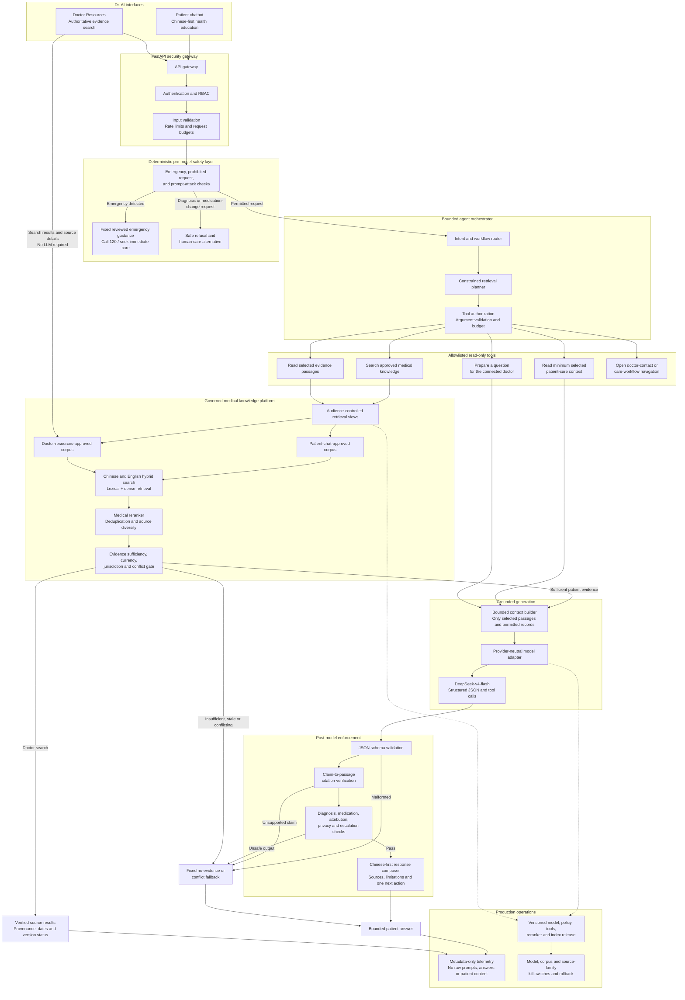

# Phase 3 Chatbot RAG, Agentic Architecture, and Medical Knowledge Base

Status: approved baseline; Slices 1-4 implemented locally with real-corpus promotion gated<br>
Date: 2026-07-13<br>
Owner: Harry Cao<br>
Applies to: Dr. AI production/commercial v1.0 patient chatbot and doctor
medical-resource search

## 1. Decision Summary

Dr. AI will use `deepseek-v4-flash` as the initial backbone model behind a
provider-neutral server adapter. The production system will not be a direct
user-to-model chatbot. It will be a bounded, retrieval-grounded workflow in
which deterministic safety rules, authorization, evidence retrieval, citation
validation, and output policy remain outside the model.

The same governed medical knowledge platform will serve two different product
experiences:

1. **Patient chatbot:** retrieves only the patient-approved subset and returns
   short, Chinese-first education within the frozen chatbot safety boundary.
2. **Doctor Resources:** a new doctor-only evidence workspace that searches the
   broader doctor-approved corpus and exposes source, version, jurisdiction,
   language, review, and supersession information.

The system is agentic only in a constrained sense. A workflow orchestrator may
select from allowlisted read-only tools and take bounded retry/fallback steps.
It may not diagnose, prescribe, edit records, message a clinician, book care,
or initiate any external action without a separately designed human-confirmed
workflow.

## 2. Product Boundaries

This plan inherits every requirement in
`Phase_3_Chatbot_Intended_Use_and_Safety_Boundary.md`. In particular:

- emergency red flags are handled before retrieval or model generation;
- the patient chatbot is for education, care understanding, question
  preparation, and safe escalation—not diagnosis or treatment;
- only minimum, explicitly selected patient context may be read;
- model output never writes to a Clinical Event, prescription, recovery plan,
  note, or other clinical record automatically;
- no raw prompt, response, patient context, or retrieved clinical content is
  written to metadata-only logs or audit events;
- the Flutter client never calls DeepSeek, an embedding provider, or a vector
  database directly; and
- the frozen evaluation suite remains separate from retrieval and training
  corpora.

The knowledge base is not itself a medical record system. Patient records stay
in the existing RBAC-controlled clinical data model. The knowledge base stores
reviewed external evidence and its provenance.

## 3. Doctor Resources Product Specification

### 3.1 Navigation and search placement

Add **Resources / 医学资源** as a top-level doctor destination at
`/doctor/resources`.

Move the current doctor header search into this page and remove the global
header search bars. The present header text combines patients, cases,
diagnoses, and resources even though the control is not connected to a search
workflow. Those domains also require different authorization and ranking
rules, so they must not share one ambiguous query box.

- Patient and Clinical Event lookup remains inside **Patient Management** and
  is restricted to active care relationships.
- Medical evidence lookup lives inside **Resources** and searches only
  admitted knowledge-base content.
- The doctor dashboard header remains calm navigation and identity chrome, not
  an unscoped search surface.

### 3.2 Page information architecture

The first production page contains:

- one prominent bilingual medical search bar;
- tabs for **Search**, **Saved**, **Recent updates**, and **Source registry**;
- filters for topic, document type, organization, jurisdiction, language,
  intended audience, publication/review date, and current/superseded status;
- query suggestions for Chinese and English clinical terminology;
- result cards showing title, short matched passage, publisher, source type,
  jurisdiction, original language, publication date, last medical review,
  version status, and patient-use eligibility;
- a source detail view with the original locator, version history, relevant
  passages, document-level metadata, related authoritative documents, and a
  clear warning if a newer source supersedes it;
- exact citation export and a stable internal link to the admitted source;
- saved resources and collections owned by the doctor account; and
- loading, no-result, stale-source, rights-restricted, partial-index, offline,
  and service-failure states.

The search page must distinguish these labels visually:

- **Current and reviewed**
- **Doctor-only**
- **Patient education approved**
- **Superseded—do not rely on as current guidance**
- **Rights-limited—link only / no stored full text**

### 3.3 Search behavior

- Core doctor search and source inspection must work without an LLM. Results
  come from the governed retrieval service, not a generated answer. A future
  evidence-summary action may be added only with the same citation and policy
  validation used by patient RAG and must remain visibly AI-generated.
- Default to China-applicable sources when the query concerns care in China.
- Preserve the user's original query and show any expanded medical terms.
- Search Chinese and English evidence across both languages, but never imply
  that an unreviewed machine translation is an official translation.
- Rank exact authoritative guidance and current regulator information above
  general health-popularization material.
- Allow a doctor to open the original official source for verification.
- Never silently merge conflicting recommendations. Show the conflict,
  jurisdiction, dates, and source hierarchy.
- Do not personalize evidence ranking from patient data in the first slice.
  A doctor deliberately links a source to a workflow only through a future,
  separately approved human action.

### 3.4 Access and audit

Doctor Resources is doctor-only. Authorization is checked by the API rather
than trusted from the client. Searches need operational metrics, but raw query
text must not enter metadata-only audit events because a doctor may type
patient information. Safe audit fields include actor ID, role, timestamp,
query hash, query length, filter categories, result count, source IDs opened,
latency bucket, and failure reason.

Saved resources store source IDs and doctor-defined collection metadata. They
must not copy source text or patient identifiers into audit records.

## 4. Production Agentic Architecture

### 4.1 Logical flow

```text
Flutter patient chat or doctor Resources
  -> FastAPI API gateway
      -> authentication, RBAC, rate limit, input validation
      -> deterministic emergency and prohibited-request gate
      -> bounded intent and workflow router
          -> approved medical-knowledge retrieval
          -> minimum selected patient-context read (patient chat only)
          -> fixed escalation/navigation action
      -> evidence sufficiency and conflict gate
      -> provider-neutral model adapter
          -> DeepSeek-v4-flash initially
      -> structured-output validation
      -> claim-to-citation and policy validation
      -> bounded response or fixed fallback
      -> metadata-only operational and safety events
```

The orchestrator is a server-side finite-state workflow. The backbone model may
request an allowlisted tool, but the orchestrator validates the request,
arguments, role, current state, and tool budget before execution.

#### 4.1.1 Normative implementation workflow

The following diagram is the normative Phase 3 chatbot-agent workflow. Later
implementation may split components into different services or rename internal
classes, but it must preserve these control boundaries and ordering. In
particular, it must not replace this workflow with a direct user-to-model path,
move emergency handling after generation, allow the model to bypass the tool
gate, use unapproved evidence, or deliver output before citation and policy
validation.



This diagram controls implementation together with the component
responsibilities, allowlisted tools, patient-chat state machine, and acceptance
criteria below. A pull request that intentionally changes one of these control
boundaries must update this document and receive explicit product and safety
review before the architecture change is implemented.

### 4.2 Component responsibilities

| Component | Responsibility | Must not do |
|---|---|---|
| API gateway | Authenticate, authorize, validate, rate-limit, issue request ID | Trust client role or expose provider credentials |
| Pre-model safety engine | Match emergency red flags, medication-change requests, diagnosis requests, prompt attacks, and unsupported inputs | Delegate emergency detection only to an LLM |
| Intent/workflow router | Select a bounded workflow and allowed tool set | Invent new tools or broaden the intended use |
| Retrieval broker | Apply corpus, audience, jurisdiction, date, language, and rights filters; run hybrid retrieval and reranking | Search the public web during a patient answer |
| Patient-context broker | Read only explicitly selected, authorized fields | Send the full medical record to the model |
| Evidence gate | Check source authority, currency, conflict, diversity, and sufficiency | Treat retrieval score as proof of medical correctness |
| Model adapter | Normalize DeepSeek and future providers; request schema-constrained output | Embed vendor behavior into the Flutter contract |
| Output validator | Validate schema, citations, attribution, prohibited instructions, length, and next action | Repair a medically unsafe answer by guesswork |
| Response composer | Render Chinese-first answer, source cards, limitation, and one next action | Hide missing evidence or source age |
| Observability layer | Record latency, counts, model/version, safety class, fallback, and cost without content | Log raw prompts, responses, passages, or patient data |

### 4.3 Allowlisted tools

Patient chatbot tools for the first slice:

- `search_medical_knowledge(query, filters, top_k)`
- `read_knowledge_passages(source_ids, passage_ids)`
- `read_selected_care_context(context_type, resource_id, fields)`
- `prepare_question_for_doctor(patient_text)`
- `open_connected_doctor_flow()` as a client navigation instruction only
- `show_emergency_guidance(rule_id)` as fixed reviewed content only

Doctor Resources tools:

- `search_doctor_resources(query, filters, cursor)`
- `read_source_record(source_id, version_id)`
- `list_source_versions(source_id)`
- `list_related_sources(source_id)`
- `save_source_reference(source_id, collection_id)`

There is no generic browser, arbitrary SQL, shell, code execution, record-write,
message-send, booking, diagnosis, prescription, or treatment tool.

### 4.4 Patient-chat state machine

1. **Receive:** authenticate, enforce rate/size/type limits, normalize safely.
2. **Safety route:** run deterministic emergency and prohibited-request rules.
3. **Classify:** choose education, doctor-authored clarification, medication
   education, question preparation, safe refusal, or unsupported input.
4. **Authorize context:** resolve only the user-selected care resource and
   approved fields; continue without context if none is needed.
5. **Plan retrieval:** create a constrained search object containing topic,
   language, China jurisdiction preference, audience, freshness requirement,
   and excluded content types.
6. **Retrieve:** hybrid search, metadata filtering, reranking, deduplication,
   and source-diversity selection.
7. **Evidence gate:** continue only if evidence is current, rights-admitted,
   audience-approved, and sufficient. Otherwise ask one clarifying question or
   return a safe no-evidence fallback.
8. **Generate:** call `deepseek-v4-flash` through the adapter with a bounded
   context window and a required JSON schema.
9. **Validate:** require every material factual claim to map to retrieved
   passage IDs; detect contradiction, unsupported medication instructions,
   diagnosis, false attribution, and missing escalation.
10. **Deliver:** show a concise answer, numbered source cards, source dates,
    limitations, and one next action.
11. **Observe:** store metadata-only safety, retrieval, model, latency, token,
    cost, and fallback fields.

The workflow gets at most one query-rewrite retry and one retrieval retry.
Repeated failure returns fixed copy rather than allowing open-ended agent loops.

### 4.5 Structured generation contract

The internal model response should be schema-constrained and never rendered
directly. Minimum fields:

```json
{
  "answer_language": "zh-Hans",
  "answer_sections": [
    {
      "text": "...",
      "supporting_passage_ids": ["passage-id"]
    }
  ],
  "uses_patient_context": false,
  "patient_context_attribution": null,
  "uncertainties": [],
  "next_action_code": "none",
  "refusal_code": null
}
```

Server code—not the model—resolves passage IDs into source cards and decides
whether the final response is eligible for display.

### 4.6 Retrieval design

Use hybrid retrieval rather than vector search alone:

1. Unicode and medical-term normalization without rewriting clinical meaning.
2. Chinese word/character lexical search plus English lexical search.
3. Multilingual dense retrieval over approved passage embeddings.
4. Mandatory metadata filters before ranking.
5. A medically evaluated cross-encoder reranker.
6. Near-duplicate collapse and source-diversity selection.
7. Evidence sufficiency/conflict checks before generation.

Initial retrieval should return a small evidence set, normally 3-6 passages
from 2-4 sources. A large model context is not a reason to send an entire
database or full documents.

### 4.7 Reliability and fallback policy

Return fixed, reviewed responses for:

- emergency rule match;
- prohibited diagnosis or medication-change request;
- authorization failure;
- no eligible evidence;
- conflicting evidence that cannot be safely explained;
- stale or superseded-only evidence;
- retrieval/index outage;
- provider timeout, quota, malformed JSON, or unavailable model;
- unsupported citation or failed policy validation; and
- low-bandwidth/network interruption.

No fallback may silently switch to ungrounded model memory.

### 4.8 Production deployment baseline

Fit the architecture to the existing Tencent Cloud, FastAPI, PostgreSQL, and
Flutter stack:

- **FastAPI:** public product API, workflow orchestrator, authorization, safety
  engine, provider adapter, and response validation.
- **PostgreSQL:** source registry, rights ledger, canonical metadata, reviews,
  saved references, index-release manifests, and metadata-only events.
- **Tencent COS:** encrypted immutable raw-source and normalized-artifact vault
  with versioning and lifecycle controls; never served directly to Flutter.
- **OpenSearch-compatible managed/self-hosted cluster:** production lexical and
  vector indexes with Chinese/English analyzers and release-specific aliases.
  A small PostgreSQL/pgvector pilot is acceptable, but production must have one
  declared active search source rather than two drifting indexes.
- **Background workers and queue:** source capture, malware/type checks,
  parsing, checksums, embedding, index builds, update monitoring, and review
  notifications. Ingestion never runs inside the user request path.
- **Self-hosted embedding and reranking service in the approved China region:**
  preferred so source content is not sent to an additional external model
  vendor. Any external embedding/reranking provider requires the same rights,
  privacy, contract, and data-location review as the backbone model.
- **Redis-compatible cache:** rate limits, short-lived safe retrieval cache,
  job coordination, and circuit-breaker state. Cache keys must include active
  index release, audience, jurisdiction, language, and filter policy.
- **Monitoring:** metrics and traces with redaction-by-construction, plus
  source-freshness, index-release, fallback, safety, and provider dashboards.

Separate the online serving path from the offline ingestion/review path. Use
private networking, workload identities, least-privilege service accounts,
encrypted transport/storage, secret management, signed artifact manifests,
backups, and restore rehearsals. The active model, prompt policy, tool schema,
reranker, and index release must each be independently versioned and
rollback-capable.

## 5. Medical Knowledge Base Structure

### 5.1 Source admission policy

Admission is organization-allowlist and rights-evidence based, not domain-name
or crawler based. Every publisher must be either:

- an authorized Chinese national or subnational health/medical authority;
- an organization explicitly admitted through the National Health Science
  Popularization Resource Library or another documented Chinese authority
  mechanism;
- a Chinese public medical institution whose authority and publishing channel
  have been verified for the specific content class; or
- the World Health Organization; or
- a verified foreign national health, public-health, medicines, or medical-
  research authority whose specific content is explicitly public domain or
  licensed for worldwide commercial copying, storage, adaptation, translation,
  embedding, excerpt display, redistribution, and the intended model-provider
  transmission.

Initial candidate families include the National Health Commission, National
Medical Products Administration, Chinese Center for Disease Control and
Prevention, National Administration of Traditional Chinese Medicine where
scope-appropriate, admitted National Health Science Popularization Resource
Library publishers, WHO, and narrowly selected patient-education collections
from MedlinePlus/NLM, the US National Cancer Institute, the US National
Institute of Mental Health, MyHealthfinder/ODPHP, and other foreign national
authorities only after the same source-family review. This is a candidate
allowlist, not automatic permission to ingest. A general government-domain or
open-website statement is insufficient when a page contains third-party text,
images, drug monographs, encyclopedia content, logos, or another page-level
rights exception.

For each source family, legal/product review must determine whether Dr. AI may:

- store the full text;
- transform or translate it;
- create and store embeddings;
- display excerpts;
- use it in a commercial generative product;
- expose it to a third-party model provider; and
- retain prior versions.

If those rights are not evidenced, store metadata and the official locator
only, or exclude the source. WHO states that substantial reproduction,
translation, or non-educational/non-commercial use may require prior
authorization; therefore WHO content is deny-by-default for full-text
commercial ingestion until the specific licence or permission is recorded.
Chinese government publication likewise does not by itself prove commercial
reuse rights.

Foreign-authority material supplements rather than displaces China-applicable
evidence. When current guidance from the National Health Commission, National
Medical Products Administration, Chinese CDC, or another competent Chinese
authority conflicts with foreign guidance, the Chinese source governs the
China-facing answer. The response must preserve the foreign source's
jurisdiction and must not silently combine screening schedules, emergency
instructions, medicine approvals, care pathways, or other jurisdiction-
dependent recommendations.

### 5.2 Authority and audience tiers

| Tier | Content | Default eligibility |
|---|---|---|
| A | Current Chinese law/regulation, regulator safety communication, national clinical/public-health guidance, official drug/device registration data | Doctor; patient only after readability and intended-use review |
| B | Current WHO material and verified foreign-national-authority patient education with explicit public-domain or open commercial reuse evidence | Doctor; patient after China-applicability, medical, native-Chinese, and readability review |
| C | Official Chinese public-health education and admitted health-popularization resources | Doctor and patient when medically reviewed |
| D | Verified official hospital/medical-institution education | Doctor by default; patient only after provenance, conflict, and review gates |

Peer-reviewed papers, commercial medical websites, scraped consultations,
social-media reposts, community answers, model outputs, and general web pages
are excluded from the production corpus under the requested source boundary.
A link from an official page to third-party content does not transfer authority
or rights.

### 5.3 Storage layers

```text
Source registry and rights ledger (PostgreSQL)
  -> immutable raw-source vault (versioned object storage)
      -> normalized document/version store
          -> medically meaningful sections and passages
              -> lexical index
              -> multilingual vector index
              -> terminology/concept mappings
                  -> approved retrieval views
                      -> patient_chat_approved
                      -> doctor_resources_approved
```

- **Source registry:** publisher identity, authority evidence, domain/channel,
  contact, content classes, rights decision, and review owner.
- **Raw vault:** immutable fetched files/responses, headers, timestamp,
  checksum, and capture method. It is not queried by the chatbot.
- **Canonical store:** parsed document versions and structured metadata.
- **Search indexes:** derived, rebuildable indexes containing only approved
  versions and passages.
- **Retrieval views:** hard audience boundaries enforced before search.

### 5.4 Core data entities

#### `kb_publishers`

- `publisher_id`, official Chinese/English names, organization type;
- authority basis and evidence locator;
- verified official domains/channels;
- country/jurisdiction and review status;
- allowed content classes; and
- created, reviewed, and revoked timestamps.

#### `kb_rights_records`

- rights record ID and publisher/source scope;
- licence name/version or written-permission reference;
- commercial use, storage, transformation, translation, embedding, excerpt,
  model-provider transmission, and redistribution flags;
- attribution requirements;
- effective/expiry dates;
- evidence checksum and internal secure locator; and
- legal reviewer and decision status.

#### `kb_sources`

- stable source ID, publisher ID, title, canonical official locator;
- source type: guideline, regulation, drug information, fact sheet, public
  health notice, patient education, or terminology;
- jurisdiction, intended audience, topic, specialty, and population;
- original language and official translations;
- publication, effective, review, and expiry dates;
- authority tier, rights record, medical review status;
- patient/doctor eligibility; and
- current, superseded, withdrawn, quarantined, or expired status.

#### `kb_source_versions`

- version ID, source ID, publisher version label, captured timestamp;
- immutable raw checksum, normalized checksum, parser version;
- valid-from/valid-to and supersedes/superseded-by links;
- change summary and review decision; and
- index release ID.

#### `kb_sections` and `kb_passages`

- hierarchical section and passage IDs;
- version ID, heading path, ordered text span, language;
- token/character counts and source offsets;
- clinical concept tags, audience, contraindication/red-flag flags;
- chunking method/version;
- patient readability review status; and
- lexical/vector index eligibility.

#### `kb_terms`

- stable concept ID;
- preferred Simplified Chinese and English terms;
- verified aliases, abbreviations, and common patient-language variants;
- concept type and disambiguation notes;
- source provenance for each mapping; and
- prohibited or ambiguous expansions.

#### `kb_reviews`

- target entity/version, review type, reviewer role and ID;
- medical, native-Chinese, rights, product, and safety decisions;
- findings, decision code, timestamp, and next-review date.

#### `kb_index_releases`

- immutable release ID;
- included source/version/passage manifest and checksums;
- embedding, lexical analyzer, and reranker versions;
- build/test results;
- approvers, release date, rollback predecessor, and status.

#### `kb_retrieval_events`

Metadata only: request ID, actor role, workflow, query hash/length, filter
classes, index release, retrieved source/passage IDs, scores, latency, evidence
decision, model version, and fallback. No raw query, passage text, patient
context, prompt, or response.

### 5.5 Document lifecycle

```text
discovered
  -> publisher_verified
  -> rights_pending
  -> captured_and_hashed
  -> parsed
  -> medical_and_language_review
  -> doctor_approved
  -> patient_approved (optional stricter gate)
  -> indexed_in_immutable_release
  -> monitored
  -> superseded / withdrawn / expired / quarantined
```

Only `doctor_approved` and `patient_approved` content enters the corresponding
retrieval view. A new source version never overwrites the old version. It
creates a reviewed version and a new index release. Rollback changes the active
release pointer; it does not mutate evidence history.

### 5.6 Bilingual content rules

- Preserve original Chinese and English text separately.
- Prefer official translations.
- Store paragraph/section alignment only when reviewed.
- Machine translation may help candidate discovery but is not production
  evidence until native-language and medical review are complete.
- A DeepSeek or other model translation is an unofficial derived artifact, not
  an official translation. It may be created only when the source rights record
  permits translation and model-provider transmission and the provider/privacy/
  data-location gates are closed. Store the exact source version, translation
  model and prompt-policy version, generation date, and aligned source offsets;
  never overwrite the original-language artifact.
- Do not index or display a machine translation in a patient retrieval view
  until medical and native-Chinese reviewers approve it. Until then, Doctor
  Resources may expose only the reviewed original text and label its language
  and jurisdiction accurately.
- Query translation/expansion must retain the original query and record which
  verified terminology mappings were applied.
- If China-specific and WHO guidance differ, do not flatten them into one
  answer. Preserve jurisdiction, date, and source attribution.

### 5.7 Chunking rules

Chunk by document structure and clinical meaning, not fixed token count alone.
Keep together:

- recommendation plus qualifying population;
- medication fact plus contraindication/warning;
- procedure explanation plus limitations;
- emergency sign plus required action; and
- table row plus headers/footnotes needed to interpret it.

Never create a chunk that detaches a recommendation from its negation,
exception, evidence grade, jurisdiction, or effective date. Store source
offsets so every displayed excerpt can be traced back exactly.

## 6. Fine-Tuning and Small Adapter Recommendation

Do not fine-tune medical facts into the backbone as the first improvement.
Facts change, are hard to remove, and are less auditable than retrieval.

Recommended order:

1. establish the approved corpus and model-only baseline;
2. evaluate hybrid retrieval, reranking, evidence sufficiency, and citations;
3. harden deterministic safety and structured output;
4. only then train small, replaceable components where measured errors remain.

The most useful first fine-tuned adapter is a **small multilingual medical
retrieval/reranking block**, trained on rights-cleared, clinician-reviewed
Chinese/English query-passage pairs. It can improve:

- low-literacy Chinese query normalization;
- medical synonym and abbreviation matching;
- relevant-passage reranking;
- China-jurisdiction preference; and
- detection of insufficient or conflicting evidence.

A separate small classifier may support intent and unsafe-request detection,
but deterministic emergency rules remain authoritative.

Do not assume that a LoRA adapter can be attached to the hosted
`deepseek-v4-flash` API. That requires model-weight access and provider terms
that permit fine-tuning and deployment. If those conditions are unavailable,
the adapter remains an independent service around the provider. Later
backbone SFT/LoRA may improve Chinese tone, schema adherence, refusals, and
question preparation, but only with a separately licensed training corpus and
without using the sealed evaluation suite or retrieval corpus by default.

## 7. Evaluation and Release Gates

Evaluate at four separate levels:

### 7.1 Retrieval

- Recall@k and nDCG/MRR on clinician-reviewed queries;
- correct version, jurisdiction, language, and audience filtering;
- stale/superseded leakage rate;
- cross-language retrieval performance;
- conflict detection;
- passage/source diversity; and
- no-evidence precision.

### 7.2 Answer quality

- material claim citation coverage;
- claim-to-passage entailment;
- factual error and unsupported-claim rate;
- source/date display accuracy;
- Simplified-Chinese clarity and health literacy;
- appropriate uncertainty and one clear next action; and
- correct attribution of doctor-authored patient context.

### 7.3 Safety and security

- 100% deterministic handling of the approved emergency fixture set;
- diagnosis and medication-change hard-failure rate;
- prompt-injection resistance in user text, patient records, and retrieved
  documents;
- cross-patient/cross-role access tests;
- tool argument and tool-budget enforcement;
- no raw content in logs/audit/analytics; and
- fixed fallback behavior for every dependency failure.

### 7.4 Production quality

- latency percentiles by workflow and network condition;
- retrieval, embedding, reranking, and generation availability;
- provider token usage and actual reported cost;
- cache correctness and tenant isolation;
- index freshness and source-update service level;
- rollback rehearsal; and
- doctor and rural-patient usability review on small screens and low bandwidth.

No component is described as clinically validated until medical, native-
Chinese, privacy, security, legal, provider-contract, data-location, and
regulatory gates are closed.

## 8. Implementation Sequence

Each slice owns the modules named below and should leave them ready for the
next dependent slice.

### Slice 1: Governance and contracts

Status: complete locally on 2026-07-13.

- **Module ownership:** policy/configuration, API and model contracts, safety
  codes, and telemetry schemas shared by all chatbot components.
- Freeze source admission, rights, review, lifecycle, and audience policies.
- Define API schemas for doctor search and patient retrieval evidence.
- Define structured model output, tool schemas, fallback codes, and safe
  telemetry.
- Obtain explicit decisions for external-provider transmission and data
  location before using any real patient context.

Development is synthetic-only. Real patient context is denied to external
providers until Mainland-China data location, field allowlisting, no-training,
no-retention, privacy, legal, and product approvals are all recorded. Retrieval,
embedding, and reranking remain self-hosted in the approved Mainland China
region. This restriction does not change the production/commercial product
target.

### Slice 2: Doctor Resources shell

Status: complete locally on 2026-07-13. The Flutter shell uses a local reviewed
fixture catalog only; backend retrieval remains deferred to later slices.

- **Module ownership:** Flutter doctor Resources navigation, search/filter UI,
  result cards, source details, and saved/recent states.
- Add `/doctor/resources` and the doctor navigation destination.
- Remove the global doctor header search.
- Build production loading/empty/error/filter/result/source-detail states
  against a local reviewed fixture catalog.
- Keep patient/Clinical Event search in Patient Management.

### Slice 3: Knowledge ingestion foundation

Status: foundation implemented locally on 2026-07-14; source-promotion gate
remains open. The governed database schema,
metadata-only ingestion path, immutable artifact adapter, deterministic index
release/activation/rollback controls, and doctor-only catalog API are
implemented. The 298-entry real-source catalog preserves all 239 official WHO
Chinese fact sheets and all 241 official WHO English fact sheets: 234 exact
slug matches are bilingual records, while five Chinese and seven English
unmatched pages remain monolingual. It also includes 52 Chinese-only,
authority-tier-A 国家卫生健康委员会 guidelines and clinical protocols and replaces
the fictional Doctor Resources data. Because commercial reuse rights and medical
review are not yet recorded, the pilot stores titles and official locators
only and is deliberately excluded from retrieval indexes. Slice 3 cannot be
declared fully closed until legal/product and medical/native-Chinese reviewers
approve at least one rights-cleared pilot source version.

- **Module ownership:** knowledge-base database models, source ingestion and
  review pipeline, artifact storage, and index-release management.
- Implement publisher/source/rights/version/review schemas.
- Add immutable capture, parsing, checksums, lineage, and quarantine.
- Create a tiny rights-cleared pilot corpus before scaling.
- Build deterministic index releases and rollback.

### Slice 4: Retrieval baseline

Status: baseline implemented locally on 2026-07-14. The doctor link-only
catalog now searches titles, official translations, catalog summaries, topic
metadata, and per-source bilingual keywords rather than titles alone. Approved
passage retrieval is release-specific and implements Unicode normalization,
Chinese character/bigram and English word lexical matching, reviewed term
expansion, dense-vector scoring, metadata filters, authority/China preference
reranking, duplicate collapse, source diversity, conflict/sufficiency gates,
and metadata-only events. Doctor and patient retrieval remain separate
server-authorized views. Retrieval metrics are computed independently from
generation.

The checked-in deterministic embedding is a development/test baseline behind a
versioned provider boundary. A production release must configure the approved
self-hosted multilingual medical embedding service in Mainland China and use a
clinically evaluated reranker. No real WHO or 国家卫生健康委员会 passage is active
yet: their rights and doctor-review gates remain open, so the current 298-source
catalog stays official-link metadata only. This blocks real-corpus promotion,
not further retrieval implementation or later removal/replacement of a source.

Doctor Resources also connects display-approved catalog records to the
doctor-only `/doctor/resources/{sourceId}/read` route. The reader fetches the
governed detail endpoint, presents original-language sections with provenance,
rights, jurisdiction, and review status, and remains distinct from retrieval
eligibility. Link-only records retain the official-source action and never show
the read-original-text action.

On 2026-07-15, Slice 4 added the governed Simplified-Chinese translation
pipeline for the 55 rights-cleared English documents (426 aligned sections;
418,089 source characters). DeepSeek generation is resumable and append-only,
uses structured JSON with thinking disabled, records the exact source-version,
model, prompt-policy, checksums, timestamps, and provider-reported token usage,
and enforces a configurable cost ceiling. Import creates derived translation
artifacts and aligned translation sections; it never creates another
`kb_sources` row, so the catalog remains 353 sources rather than treating each
language as a separate entry.

Every imported translation starts as `generated_pending_review`. It is excluded
from catalog bilingual status, doctor display, lexical/vector eligibility, and
all retrieval releases until separate medical and native-Chinese reviews both
approve the artifact. After both approvals, the existing source advertises
English and `zh-Hans`, Chinese-title catalog search is enabled, and the
doctor-only reader offers Original English / Reviewed Chinese translation on
the same stable route. The UI labels the translation as unofficial and keeps
the publisher's English original available for authoritative verification.
Patient display and retrieval admission remain separate, stricter gates.

Translation status on 2026-07-15: all 55 artifacts and 426 aligned sections were
validated and imported using DeepSeek v4 Flash (107,006 input tokens; 94,090
output tokens; approximately `$0.0413` from provider-reported usage). The source
registry remains 353 rows. The product owner subsequently confirmed completion
of medical and native-Chinese review for all 55; the system recorded 110
separate approved review rows and promoted every artifact to `approved`.
Doctor Resources now exposes the same 55 entries as English + `zh-Hans` and the
reader provides the reviewed unofficial translation beside the original.
Reviewer names were not supplied in the confirmation, so audit findings record
that provenance explicitly. Zero translated passages are retrieval-eligible:
doctor display approval still does not create an immutable retrieval release or
patient-use approval.

Bilingual summary status on 2026-07-15: DeepSeek v4 Flash generated all 55
English and Simplified-Chinese summary pairs from the immutable English sources
and their aligned reviewed translations (192,598 input tokens; 10,802 output
tokens). After the product owner confirmed manual review of every pair, the
system imported 55 approved `kb_summary_artifacts` and 55 review records while
keeping the source registry at 353 rows. Doctor Resources catalog search now
matches approved English or Chinese summary text in addition to titles,
official translations, topics, catalog metadata summaries, and bilingual
keywords. Reviewer names were not supplied, so the review records preserve the
product-owner confirmation and that provenance limitation explicitly. Summary
approval changes catalog matching only; it does not admit passages to a doctor
or patient retrieval release.

- **Module ownership:** approved retrieval views, lexical/vector search,
  reranking, evidence checks, and retrieval evaluation.
- Implement Chinese/English lexical plus dense retrieval.
- Add metadata filters, reranking, deduplication, and evidence sufficiency.
- Validate retrieval independently from generation.

### Slice 5: Patient RAG workflow

- **Module ownership:** patient chat UI and API, agent orchestrator, deterministic
  safety routing, allowlisted tools, provider adapter, and response validator.
- Add the finite-state orchestrator and allowlisted tools.
- Integrate `deepseek-v4-flash` through the provider adapter.
- Enforce structured output, citation mapping, policy validation, and fixed
  fallbacks.
- Preserve session-only conversation content and metadata-only telemetry.

### Slice 6: Adapter experiment

- **Module ownership:** retrieval training-pair pipeline, optional query/reranker
  adapter, and baseline comparison report.
- Build rights-cleared clinician-reviewed retrieval training pairs.
- Compare the small reranking/query adapter against the frozen retrieval
  baseline.
- Promote it only if safety-critical slices do not regress.

### Slice 7: Production and clinical gates

- **Module ownership:** end-to-end release tests, clinical/safety review,
  observability, operational controls, staged rollout, and rollback readiness.
- Run the frozen model suite plus retrieval-specific and live workflow tests.
- Complete medical/native-Chinese review, threat modeling, privacy/legal/
  provider review, load tests, observability, incident response, and rollback.
- Release through a small monitored cohort with kill switches for generation,
  retrieval release, and individual source families.

## 9. Architecture Acceptance Criteria

This plan is implemented correctly only when:

- Doctors have a dedicated Resources destination and the ambiguous header
  search has been removed.
- Patient, doctor, and source-registry searches are separate authorized
  workflows.
- Every production passage traces to an approved publisher, source version,
  rights record, checksum, review, and immutable index release.
- Patient chat cannot retrieve doctor-only, stale, withdrawn, quarantined, or
  rights-pending content.
- Emergency routing occurs before retrieval and generation.
- The model can call only bounded read tools with server-validated arguments.
- Unsupported or conflicting evidence cannot fall back to model memory.
- Every material factual answer section maps to displayed evidence.
- DeepSeek can be replaced without changing the Flutter-facing product
  contract.
- No raw medical/query/chat content leaks into metadata-only observability.
- Fine-tuning and retrieval assets remain separate from the sealed evaluation
  suite.
- Rollback of a bad model, index release, or source family is rehearsed and
  measurable.
- The implemented control flow matches the normative Mermaid diagram in
  Section 4.1.1; any intentional boundary or ordering change was documented
  and explicitly approved before implementation.

## 10. Authoritative Planning References

- National Health Commission: National Health Science Popularization Resource
  Library first admitted new-media accounts,
  <https://www.nhc.gov.cn/xcs/c100122/202412/e414ccb7d7b843ddb34e23aaeb3bc9cb.shtml>
- National Health Commission health-rumor verification search,
  <https://www.nhc.gov.cn/kppypt/index.shtml>
- Chinese CDC health-popularization portal,
  <https://www.chinacdc.cn/jkkp/>
- NMPA government-service data-query portal,
  <https://www.nmpa.gov.cn/zwfwqjd/index.html>
- WHO copyright, licensing, and permissions,
  <https://www.who.int/about/policies/publishing/copyright>
- WHO website terms of use,
  <https://www.who.int/about/policies/terms-of-use>
- DeepSeek API model and tool/structured-output documentation,
  <https://api-docs.deepseek.com/>

These references identify candidate official sources and platform capability.
They do not substitute for source-by-source medical, legal, privacy, security,
or commercial-use approval.
