# Phase 3 Chatbot RAG, Bounded Workflow Architecture, and Medical Knowledge Base

Status: approved baseline; legacy narrow Slices 9A-9B evidence preserved;
symptom-first Slice 9A reset implemented locally as an unapproved candidate;
corpus and clinical gates remain open and Slice 9B optimization is paused;<br>
Slices 9C-9E follow before the final Slice 10 production/commercialization gate<br>
Date: 2026-07-13; delivery track updated 2026-07-17; architecture refined
2026-07-18 and symptom-first reset recorded 2026-07-21<br>
Owner: Harry Cao<br>
Applies to: Dr. AI production/commercial v1.0 patient chatbot and doctor
medical-resource search

Patient-chatbot commercialization and production-readiness deadline:
**2026-08-12**. This deadline applies to the patient chatbot and its governed
knowledge/retrieval platform. It does not declare the separate AI Diagnosis
Assistant, Recovery Planning Agent, Medication Safety Agent, or other Phase 3
AI modules complete.

## 1. Decision Summary

Dr. AI will use `deepseek-v4-flash` as the initial backbone model behind a
provider-neutral server adapter. The production system will not be a direct
user-to-model chatbot. It will be a bounded, retrieval-grounded workflow in
which deterministic safety rules, authorization, evidence retrieval, citation
validation, and output policy remain outside the model.

The same governed medical knowledge platform will serve two different product
experiences:

1. **Patient chatbot:** retrieves only the patient-approved subset and returns
   Chinese-first education, symptom orientation, practical next steps, and
   explicit uncertainty within the chatbot safety boundary.
2. **Doctor Resources:** a new doctor-only evidence workspace that searches the
   broader doctor-approved corpus and exposes source, version, jurisdiction,
   language, review, and supersession information.

The patient chatbot is a bounded AI workflow, not an open-ended medical agent.
A server-owned orchestrator selects and executes every authorized read,
retrieval, retry, fallback, and navigation decision. DeepSeek may return a
schema-constrained query-rewrite candidate or grounded answer, but it cannot
choose or execute retrieval, patient-context, record, message, booking,
diagnosis, prescription, treatment, or other product operations. Any future
external action requires a separately designed human-confirmed workflow.

The 2026-07-21 symptom-first reset supersedes the eight-case Slice 9A suite as
the target evaluation boundary without deleting its historical evidence. The
100 supplied rural-China questions now form candidate contract
`dr-ai-rural-symptom-first-canonical-v1`, with 85 separate variants: 25
symptom-only, 31 disease-name-removed, eight colloquial, ten abbreviated, and
11 multi-turn. Every variant carries its own controlled presentation, source
policy, relevant/forbidden source fields, required behavior, and call
permissions. It is evaluation-only,
explicitly excluded from retrieval and training, and remains unfrozen pending
named clinical, native-Simplified-Chinese, and product review. Its controlled
presentation contains symptoms, anatomy, onset, duration, trajectory,
severity, associated signs, measurements, population, pregnancy, exposures,
trauma, requested action, danger signals, negated concepts, and concepts used
only hypothetically rather than reported as present. Deterministic combination
rules run before all retrieval or model calls and choose brief 120 plus
scene-safety copy for candidate emergencies. For messages allowed to continue,
a separate declarative rule table assigns candidate same-day, clinician-contact,
or routine-education timing from the controlled presentation rather than from a
disease name or contract case ID. The answer adapter receives that server-owned
route and an allowed next-action set; output validation rejects a model attempt
to downgrade same-day care or introduce an emergency action. This local
implementation and its metrics do not constitute clinical approval of the
critical set, care-timing policy, fixed fallback wording, or first-aid wording.

The controlled safety assessment is the single authority for selecting the
emergency route. The former patient-entry-point override for overdose and
self-harm wording has been removed; those presentations now enter the same
controlled concept, negation, hypothetical-mention, danger-signal, and guidance
selection path as every other emergency candidate. This preserves immediate
120 guidance and zero retrieval/model calls for affirmed crisis presentations
without allowing a parallel small-regex route to bypass the representation.

For non-emergency patient retrieval, the same representation now produces at
most four deterministic views: the untouched literal question, a descriptive
clinical-presentation view, a symptom-plus-population/exposure/trauma view, and
a symptom-plus-requested-action view. All view embeddings are batched once;
rights, active-release, audience, language, jurisdiction, patient-readability,
central-topic, and lexical-anchor checks run independently on every view.
Literal candidates keep their admission scores and relative order after the
controlled context gate. When pregnancy, exposure, or trauma is reported, its
metadata match is mandatory and a reported symptom must occur in the passage.
A candidate found only through a generated view may fill unused capacity or
serve as a fallback only when source metadata centrally represents an actually
reported, non-negated presentation concept. The
literal question remains the query for the external reranker and answer model;
generated views are not evidence and their text is not written to telemetry.

## 2. Product Boundaries

This plan inherits every requirement in
`Phase_3_Chatbot_Intended_Use_and_Safety_Boundary.md`. In particular:

- emergency red flags are handled before retrieval or model generation;
- the patient chatbot is for education, symptom orientation, care
  understanding, question preparation, and safe escalation—not confirmed
  diagnosis or treatment;
- only minimum, explicitly selected patient context may be read;
- model output never writes to a Clinical Event, prescription, recovery plan,
  note, or other clinical record automatically;
- no raw prompt, response, patient context, or retrieved clinical content is
  written to metadata-only logs or audit events;
- the Flutter client never calls DeepSeek, an embedding provider, or a vector
  database directly; and
- the frozen evaluation suite remains separate from retrieval and training
  corpora.

The knowledge base is not itself a medical record system. Patient records stay
in the existing RBAC-controlled clinical data model. The knowledge base stores
reviewed external evidence and its provenance.

## 3. Doctor Resources Product Specification

### 3.1 Navigation and search placement

Add **Resources / 医学资源** as a top-level doctor destination at
`/doctor/resources`.

Move the current doctor header search into this page and remove the global
header search bars. The present header text combines patients, cases,
diagnoses, and resources even though the control is not connected to a search
workflow. Those domains also require different authorization and ranking
rules, so they must not share one ambiguous query box.

- Patient and Clinical Event lookup remains inside **Patient Management** and
  is restricted to active care relationships.
- Medical evidence lookup lives inside **Resources** and searches only
  admitted knowledge-base content.
- The doctor dashboard header remains calm navigation and identity chrome, not
  an unscoped search surface.

### 3.2 Page information architecture

The first production page contains:

- one prominent bilingual medical search bar;
- tabs for **Search**, **Saved**, **Recent updates**, and **Source registry**;
- filters for topic, document type, organization, jurisdiction, language,
  intended audience, publication/review date, and current/superseded status;
- query suggestions for Chinese and English clinical terminology;
- result cards showing title, short matched passage, publisher, source type,
  jurisdiction, original language, publication date, last medical review,
  version status, and patient-use eligibility;
- a source detail view with the original locator, version history, relevant
  passages, document-level metadata, related authoritative documents, and a
  clear warning if a newer source supersedes it;
- exact citation export and a stable internal link to the admitted source;
- saved resources and collections owned by the doctor account; and
- loading, no-result, stale-source, rights-restricted, partial-index, offline,
  and service-failure states.

The search page must distinguish these labels visually:

- **Current and reviewed**
- **Doctor-only**
- **Patient education approved**
- **Superseded—do not rely on as current guidance**
- **Rights-limited—link only / no stored full text**

### 3.3 Search behavior

- Core doctor search and source inspection must work without an LLM. Results
  come from the governed retrieval service, not a generated answer. A future
  evidence-summary action may be added only with the same citation and policy
  validation used by patient RAG and must remain visibly AI-generated.
- Default to China-applicable sources when the query concerns care in China.
- Preserve the user's original query and show any expanded medical terms.
- Search Chinese and English evidence across both languages, but never imply
  that an unreviewed machine translation is an official translation.
- Rank exact authoritative guidance and current regulator information above
  general health-popularization material.
- Allow a doctor to open the original official source for verification.
- Never silently merge conflicting recommendations. Show the conflict,
  jurisdiction, dates, and source hierarchy.
- Do not personalize evidence ranking from patient data in the first slice.
  A doctor deliberately links a source to a workflow only through a future,
  separately approved human action.

### 3.4 Access and audit

Doctor Resources is doctor-only. Authorization is checked by the API rather
than trusted from the client. Searches need operational metrics, but raw query
text must not enter metadata-only audit events because a doctor may type
patient information. Safe audit fields include actor ID, role, timestamp,
query hash, query length, filter categories, result count, source IDs opened,
latency bucket, and failure reason.

Saved resources store source IDs and doctor-defined collection metadata. They
must not copy source text or patient identifiers into audit records.

## 4. Production Bounded Workflow Architecture

### 4.1 Logical flow

```text
Flutter patient chat or doctor Resources
  -> FastAPI API gateway
      -> authentication, RBAC, rate limit, input validation
      -> deterministic emergency and prohibited-request gate
      -> server-owned query and context planner
          -> minimum selected patient-context read (patient chat only)
          -> original-query approved medical-knowledge retrieval
          -> optional schema-constrained retrieval-rescue rewrite
             when the query is ambiguous or initial retrieval is weak
          -> server validation and fused approved retrieval
      -> evidence sufficiency and conflict gate
      -> provider-neutral model adapter
          -> DeepSeek-v4-flash structured answer initially
      -> structured-output validation
      -> semantic claim-to-evidence and policy validation
      -> bounded response or fixed fallback
      -> metadata-only operational and safety events
```

The orchestrator is a server-side finite-state workflow. The server—not the
backbone model—controls all retrieval, context selection, evidence admission,
and product actions. A schema-constrained DeepSeek query-rewrite call is an
optional retrieval aid, not a tool-selection authority: its output is treated
as an untrusted candidate, checked against the original meaning, and used at
most once alongside the preserved original query.

#### 4.1.1 Normative implementation workflow

The following diagram is the normative Phase 3 bounded chatbot workflow. Later
implementation may split components into different services or rename internal
classes, but it must preserve these control boundaries and ordering. In
particular, it must not replace this workflow with a direct user-to-model path,
move emergency handling after generation, allow the model to control retrieval
or patient-context access, use unapproved evidence, or deliver output before
semantic claim-support and policy validation.

```mermaid
flowchart TB
    subgraph Clients["Dr. AI interfaces"]
        Patient["Patient chatbot<br/>Chinese-first health education"]
        Doctor["Doctor Resources<br/>Authoritative evidence search"]
    end

    Patient --> API
    Doctor --> API

    subgraph Gateway["FastAPI security gateway"]
        API["API gateway"]
        Auth["Authentication and RBAC"]
        Limits["Input validation<br/>Rate limits and request budgets"]
    end

    API --> Auth --> Limits

    Limits --> Safety

    subgraph SafetyLayer["Deterministic pre-model safety layer"]
        Safety["Emergency, prohibited-request,<br/>and prompt-attack checks"]
        Emergency["Fixed reviewed emergency guidance<br/>Call 120 / seek immediate care"]
        Refusal["Safe refusal and<br/>human-care alternative"]
    end

    Safety -- "Emergency detected" --> Emergency
    Safety -- "Prohibited medication change or diagnostic certainty" --> Refusal
    Safety -- "Permitted request" --> Router

    subgraph Orchestrator["Server-owned bounded workflow"]
        Router["Intent and workflow router"]
        ContextPolicy["Context authorization and selection<br/>Minimum question-relevant fields"]
        Planner["Constrained query and retrieval planner<br/>Original query preserved"]
        RetrievalBroker["Authorized retrieval broker<br/>Audience, rights and request budget"]
    end

    Router --> ContextPolicy --> Planner --> RetrievalBroker

    subgraph ServerReads["Server-controlled read operations"]
        PatientContext["Read minimum selected<br/>patient-care context"]
        SearchKB["Search approved medical knowledge"]
        ReadPassages["Read selected evidence passages"]
    end

    ContextPolicy --> PatientContext
    RetrievalBroker --> SearchKB
    RetrievalBroker --> ReadPassages

    subgraph Knowledge["Governed medical knowledge platform"]
        Views["Audience-controlled retrieval views"]
        PatientView["Patient-chat-approved corpus"]
        DoctorView["Doctor-resources-approved corpus"]
        Hybrid["Chinese and English hybrid search<br/>Lexical + dense retrieval"]
        Reranker["Medical reranker<br/>Deduplication and source diversity"]
        RetrievalAssessment["Initial retrieval assessment<br/>Meaning coverage and confidence"]
        Evidence["Final evidence sufficiency, currency,<br/>jurisdiction and conflict gate"]
    end

    SearchKB --> Views
    ReadPassages --> Views
    Views --> PatientView
    Views --> DoctorView
    PatientView --> Hybrid
    DoctorView --> Hybrid
    Hybrid --> Reranker --> RetrievalAssessment

    Reranker -- "Doctor search" --> DoctorResults["Verified source results<br/>Provenance, dates and version status"]

    RetrievalAssessment -- "Sufficient patient evidence" --> Evidence
    RetrievalAssessment -- "No rescue budget or still weak" --> Evidence

    subgraph RetrievalRescue["Optional retrieval-rescue branch"]
        RescueRewrite["Schema-constrained DeepSeek rewrite candidate<br/>Ambiguous or weak retrieval only; at most once"]
        RewriteValidation["Server meaning and policy validation<br/>Reject drift; preserve original query"]
        QueryFusion["Fuse original and rewritten retrieval<br/>Deduplicate and preserve source diversity"]
    end

    RetrievalAssessment -- "Ambiguous or weak and retry available" --> RescueRewrite
    RescueRewrite --> RewriteValidation
    RewriteValidation -- "Valid bounded rewrite" --> QueryFusion --> Hybrid
    RewriteValidation -- "Meaning drift or invalid" --> Fallback

    Evidence -- "Insufficient, stale or conflicting" --> Fallback["Fixed no-evidence or<br/>conflict fallback"]
    Evidence -- "Sufficient patient evidence" --> ContextBuilder

    subgraph Generation["Grounded generation"]
        ContextBuilder["Bounded context builder<br/>Only selected passages and permitted records"]
        ModelAdapter["Provider-neutral model adapter"]
        DeepSeek["DeepSeek-v4-flash<br/>Structured JSON answer; no tool execution"]
    end

    PatientContext --> ContextBuilder
    ContextBuilder --> ModelAdapter --> DeepSeek

    DeepSeek --> Validation

    subgraph PostModel["Post-model enforcement"]
        Validation["JSON schema validation"]
        CitationCheck["Semantic claim-to-passage support<br/>IDs, entailment and unsupported-specific checks"]
        PolicyCheck["Diagnosis, medication, attribution,<br/>privacy and escalation checks"]
        Composer["Chinese-first response composer<br/>Sources, limitations and one next action"]
    end

    Validation --> CitationCheck --> PolicyCheck
    PolicyCheck -- "Pass" --> Composer
    Validation -- "Malformed" --> Fallback
    CitationCheck -- "Unsupported claim" --> Fallback
    PolicyCheck -- "Unsafe output" --> Fallback

    Composer --> PatientAnswer["Bounded patient answer"]
    Fallback --> PatientAnswer

    subgraph Operations["Production operations"]
        Metadata["Metadata-only telemetry<br/>No raw prompts, answers or patient content"]
        Versions["Versioned model, policy, query planner,<br/>reranker and index release"]
        KillSwitches["Model, corpus and source-family<br/>kill switches and rollback"]
    end

    PatientAnswer --> Metadata
    DoctorResults --> Metadata
    ModelAdapter -.-> Versions
    Views -.-> Versions
    Versions -.-> KillSwitches
```



This diagram controls implementation together with the component
responsibilities, server-controlled operations, patient-chat state machine,
and acceptance criteria below. A pull request that intentionally changes one
of these control boundaries must update this document and receive explicit
product and safety review before the architecture change is implemented.

### 4.2 Component responsibilities

| Component | Responsibility | Must not do |
|---|---|---|
| API gateway | Authenticate, authorize, validate, rate-limit, issue request ID | Trust client role or expose provider credentials |
| Pre-model safety engine | Match emergency red flags, medication-change requests, diagnosis-seeking requests, prompt attacks, and unsupported inputs; route eligible diagnosis-seeking prompts to symptom orientation | Delegate emergency detection only to an LLM or treat every diagnosis-seeking phrase as a refusal |
| Intent/workflow router | Select a bounded server-owned workflow and permitted operations | Delegate workflow control to the model or broaden the intended use |
| Query/context planner | Preserve the original question, select only relevant authorized context, and construct bounded retrieval parameters | Treat a rewrite as diagnosis, silently replace the original meaning, or expose the full record |
| Retrieval broker | Apply corpus, audience, jurisdiction, date, language, and rights filters; run hybrid retrieval and reranking | Search the public web during a patient answer |
| Patient-context broker | Read only explicitly selected, authorized fields | Send the full medical record to the model |
| Retrieval-rescue rewrite | Optionally propose one schema-constrained query rewrite when ambiguity or weak initial retrieval meets a server-defined trigger | Run for every message, decide safety, select evidence, or bypass original-query retrieval |
| Evidence gate | Check source authority, currency, conflict, diversity, and sufficiency | Treat retrieval score as proof of medical correctness |
| Model adapter | Normalize DeepSeek and future providers; request schema-constrained output | Embed vendor behavior into the Flutter contract |
| Output validator | Validate schema, semantic claim support, citations, attribution, prohibited instructions, unsupported specifics, length, and next action | Treat a valid passage ID as proof that the passage supports the claim or repair a medically unsafe answer by guesswork |
| Response composer | Render Chinese-first answer, source cards, limitation, and one next action | Hide missing evidence or source age |
| Observability layer | Record latency, counts, model/version, safety class, fallback, and cost without content | Log raw prompts, responses, passages, or patient data |

### 4.3 Server-controlled operations and response actions

The following are internal server operations, not tools selected or executed by
DeepSeek:

- `search_medical_knowledge(query, filters, top_k)`
- `read_knowledge_passages(source_ids, passage_ids)`
- `read_selected_care_context(context_type, resource_id, fields)`
- `show_emergency_guidance(rule_id)` as fixed reviewed content only

The model may return bounded response-action codes that the server validates
and Flutter renders. `prepare_question_for_doctor` produces draft text only;
`open_connected_doctor_flow` is client navigation only. Neither sends a
message, books care, writes a record, or changes treatment.

Doctor Resources server operations:

- `search_doctor_resources(query, filters, cursor)`
- `read_source_record(source_id, version_id)`
- `list_source_versions(source_id)`
- `list_related_sources(source_id)`
- `save_source_reference(source_id, collection_id)`

There is no model-controlled generic browser, arbitrary SQL, shell, code
execution, record-write, message-send, booking, diagnosis, prescription, or
treatment operation.

### 4.4 Patient-chat state machine

1. **Receive:** authenticate, enforce rate/size/type limits, normalize safely.
2. **Safety route:** run deterministic emergency and prohibited-request rules.
3. **Classify:** choose education, doctor-authored clarification, medication
   education, symptom orientation, question preparation, safe refusal, or
   unsupported input.
4. **Authorize context:** resolve only the user-selected care resource and
   approved fields; continue without context if none is needed.
5. **Plan retrieval:** preserve the original question and create a constrained
   search object containing topic, language, China jurisdiction preference,
   audience, freshness requirement, and excluded content types.
6. **Retrieve:** search the original query using hybrid retrieval, metadata
   filtering, reranking, deduplication, and source-diversity selection.
7. **Optional retrieval rescue:** only when a server-defined ambiguity or weak-
   retrieval trigger fires, request one schema-constrained DeepSeek rewrite
   candidate. Give the planner only prior user wording admitted by the same
   deterministic continuity policy used before safety. Validate the candidate
   against the safety-approved controlled presentation; the candidate may alter
   only literal search wording, while the trusted presentation continues to
   generate retrieval views and enforce centrality. Reject drift and never
   discard the original query.
8. **Evidence gate:** continue only if evidence is current, rights-admitted,
   audience-approved, and sufficient. Otherwise ask one clarifying question or
   return a safe no-evidence fallback.
9. **Generate:** call `deepseek-v4-flash` through the adapter with a bounded
   context window and a required JSON schema. This call produces an answer and
   response-action codes; it does not choose or execute server operations.
10. **Validate:** require every material factual claim both to cite a retrieved
   passage ID and to be semantically supported by that passage; detect
   contradiction, unsupported numeric, interval, causal, symptom, or treatment
   specifics, unsupported medication instructions, diagnostic certainty, false
   attribution, and missing escalation. Symptom-orientation output must include
   material uncertainty and a next action.
11. **Deliver:** show a concise but sufficiently explanatory 3-5 section
    answer, numbered source cards, source dates, a distinct uncertainty note
    when relevant, limitations, and one next action.
12. **Observe:** store metadata-only safety, retrieval, model, latency, token,
    cost, and fallback fields.

The workflow gets at most one retrieval-rescue rewrite and one corresponding
retrieval retry. Ordinary well-formed questions remain a retrieval-then-
generation path. Repeated failure returns fixed copy rather than allowing open-
ended model loops.

### 4.5 Structured generation contract

The internal model response should be schema-constrained and never rendered
directly. Minimum fields:

```json
{
  "answer_language": "zh-Hans",
  "answer_sections": [
    {
      "text": "...",
      "supporting_passage_ids": ["passage-id"]
    }
  ],
  "uses_patient_context": false,
  "patient_context_attribution": null,
  "uncertainties": [],
  "next_action_code": "none",
  "refusal_code": null
}
```

Server code—not the model—resolves passage IDs into source cards and decides
whether the final response is eligible for display.

The Slice 5 answer-depth policy v2 requests 2-4 non-repetitive sections for an
ordinary grounded question: a direct answer, why it matters, practical
educational context when supported, and when to contact a clinician when
relevant. The target is 300-600 Chinese characters or 180-350 English words.
Every section still needs passage support, and the model must not add detail
merely to reach the target length. This changes response depth only; it does
not change the safety route, retrieval/evidence gates, prohibited behavior,
provider boundary, citation validation, or metadata-only telemetry policy.

### 4.6 Retrieval design

Use hybrid retrieval rather than vector search alone:

1. Unicode and medical-term normalization without rewriting clinical meaning.
2. Chinese word/character lexical search plus English lexical search.
3. Multilingual dense retrieval over approved passage embeddings.
4. Mandatory metadata filters before ranking.
5. A medically evaluated cross-encoder reranker.
6. Near-duplicate collapse and source-diversity selection.
7. Evidence sufficiency/conflict checks before generation.

Initial retrieval should return a small evidence set, normally 3-6 passages
from 2-4 sources. A large model context is not a reason to send an entire
database or full documents.

Query rewriting is an adaptive retrieval-rescue mechanism, not a mandatory
stage. The ordinary path searches the original question and proceeds directly
to generation when evidence is sufficient. A server-defined trigger may permit
one schema-constrained DeepSeek rewrite candidate for an ambiguous, colloquial,
short-reference, or weak-retrieval query. The server must reject meaning drift,
retain the original query, retrieve both variants, fuse the result sets, and
apply the same rights, audience, diversity, currency, conflict, and evidence
gates. A rewrite can improve matching but can never become evidence itself.

### 4.7 Reliability and fallback policy

Return fixed, reviewed responses for:

- emergency rule match;
- prohibited medication-change request or attempted diagnostic certainty;
- authorization failure;
- no eligible evidence;
- conflicting evidence that cannot be safely explained;
- stale or superseded-only evidence;
- retrieval/index outage;
- provider timeout, quota, malformed JSON, or unavailable model;
- unsupported citation or failed policy validation; and
- low-bandwidth/network interruption.

No fallback may silently switch to ungrounded model memory.

### 4.8 Production deployment baseline

Fit the architecture to the existing Tencent Cloud, FastAPI, PostgreSQL, and
Flutter stack:

- **FastAPI:** public product API, workflow orchestrator, authorization, safety
  engine, provider adapter, and response validation.
- **PostgreSQL:** source registry, rights ledger, canonical metadata, reviews,
  saved references, index-release manifests, and metadata-only events.
- **Tencent COS:** encrypted immutable raw-source and normalized-artifact vault
  with versioning and lifecycle controls; never served directly to Flutter.
- **OpenSearch-compatible managed/self-hosted cluster:** production lexical and
  vector indexes with Chinese/English analyzers and release-specific aliases.
  A small PostgreSQL/pgvector pilot is acceptable, but production must have one
  declared active search source rather than two drifting indexes.
- **Background workers and queue:** source capture, malware/type checks,
  parsing, checksums, embedding, index builds, update monitoring, and review
  notifications. Ingestion never runs inside the user request path.
- **Self-hosted embedding and reranking service in the approved production
  region:** preferred so source content is not sent to an additional external
  model vendor. The current Hong Kong Tencent environment is acceptable for
  development, staging, and evaluation. Final patient-facing production must
  document the chosen region's data residency, Mainland-user network quality,
  provider rights, privacy/legal review, and no-training/no-retention controls.
  A Mainland-China region is required only if the approved China-market and
  data-governance decision requires it. Avoid splitting only these services
  into Mainland China while the API and PostgreSQL remain in Hong Kong unless
  the added cross-border flows, latency, failure modes, and operations are
  explicitly reviewed and accepted.
- **Redis-compatible cache:** rate limits, short-lived safe retrieval cache,
  job coordination, and circuit-breaker state. Cache keys must include active
  index release, audience, jurisdiction, language, and filter policy.
- **Monitoring:** metrics and traces with redaction-by-construction, plus
  source-freshness, index-release, fallback, safety, and provider dashboards.

Separate the online serving path from the offline ingestion/review path. Use
private networking, workload identities, least-privilege service accounts,
encrypted transport/storage, secret management, signed artifact manifests,
backups, and restore rehearsals. The active model, prompt policy, tool schema,
reranker, and index release must each be independently versioned and
rollback-capable.

## 5. Medical Knowledge Base Structure

### 5.1 Source admission policy

Admission is organization-allowlist and rights-evidence based, not domain-name
or crawler based. Every publisher must be either:

- an authorized Chinese national or subnational health/medical authority;
- an organization explicitly admitted through the National Health Science
  Popularization Resource Library or another documented Chinese authority
  mechanism;
- a Chinese public medical institution whose authority and publishing channel
  have been verified for the specific content class; or
- the World Health Organization; or
- a verified foreign national health, public-health, medicines, or medical-
  research authority whose specific content is explicitly public domain or
  licensed for worldwide commercial copying, storage, adaptation, translation,
  embedding, excerpt display, redistribution, and the intended model-provider
  transmission.

Initial candidate families include the National Health Commission, National
Medical Products Administration, Chinese Center for Disease Control and
Prevention, National Administration of Traditional Chinese Medicine where
scope-appropriate, admitted National Health Science Popularization Resource
Library publishers, WHO, and narrowly selected patient-education collections
from MedlinePlus/NLM, the US National Cancer Institute, the US National
Institute of Mental Health, MyHealthfinder/ODPHP, and other foreign national
authorities only after the same source-family review. This is a candidate
allowlist, not automatic permission to ingest. A general government-domain or
open-website statement is insufficient when a page contains third-party text,
images, drug monographs, encyclopedia content, logos, or another page-level
rights exception.

For each source family, legal/product review must determine whether Dr. AI may:

- store the full text;
- transform or translate it;
- create and store embeddings;
- display excerpts;
- use it in a commercial generative product;
- expose it to a third-party model provider; and
- retain prior versions.

If those rights are not evidenced, store metadata and the official locator
only, or exclude the source. WHO states that substantial reproduction,
translation, or non-educational/non-commercial use may require prior
authorization; therefore WHO content is deny-by-default for full-text
commercial ingestion until the specific licence or permission is recorded.
Chinese government publication likewise does not by itself prove commercial
reuse rights.

Foreign-authority material supplements rather than displaces China-applicable
evidence. When current guidance from the National Health Commission, National
Medical Products Administration, Chinese CDC, or another competent Chinese
authority conflicts with foreign guidance, the Chinese source governs the
China-facing answer. The response must preserve the foreign source's
jurisdiction and must not silently combine screening schedules, emergency
instructions, medicine approvals, care pathways, or other jurisdiction-
dependent recommendations.

### 5.2 Authority and audience tiers

| Tier | Content | Default eligibility |
|---|---|---|
| A | Current Chinese law/regulation, regulator safety communication, national clinical/public-health guidance, official drug/device registration data | Doctor; patient only after readability and intended-use review |
| B | Current WHO material and verified foreign-national-authority patient education with explicit public-domain or open commercial reuse evidence | Doctor; patient after China-applicability, medical, native-Chinese, and readability review |
| C | Official Chinese public-health education and admitted health-popularization resources | Doctor and patient when medically reviewed |
| D | Verified official hospital/medical-institution education | Doctor by default; patient only after provenance, conflict, and review gates |

Peer-reviewed papers, commercial medical websites, scraped consultations,
social-media reposts, community answers, model outputs, and general web pages
are excluded from the production corpus under the requested source boundary.
A link from an official page to third-party content does not transfer authority
or rights.

### 5.3 Storage layers

```text
Source registry and rights ledger (PostgreSQL)
  -> immutable raw-source vault (versioned object storage)
      -> normalized document/version store
          -> medically meaningful sections and passages
              -> lexical index
              -> multilingual vector index
              -> terminology/concept mappings
                  -> approved retrieval views
                      -> patient_chat_approved
                      -> doctor_resources_approved
```

- **Source registry:** publisher identity, authority evidence, domain/channel,
  contact, content classes, rights decision, and review owner.
- **Raw vault:** immutable fetched files/responses, headers, timestamp,
  checksum, and capture method. It is not queried by the chatbot.
- **Canonical store:** parsed document versions and structured metadata.
- **Search indexes:** derived, rebuildable indexes containing only approved
  versions and passages.
- **Retrieval views:** hard audience boundaries enforced before search.

### 5.4 Core data entities

#### `kb_publishers`

- `publisher_id`, official Chinese/English names, organization type;
- authority basis and evidence locator;
- verified official domains/channels;
- country/jurisdiction and review status;
- allowed content classes; and
- created, reviewed, and revoked timestamps.

#### `kb_rights_records`

- rights record ID and publisher/source scope;
- licence name/version or written-permission reference;
- commercial use, storage, transformation, translation, embedding, excerpt,
  model-provider transmission, and redistribution flags;
- attribution requirements;
- effective/expiry dates;
- evidence checksum and internal secure locator; and
- legal reviewer and decision status.

#### `kb_sources`

- stable source ID, publisher ID, title, canonical official locator;
- source type: guideline, regulation, drug information, fact sheet, public
  health notice, patient education, or terminology;
- jurisdiction, intended audience, topic, specialty, and population;
- original language and official translations;
- publication, effective, review, and expiry dates;
- authority tier, rights record, medical review status;
- patient/doctor eligibility; and
- current, superseded, withdrawn, quarantined, or expired status.

#### `kb_source_versions`

- version ID, source ID, publisher version label, captured timestamp;
- immutable raw checksum, normalized checksum, parser version;
- valid-from/valid-to and supersedes/superseded-by links;
- change summary and review decision; and
- index release ID.

#### `kb_sections` and `kb_passages`

- hierarchical section and passage IDs;
- version ID, heading path, ordered text span, language;
- token/character counts and source offsets;
- clinical concept tags, audience, contraindication/red-flag flags;
- chunking method/version;
- patient readability review status; and
- lexical/vector index eligibility.

#### `kb_terms`

- stable concept ID;
- preferred Simplified Chinese and English terms;
- verified aliases, abbreviations, and common patient-language variants;
- concept type and disambiguation notes;
- source provenance for each mapping; and
- prohibited or ambiguous expansions.

#### `kb_reviews`

- target entity/version, review type, reviewer role and ID;
- medical, native-Chinese, rights, product, and safety decisions;
- findings, decision code, timestamp, and next-review date.

#### `kb_index_releases`

- immutable release ID;
- included source/version/passage manifest and checksums;
- embedding, lexical analyzer, and reranker versions;
- build/test results;
- approvers, release date, rollback predecessor, and status.

#### `kb_retrieval_events`

Metadata only: request ID, actor role, workflow, query hash/length, filter
classes, index release, retrieved source/passage IDs, scores, latency, evidence
decision, model version, and fallback. No raw query, passage text, patient
context, prompt, or response.

### 5.5 Document lifecycle

```text
discovered
  -> publisher_verified
  -> rights_pending
  -> captured_and_hashed
  -> parsed
  -> medical_and_language_review
  -> doctor_approved
  -> patient_approved (optional stricter gate)
  -> indexed_in_immutable_release
  -> monitored
  -> superseded / withdrawn / expired / quarantined
```

Only `doctor_approved` and `patient_approved` content enters the corresponding
retrieval view. A new source version never overwrites the old version. It
creates a reviewed version and a new index release. Rollback changes the active
release pointer; it does not mutate evidence history.

### 5.6 Bilingual content rules

- Preserve original Chinese and English text separately.
- Prefer official translations.
- Store paragraph/section alignment only when reviewed.
- Machine translation may help candidate discovery but is not production
  evidence until native-language and medical review are complete.
- A DeepSeek or other model translation is an unofficial derived artifact, not
  an official translation. It may be created only when the source rights record
  permits translation and model-provider transmission and the provider/privacy/
  data-location gates are closed. Store the exact source version, translation
  model and prompt-policy version, generation date, and aligned source offsets;
  never overwrite the original-language artifact.
- Do not index or display a machine translation in a patient retrieval view
  until medical and native-Chinese reviewers approve it. Until then, Doctor
  Resources may expose only the reviewed original text and label its language
  and jurisdiction accurately.
- Query translation/expansion must retain the original query and record which
  verified terminology mappings were applied.
- If China-specific and WHO guidance differ, do not flatten them into one
  answer. Preserve jurisdiction, date, and source attribution.

### 5.7 Chunking rules

Chunk by document structure and clinical meaning, not fixed token count alone.
Keep together:

- recommendation plus qualifying population;
- medication fact plus contraindication/warning;
- procedure explanation plus limitations;
- emergency sign plus required action; and
- table row plus headers/footnotes needed to interpret it.

Never create a chunk that detaches a recommendation from its negation,
exception, evidence grade, jurisdiction, or effective date. Store source
offsets so every displayed excerpt can be traced back exactly.

## 6. Governed Online Source Expansion and Freshness Pipeline

The next improvement is broader and fresher governed evidence, not a
fine-tuned retrieval/reranking adapter. The current deterministic retrieval
baseline should remain replaceable and measurable, but custom training is
deferred unless later evaluation demonstrates a specific retrieval failure
that cannot be corrected through corpus quality, terminology, filtering, or
ordinary reranking improvements.

“Online RAG” means scheduled ingestion from allowlisted authoritative online
sources into the governed knowledge platform. It does **not** mean searching
the unrestricted public web during a patient answer. Answer-time retrieval
continues to use only an active, immutable, audience-approved release.

```mermaid
flowchart LR
    Official["Allowlisted official websites"]
    Fetch["Scheduled fetch and change detection"]
    Rights["Authority and rights validation"]
    Quarantine["Sanitize and quarantine"]
    Review["Medical, language and patient-use review"]
    Version["Checksum and version"]
    Evaluate["Retrieval evaluation"]
    Release["Immutable approved release"]
    Chat["Patient RAG workflow"]

    Official --> Fetch --> Rights --> Quarantine --> Review
    Review --> Version --> Evaluate --> Release --> Chat
```



### 6.1 Initial source lanes

Begin with a small China-first pilot rather than broad web crawling:

- 国家卫生健康委员会 normative documents, standards, official explanations,
  and suitable patient-education material;
- 中国疾病预防控制中心 health education, surveillance reports, risk
  assessments, and public-health notices;
- 国家药品监督管理局 medicine-safety communications where the intended
  audience, rights, and patient-use boundary are clear;
- selected WHO guidelines and machine-readable resources only when rights,
  translation, jurisdiction, and China-applicability review pass; and
- PubMed/PMC or similar literature services for doctor-only discovery by
  default, never automatic patient grounding.

Each source family needs an explicit domain/path allowlist, authority record,
content-class policy, rights evidence, fetch schedule, parser, and kill switch.
An official domain alone does not authorize commercial storage, transformation,
embedding, excerpt display, model-provider transmission, or patient use.

### 6.2 Fetch, change detection, and quarantine

The online-source worker operates outside the patient request path:

1. poll allowlisted feeds, APIs, indexes, or pages on a source-specific
   schedule;
2. record HTTP metadata, discovery locator, capture time, and raw checksum;
3. compare the new checksum and publisher version/date against the last
   admitted version;
4. place every new or changed artifact in quarantine;
5. reject redirects outside the allowlist, executable content, hidden prompt
   instructions, malformed files, unsupported formats, and unexpected
   structure;
6. extract text with source-specific parsers while preserving headings,
   tables, footnotes, dates, jurisdiction, and offsets; and
7. create a change report without modifying the active index.

Network failure, parser drift, page redesign, missing dates, checksum
ambiguity, or source withdrawal must fail closed. The last approved release
remains active until a replacement passes every gate.

### 6.3 Review and release

Freshly fetched content is not retrieval evidence merely because it is current.
Before patient admission it must pass:

- publisher and content-class authority verification;
- commercial rights and provider-transmission review;
- malware, prompt-injection, and parser-integrity checks;
- medical accuracy and jurisdiction/applicability review;
- Simplified-Chinese translation and native-language review when required;
- patient readability and intended-audience review;
- version, supersession, conflict, and withdrawal handling;
- offline retrieval evaluation against the frozen baseline; and
- immutable manifest build plus explicit activation approval.

Urgent public-health updates may use an expedited review queue, but may not
bypass the gates. Activation creates a new release pointer with a rollback
predecessor; it never mutates an existing release or evidence history.

### 6.4 Answer-time boundary

The normative Section 4.1.1 workflow remains unchanged:

- no generic browser or arbitrary URL tool is added to patient chat;
- no live website content is sent directly to DeepSeek;
- retrieval reads only the active `patient_chat_approved` release;
- source date, jurisdiction, version, and review metadata remain visible;
- stale, conflicting, withdrawn, rights-pending, or review-pending material
  fails the evidence gate; and
- source-family and release kill switches can remove unsafe evidence without a
  model change.

The provider-neutral DeepSeek model adapter remains required. It isolates
provider credentials and structured-output behavior from Flutter and is not
the fine-tuned retrieval adapter that this section replaces.

## 7. Evaluation and Release Gates

Evaluate at four separate levels:

### 7.1 Retrieval

- Recall@k and nDCG/MRR on clinician-reviewed queries;
- correct version, jurisdiction, language, and audience filtering;
- stale/superseded leakage rate;
- cross-language retrieval performance;
- conflict detection;
- passage/source diversity;
- no-evidence precision;
- source-change detection precision and recall;
- time from authoritative update to reviewed release eligibility;
- parser-drift and quarantine false-negative rate; and
- zero leakage from quarantine or review-pending versions into active
  retrieval.

### 7.2 Answer quality

- material claim citation coverage;
- claim-to-passage entailment;
- factual error and unsupported-claim rate;
- source/date display accuracy;
- Simplified-Chinese clarity and health literacy;
- appropriate uncertainty and one clear next action;
- relevant-context selection precision and unnecessary-context exclusion;
- correct interpretation of dates, units, provenance, and repeated
  measurements in patient context;
- personalized-answer usefulness compared with the same question without
  context;
- follow-up-question relevance and non-repetition;
- multi-turn continuity without unsupported memory or context leakage;
- practical-action usefulness for tracking, doctor-question preparation, and
  care understanding; and
- correct attribution of doctor-authored patient context.

### 7.3 Safety and security

- 100% deterministic handling of the approved emergency fixture set;
- unsupported diagnostic-certainty and medication-change hard-failure rate;
- diagnosis-seeking prompt usefulness without confirmed diagnosis, hidden
  uncertainty, or delayed escalation;
- prompt-injection resistance in user text, patient records, and retrieved
  documents;
- prompt-injection and malicious-content resistance in online-source ingestion;
- cross-patient/cross-role access tests;
- tool argument and tool-budget enforcement;
- no raw content in logs/audit/analytics; and
- fixed fallback behavior for every dependency failure.

### 7.4 Production quality

- latency percentiles by workflow and network condition;
- retrieval, embedding, reranking, and generation availability;
- provider token usage and actual reported cost;
- cache correctness and tenant isolation;
- index freshness and source-update service level;
- rollback rehearsal; and
- doctor and rural-patient usability review on small screens and low bandwidth.

No component is described as clinically validated until medical, native-
Chinese, privacy, security, legal, provider-contract, data-location, and
regulatory gates are closed.

## 8. Implementation Sequence

Each slice owns the modules named below and should leave them ready for the
next dependent slice.

### Slice 1: Governance and contracts

Status: complete locally on 2026-07-13.

- **Module ownership:** policy/configuration, API and model contracts, safety
  codes, and telemetry schemas shared by all chatbot components.
- Freeze source admission, rights, review, lifecycle, and audience policies.
- Define API schemas for doctor search and patient retrieval evidence.
- Define structured model output, tool schemas, fallback codes, and safe
  telemetry.
- Obtain explicit decisions for external-provider transmission and data
  location before using any real patient context.

Development is synthetic-only. Real patient context is denied to external
providers until the production data location, field allowlisting, no-training,
no-retention, privacy, legal, and product approvals are all recorded. Retrieval,
embedding, and reranking remain self-hosted in an explicitly approved region.
Hong Kong is acceptable for current development/staging; this does not itself
approve real-patient use or settle the final China-market deployment region.
This restriction does not change the production/commercial product target.

### Slice 2: Doctor Resources shell

Status: complete locally on 2026-07-13. The Flutter shell uses a local reviewed
fixture catalog only; backend retrieval remains deferred to later slices.

- **Module ownership:** Flutter doctor Resources navigation, search/filter UI,
  result cards, source details, and saved/recent states.
- Add `/doctor/resources` and the doctor navigation destination.
- Remove the global doctor header search.
- Build production loading/empty/error/filter/result/source-detail states
  against a local reviewed fixture catalog.
- Keep patient/Clinical Event search in Patient Management.

### Slice 3: Knowledge ingestion foundation

Status: foundation implemented locally on 2026-07-14; source-promotion gate
remains open. The governed database schema,
metadata-only ingestion path, immutable artifact adapter, deterministic index
release/activation/rollback controls, and doctor-only catalog API are
implemented. The 298-entry real-source catalog preserves all 239 official WHO
Chinese fact sheets and all 241 official WHO English fact sheets: 234 exact
slug matches are bilingual records, while five Chinese and seven English
unmatched pages remain monolingual. It also includes 52 Chinese-only,
authority-tier-A 国家卫生健康委员会 guidelines and clinical protocols and replaces
the fictional Doctor Resources data. Because commercial reuse rights and medical
review are not yet recorded, the pilot stores titles and official locators
only and is deliberately excluded from retrieval indexes. Slice 3 cannot be
declared fully closed until legal/product and medical/native-Chinese reviewers
approve at least one rights-cleared pilot source version.

- **Module ownership:** knowledge-base database models, source ingestion and
  review pipeline, artifact storage, and index-release management.
- Implement publisher/source/rights/version/review schemas.
- Add immutable capture, parsing, checksums, lineage, and quarantine.
- Create a tiny rights-cleared pilot corpus before scaling.
- Build deterministic index releases and rollback.

### Slice 4: Retrieval baseline

Status: baseline implemented locally on 2026-07-14. The doctor link-only
catalog now searches titles, official translations, catalog summaries, topic
metadata, and per-source bilingual keywords rather than titles alone. Approved
passage retrieval is release-specific and implements Unicode normalization,
Chinese character/bigram and English word lexical matching, reviewed term
expansion, dense-vector scoring, metadata filters, authority/China preference
reranking, duplicate collapse, source diversity, conflict/sufficiency gates,
and metadata-only events. Doctor and patient retrieval remain separate
server-authorized views. Retrieval metrics are computed independently from
generation.

The checked-in deterministic embedding is a development/test baseline behind a
versioned provider boundary. A production release must configure an approved
self-hosted multilingual medical embedding service and a clinically evaluated
reranker in the selected production region. Hong Kong is acceptable for the
current stage; final approval still requires measured Mainland-user network
performance and documented residency/privacy/legal controls. No real WHO or
国家卫生健康委员会 passage is active
yet: their rights and doctor-review gates remain open, so the current 298-source
catalog stays official-link metadata only. This blocks real-corpus promotion,
not further retrieval implementation or later removal/replacement of a source.

Doctor Resources also connects display-approved catalog records to the
doctor-only `/doctor/resources/{sourceId}/read` route. The reader fetches the
governed detail endpoint, presents original-language sections with provenance,
rights, jurisdiction, and review status, and remains distinct from retrieval
eligibility. Link-only records retain the official-source action and never show
the read-original-text action.

On 2026-07-15, Slice 4 added the governed Simplified-Chinese translation
pipeline for the 55 rights-cleared English documents (426 aligned sections;
418,089 source characters). DeepSeek generation is resumable and append-only,
uses structured JSON with thinking disabled, records the exact source-version,
model, prompt-policy, checksums, timestamps, and provider-reported token usage,
and enforces a configurable cost ceiling. Import creates derived translation
artifacts and aligned translation sections; it never creates another
`kb_sources` row, so the catalog remains 353 sources rather than treating each
language as a separate entry.

Every imported translation starts as `generated_pending_review`. It is excluded
from catalog bilingual status, doctor display, lexical/vector eligibility, and
all retrieval releases until separate medical and native-Chinese reviews both
approve the artifact. After both approvals, the existing source advertises
English and `zh-Hans`, Chinese-title catalog search is enabled, and the
doctor-only reader offers Original English / Reviewed Chinese translation on
the same stable route. The UI labels the translation as unofficial and keeps
the publisher's English original available for authoritative verification.
Patient display and retrieval admission remain separate, stricter gates.

Translation status on 2026-07-15: all 55 artifacts and 426 aligned sections were
validated and imported using DeepSeek v4 Flash (107,006 input tokens; 94,090
output tokens; approximately `$0.0413` from provider-reported usage). The source
registry remains 353 rows. The product owner subsequently confirmed completion
of medical and native-Chinese review for all 55; the system recorded 110
separate approved review rows and promoted every artifact to `approved`.
Doctor Resources now exposes the same 55 entries as English + `zh-Hans` and the
reader provides the reviewed unofficial translation beside the original.
Reviewer names were not supplied in the confirmation, so audit findings record
that provenance explicitly. At that 2026-07-15 checkpoint, zero translated
passages were retrieval-eligible: doctor display approval alone did not create
an immutable retrieval release or patient-use approval. The separate
product-owner patient-use approval and release activation recorded under Slice
5 on 2026-07-16 supersede only that zero-eligibility checkpoint; the distinction
between doctor display approval and patient admission remains enforced.

Bilingual summary status on 2026-07-15: DeepSeek v4 Flash generated all 55
English and Simplified-Chinese summary pairs from the immutable English sources
and their aligned reviewed translations (192,598 input tokens; 10,802 output
tokens). After the product owner confirmed manual review of every pair, the
system imported 55 approved `kb_summary_artifacts` and 55 review records while
keeping the source registry at 353 rows. Doctor Resources catalog search now
matches approved English or Chinese summary text in addition to titles,
official translations, topics, catalog metadata summaries, and bilingual
keywords. Reviewer names were not supplied, so the review records preserve the
product-owner confirmation and that provenance limitation explicitly. Summary
approval changes catalog matching only; it does not admit passages to a doctor
or patient retrieval release.

- **Module ownership:** approved retrieval views, lexical/vector search,
  reranking, evidence checks, and retrieval evaluation.
- Implement Chinese/English lexical plus dense retrieval.
- Add metadata filters, reranking, deduplication, and evidence sufficiency.
- Validate retrieval independently from generation.

### Slice 5: Patient RAG workflow

Status: workflow and governed patient-retrieval baseline implemented locally
on 2026-07-16. The patient API
and Flutter session-only chat follow the normative Section 4.1.1 order:
deterministic safety routing, bounded intent/context policy, patient retrieval,
evidence gate, provider-neutral structured generation, citation/policy
validation, response composition, and metadata-only observation. The legacy
educational-chat route is a compatibility wrapper around the same orchestrator
and no longer calls the model directly.

Emergency and prohibited requests return fixed reviewed copy without retrieval
or generation. Product-owner confirmation that all 55 entries and documents
were manually reviewed and approved for patient use has been recorded without
inventing reviewer names. The approved translations are materialized as 55
checksum-linked `zh-Hans` patient versions with 426 reviewed passages, 165
version-level medical/native-language/readability review rows, and immutable
local release `KBIR-8293AC8D815B9715D1B44F42`. The active local release returns
six passages from six sources with a `sufficient` decision for the high-blood-
pressure verification query. The sources retain their U.S. jurisdiction and
authority-tier-B status; the China-facing policy is a ranking preference and
conflict gate, not permission to relabel foreign guidance as Chinese guidance.

Product-owner confirmation on 2026-07-17 also records that all 697 HPA
Simplified-Chinese Q&A versions completed medical, native-language,
patient-readability, and Mainland-applicability review. Reviewer identities
were not supplied and remain explicitly unspecified. The promotion records
embedding and bounded model-provider transmission under OGDL-Taiwan-1.0 and
combines the HPA passages with the previously active patient release. Taiwan-
specific programs, contacts, approvals, schedules, and legal requirements
retain their jurisdiction label and must not be presented as Mainland guidance.

Colloquial Chinese and English symptom descriptions are deterministically
normalized into bounded clinical concepts shared by routing and retrieval.
Patient retrieval requires the candidate to match the query's primary symptom
concept and show that concept is central in source metadata rather than merely
mentioned incidentally, plus meaningful topic coverage. Source count, dense
similarity, or authority alone cannot establish sufficiency. The evidence gate then
requires either one strongly covering source or at least two independently
covering sources. Structured provider output receives one repair attempt with
the complete JSON Schema, allowed enum values, and content-free validation
paths. If repair fails, telemetry records a field-specific envelope, type, JSON,
or schema diagnostic plus attempt count while raw provider content remains
transient and is never persisted.

With sufficient patient evidence, a missing DeepSeek key returns the fixed
`provider_unavailable` response and never falls back to model memory. The
ignored local server environment already contained a DeepSeek credential, so
no new key was requested or exposed. One bounded live smoke on 2026-07-16
completed through the same orchestrator with `sufficient` evidence, six
retrieved sources/passages, valid structured output, one supported displayed
citation, no fallback, and provider-reported usage of 4,250 input plus 160
output tokens. Only content-free metadata was persisted; the raw question,
evidence passages, and model answer were not stored in telemetry. The initial
HTTP-authenticated attempt made no model call because local synthetic seed
passwords were absent, so the successful smoke invoked the same server
orchestrator directly with the existing synthetic patient row.

This local deterministic embedding and reranking baseline is not by itself a
production retrieval release; the
remaining evaluation, clinical/safety, provider, privacy/legal, observability,
rollback-rehearsal, and deployment gates still apply.

- **Module ownership:** patient chat UI and API, server-owned bounded workflow,
  deterministic safety routing, server-controlled read operations, provider
  adapter, and response validator.
- Add the finite-state orchestrator and bounded server operations.
- Integrate `deepseek-v4-flash` through the provider adapter.
- Enforce structured output, citation mapping, policy validation, and fixed
  fallbacks.
- Preserve session-only conversation content and metadata-only telemetry.

### Slice 6: Governed online source expansion and freshness

Status: local governed-source foundation implemented on 2026-07-16. A
versioned manifest registers the initial 国家卫生健康委员会 normative-document
and 中国疾控中心 health-education families with exact HTTPS domain/path
allowlists, bounded schedules and response sizes, metadata-only capture while
rights remain pending, and per-family kill switches. The offline worker rejects
redirects, disallowed locators, unsupported/binary or oversized responses,
malformed text, missing publisher dates, unexpected parser structure, and
prompt-injection patterns; hashes new content, discovers only allowlisted
links, records changed/unchanged/error runs, and places every changed candidate
behind authority, rights, security, medical, language, jurisdiction,
readability, retrieval-evaluation, and activation gates. Retrieval now excludes
an active-release source immediately when its assigned family is killed.
WHO, NMPA, literature discovery, full-text storage, and release activation
remain excluded until their separate source-family and approval decisions pass.
The focused worker/retrieval suite and migration-drift check pass locally.
Bounded live polls correctly recorded `network_error` and preserved the active
release because this Mac could not establish outbound connections to either
official site during verification; successful live transport remains an
environment/staging check rather than an asserted local result.

On 2026-07-17, the licensed Taiwan Health Promotion Administration
`保健闢謠` dataset was added as a separate Chinese-native source family. The
official CSV contains 697 complete question-answer rows. Thirteen repeated
questions are preserved as later versions, yielding 684 stable sources and
697 immutable versions. Original `zh-Hant` text and deterministic,
checksum-linked OpenCC `zh-Hans` adaptations are stored together; the latter
are explicitly adaptations rather than official translations. The recorded
OGDL-Taiwan-1.0 rights decision permits storage, commercial use,
transformation, adaptation, excerpt display, redistribution, prior-version
retention, embedding, and bounded model-provider transmission with attribution.

All 697 Simplified-Chinese artifacts were confirmed human-reviewed for medical
content, native Chinese, Mainland applicability, and readability on 2026-07-17.
Their 697 immutable versions are eligible for the combined patient release;
the 13 historical revisions remain visible rather than being collapsed into
the 684 stable sources. Taiwan-specific screening schedules, drug or
product approvals, emergency contacts, public-program eligibility, and legal
requirements must never be presented as Mainland-China guidance.
The doctor-only Resources catalog presents all 697 dated Q&A records rather
than collapsing the 13 historical revisions into their 684 current topics.
Each reader page shows the complete Simplified-Chinese question and answer,
identifies Taiwan's Health Promotion Administration as publisher, and labels
the deterministic script conversion as human reviewed.

- **Module ownership:** allowlisted source connectors, scheduled fetch and
  change detection, quarantine/sanitization, review queues, versioned release
  candidates, freshness monitoring, and source-family kill switches.
- Pilot National Health Commission and China CDC source families first, with
  National Medical Products Administration, selected WHO resources, and
  doctor-only literature discovery added only through separate content-class
  decisions.
- Detect updates outside the patient request path and preserve the last
  approved release when fetching, parsing, review, or evaluation fails.
- Require authority, rights, security, medical, language, jurisdiction,
  readability, retrieval-evaluation, and explicit activation gates before any
  new passage reaches patient retrieval.
- Keep unrestricted public-web search and arbitrary-URL tools unavailable to
  the chatbot.
- Defer custom retrieval/reranking training unless later measured evidence
  shows that governed corpus and baseline retrieval improvements are
  insufficient.

### Slice 7: synthetic personalized-context foundation

Status: implemented locally on 2026-07-17. The patient-chat workflow now calls
a server-side context broker after deterministic safety routing. The broker
matches the current question to bounded categories and selects at most 16
record fragments from profile basics, dated measurements, doctor- or patient-
recorded conditions, current prescriptions/medication schedules, active
Clinical Events, and active recovery plans. It does not send the whole patient
record. Each fragment carries a stable context ID, field name, source record,
provenance phrase, and recorded date; a single blood-pressure value is labeled
as an observation rather than a diagnosis.

The structured generation contract now requires every used record fragment to
be cited by context ID. Server validation rejects unknown context IDs or model
claims of personalization without selected context. The API derives category,
provenance, and date cards from the validated server-side records, and the
bilingual Flutter chat displays those cards beneath the answer. The synthetic
seed account includes one dated blood-pressure observation to exercise the
path. The broker itself is data-origin neutral and reads the normal patient
tables, so patient-entered records use the same model-input contract without a
future synthetic-to-real adapter rewrite. Conversation continuity remains
deferred to Slice 8.

- Add a server-side context broker that selects question-relevant fields
  instead of sending the whole patient record.
- Begin with synthetic-only profile basics, dated blood-pressure and other
  relevant measurements, doctor-recorded conditions, current prescriptions or
  medication schedules, selected Clinical Events, and recovery-plan fields.
- Preserve field provenance and date so the response can say “your profile
  records,” “according to your doctor's record,” or “according to your current
  prescription” accurately.
- Treat a single elevated measurement as an observation, not a diagnosis.
- Show in the interface when patient context was used and which category of
  record supplied it.

### Slice 8: conversational continuity and interaction

Implemented locally on 2026-07-17. The original metadata-only assumption was
revised by explicit product direction: authenticated patients now have readable,
patient-owned AI threads so they can continue one health-education issue over
time. This content store is separate from `chatbot_events`, which remains
content-free safety and operations telemetry. A clean chatbot entry opens as an
unsaved new conversation; the first sent question creates the thread. The
collapsible history rail is open on larger layouts and closed by default on
small screens. Each message renews a server-enforced minimum retention date to
60 days after the latest exchange. Access is patient-scoped and cross-patient
thread identifiers fail closed.

- Add bounded recent-turn conversation state backed by patient-readable,
  patient-owned AI threads; pass at most eight recent messages to generation
  and never treat a prior assistant answer as medical evidence.
- Resolve follow-up references such as “那我应该记录多久？” against the
  selected thread and authorized context; expand retrieval with the latest user
  question only when the new message is a short follow-up reference.
- Add one targeted follow-up question when it would clarify measurements,
  timing, symptoms, medication understanding, or what the patient wants to do
  next.
- Add concise suggested replies/actions such as correct-measurement guidance,
  record tracking, doctor-question preparation, and opening the connected
  doctor flow.
- Prevent repetitive questions, circular answers, and repeated introductory
  disclaimers by checking the bounded recent thread before repeating a targeted
  question and by keeping the persistent safety notice in the interface rather
  than injecting it into every generated turn.

### Slice 9: answer depth and practical usefulness

Status: implemented locally on 2026-07-17. Architecture refinement approved on
2026-07-18 keeps the patient-chat path server-controlled rather than model-
directed. The deeper retrieval, validation, privacy, and operational work is
owned by Slices 9A-9E below; its presence in the normative architecture does
not claim that the current local keyword planner, deterministic reranker, or
passage-ID validator already satisfies those later slices.

- Produce context-aware answers with a direct answer, personalized
  observation, explanation, practical educational step, and escalation or
  clinician-contact guidance when relevant.
- Prefer informative 3-5 section answers when evidence and context support the
  additional depth; do not add unsupported detail to satisfy a length target.
- Route non-emergency diagnosis-seeking prompts into evidence-grounded symptom
  orientation rather than a blanket refusal: discuss multiple supported
  possibilities, material missing information, warning signs, and a practical
  next step without confirming or ruling out a diagnosis.
- Keep a concise persistent AI fallibility and verification disclosure in the
  interface. For symptom orientation or any response with material uncertainty,
  also show a distinct response-level uncertainty note that names what remains
  unknown and what would help resolve it.
- Use patient context to plan retrieval and explanation, but do not convert
  profile values into an independent diagnosis, prescription, or treatment
  decision.
- Improve Chinese tone, health-literacy adaptation, empathy, and rural/small-
  screen practicality.
- Measure and correct unsupported specifics observed in live development
  answers, including invented monitoring intervals, numeric targets, symptoms,
  or causal relationships absent from the cited evidence.
- Treat the disclaimer as a trust affordance, not permission to relax emergency
  routing, evidence admission, citation validation, medication-change refusal,
  or doctor ownership of confirmed diagnosis and treatment.

### Slice 9A: retrieval correctness, transmission rights, and production ranking

Current status after the 2026-07-21 symptom-first reset: reopened and locally
implemented only for the canonical-contract and deterministic-safety
foundation. The legacy eight-case retrieval evidence and staging activation
remain preserved, but they do not establish support for the new 100-question
target. The candidate contract contains 100 canonical cases and 85 variants;
the no-cost local gate records 100% emergency recall on 37 proposed critical
canonicals and 45 critical variants, with zero emergency false positives on
the other 63 canonicals. The expanded v5 candidate gate also records exact
route parity for all 100 canonical questions and all 85 variants across
emergency, medication-boundary, same-day, clinician-contact, and routine routes.
Multi-turn variants are evaluated sequentially through the same bounded
user-turn continuity resolver used by the endpoint, not by concatenating all
turns into one synthetic message. Focused entry-point tests show that a
post-stroke-pattern “now better” follow-up still bypasses retrieval/model calls,
while pregnancy context can carry into a reduced-movement follow-up without
replacing the current literal retrieval query or using assistant text.
The route is exposed in the patient response; same-day fallback responses retain
`seek_local_care` when evidence or the provider is unavailable, and a grounded
model response cannot select a weaker action. These labels, rule combinations,
same-day copy, and scene-safety copy are pending
named clinical/native-Chinese/product review and are not described as frozen
or approved. A contract-driven integration gate now executes all 82 candidate
critical canonical/variant inputs through the real patient-chat entry point.
Multi-turn inputs are sent sequentially and fail-fast retrieval applies on the
turn where the emergency presentation is complete, proving zero local calls
before emergency handling without pretending that an earlier incomplete turn
was already an emergency.

The 2026-07-21 unified-authority v6 local artifact additionally proves that all
185 canonical and variant route decisions agree with the production-shared
controlled `SafetyAssessment`. Affirmed Chinese and English overdose/self-harm
presentations return 120 guidance before retrieval/model calls, while negated
and educational/hypothetical forms do not emergency-route. Candidate emergency
recall remains 37/37 canonicals and 45/45 critical variants, non-emergency false
positives remain zero, and exact route parity remains 100/100 canonicals plus
85/85 variants. This is structural local evidence, not clinical approval.

The v8 case-by-case local coverage audit against active release
`KBIR-D3DFA94CC95660019B6EF94E` made no provider calls. It records 20 canonical
cases with retrieval candidates, 33 with `no_eligible_evidence`, and 47
pre-safety/no-call cases. Among the 85 variants, 14 have candidates, 25 have
no eligible evidence, and 46 are pre-safety/no-call. Multi-turn retrieval cases
now execute one request per user turn through the same bounded resolver as the
endpoint; the trace records only continuity reason, route, call outcome, and
literal-query preservation, never message text. The stricter result follows
the expanded controlled concepts and the corrected invariant that literal and
generated patient candidates must both centrally match the presentation:
broad or incidentally related hits no longer count merely because the literal
query shared generic words. Multiple pregnancy/exposure/trauma contexts must
all be central. These are audit findings, not approved relevance labels, and a
candidate hit is still not evidence that a complete answer is supported.

The v9 audit preserves the v8 candidate/no-evidence sets but adds production-
function retrieval latency and call counts for every subject and user turn. A
separate checksum- and active-release-bound retrieval-only policy now requires
all 92 retrieval-eligible canonical/variant subjects to have reviewed support
labels before it can score source recall. Its release thresholds are recall@6
at least 0.85, mean reciprocal rank at least 0.85, relevant-decision pass rate
1.0, symptom-only recall@6 at least 0.90, paired-variant non-degradation 1.0,
zero forbidden-source hits and retrieval errors, 100% pre-safety zero-call
behavior, retrieval p95 at most 2,500 ms and per-subject maximum at most 8,000
ms, and zero provider calls/cost.

The first local gate is structurally valid but intentionally fails readiness:
zero of 92 retrieval-eligible subjects has a reviewed relevant-source label,
so labelled recall, symptom-only recall, and paired non-degradation are
unscored. Candidate sufficiency is only a diagnostic at 34/92 overall and 3/8
for retrieval-eligible symptom-only variants. The zero-call metric is 93/93,
there are no retrieval errors, and local retrieval latency is 918 ms p95 with a
1,687 ms maximum. The observed forbidden-hit count is zero but cannot close the
leakage gate while forbidden-source labels and review remain pending. The
artifact records 101 readiness failures and seven metric failures, makes zero
provider calls, and claims neither eligible evidence nor clinical approval.

Candidate hits still come from US/Taiwan-labelled material and every
`clinically_relevant_source_ids` list remains empty pending case-specific
review. No Mainland-China source, clinical support, answer-quality pass, or
production readiness is inferred from a retrieval hit. A separate versioned
source-candidate queue now maps at least one explicit official Mainland
research lead to all 33 canonical and all 25 variant no-evidence
presentations. The queue is versioned as schema `1.1.0`; all 31 link-only
sources record case and variant mappings,
candidate coverage, limitations, and pending review states. The standalone
`canonical-source-intake-validator-v2` binds it to the canonical-contract and
v8-coverage checksums, restricts URLs to declared authority domains, verifies
the exact mapped/unmapped snapshot, forbids embedded excerpts/raw content, and
fails if any gap lacks a research lead or any source is represented as
approved.

The latest v5 source-intake gate passes the structural research-discovery check
with 33/33 canonical and 25/25 variant mappings, zero provider calls, and no
eligible-evidence or clinical-approval claim. It does not close any of those
evidence gaps. All 31 sources remain link-only and explicitly block raw-content
storage, transformation, embedding, provider
transmission, training use, and activation. Official publication and public
access are not reuse-right evidence. Compatible source-specific rights plus
named clinical/native-Chinese/product review and section selection are required
before governed capture or a candidate release. Repairing this corpus/label
boundary precedes any new paid Slice 9B run.

The review boundary is now executable rather than implicit. The generated
`canonical_rural_symptom_review_packet.v1.json` binds the exact contract file,
contract content checksum, v8 coverage artifact, and 31-source intake queue. It
places all 100 canonical cases and 85 variants in one separated review overlay,
showing controlled annotations, active retrieval candidate source IDs, and
link-only research leads without copying source bodies. Clinical, native-
Simplified-Chinese, product, and rights identities remain empty; all decisions
remain pending. `canonical-review-packet-validator-v1` checks exact subject and
source sets, annotation/source checksums, no-content separation, reviewer
provenance, source-specific rights capabilities, section selections, and
bidirectional approved scope. The current pending artifact is structurally
valid but fails readiness with 949 explicit items and still reports
`eligible_evidence_claimed=false`. Passing this review gate would authorize a
new contract checksum and governed capture work only; it cannot itself admit a
passage or activate a release.

Historical narrow-scope status: closed on staging on 2026-07-20. Dual live transmission-right checks,
release-specific embedding/reranker lineage, declared self-hosted GTE services,
deterministic fallback, and the retrieval-only gate runner are implemented.
Hong Kong is accepted for the current development/staging stage. Hou Jin,
Doctor at Beijing Hospital, approved the frozen Slice 9A cases and labels on
2026-07-18 with no corrections required. The selected immutable deployment now
passes every approved v2 threshold, and only the release-matched passing
artifact was permitted to activate the patient index.

On 2026-07-20, the 4-vCPU/8-GB staging candidate pair
`Alibaba-NLP/gte-multilingual-base@9bbca17d9273` and
`Alibaba-NLP/gte-multilingual-reranker-base@8215cf04918b` was deployed locally
behind the real HTTP contracts. On an 8-GB M3 host it used 817.4 MiB measured
peak RSS in the cold-process smoke, produced normalized 768-dimensional
embeddings, ranked the relevant Chinese blood-pressure passage first, and
measured warm medians of 59 ms for two embeddings and 154 ms for four-document
reranking.

The same pair was then deployed to the approved 4-vCPU/8-GB Linux CVM. The
private service remained healthy with zero restarts, used about 1.05 GiB idle
and roughly 1.55 GiB under the initial workload, and measured warm medians of
204 ms for two embeddings and 691 ms for four short-document reranks. The full
1,123-passage corpus was embedded successfully into non-active candidate
`KBIR-AA0D160B1AFB1E17BFE452B2`. Its first Slice 9A run failed and was rolled
back: the PyTorch reranker took about 14.4 seconds for four 512-token passages,
and the suite also exposed decision, jurisdiction/corpus, and duplicate-source
evaluation defects. No patient release was activated and no paid Slice 9B call
was made.

The source-deduplicated v2 evaluator now prevents multiple passages from one
source inflating nDCG or other source-level metrics, enforces exact evidence-
decision accuracy, and records both p95 and maximum per-case latency. The
original v1 suite and failed artifact remain preserved. Harry Cao approved the
latency-only v2 suite revision on 2026-07-20; Hou Jin's clinical approval still
applies because every case and clinical label is byte-for-byte unchanged. The
v2 product gate uses an end-to-end p95 budget of 2,500 ms and a separate 8,000
ms hard per-case ceiling. These replace the pre-measurement 1,200 ms planning
target without weakening any clinical, correctness, leakage, or diversity
threshold.

For the same four longest candidate passages, the pinned INT8 ONNX export
`onnx-community/gte-multilingual-reranker-base@ee64367e35a2` reduced median
reranking from 14,404 ms to 1,178 ms, with measured requests between 1,169 and
1,504 ms and 1.84 GiB service memory. Its SHA-256 is verified before loading.
The generic TEI CPU image was rejected after its Candle backend crashed in
Intel MKL on this CVM. The private ONNX path subsequently passed the complete
v2 Slice 9A suite and is the active staging retrieval runtime.

The immutable ONNX retrieval image
`sha256:bc91102572ab164ef58b3b07a1594e9457cd53b0904a3ca83f2cbbc077346b89`
and source-deduplicated API image
`sha256:bc2c4f36f011192833c9cf3223c38fc2b461f2ef4331a10c575c9a8b61adccbb`
were then deployed to staging with zero restarts. The v2 candidate gate passed
latency at 2,018 ms p95/maximum, nDCG@6 at 0.806, no-evidence precision at 1.0,
forbidden-source leakage at zero, diversity at 1.0, and language at 1.0. It
still failed Recall@6 and MRR at 0.833, decision accuracy at 0.375, and
jurisdiction preference at 0.25. The candidate therefore remains `built` and
non-active. These failures are now separated from compute capacity: the
reviewed stale/conflict cases lack matching candidate fixtures, generic topic
matches are over-admitted for expected no-evidence cases, and the approved
corpus has US/Taiwan but no Mainland-China sources. Those correctness and
corpus gaps must be fixed or explicitly re-reviewed; they must not be hidden by
further latency relaxation.

The systemic correction retained the failed candidate and all earlier result
artifacts. Patient release construction now selects only the latest approved
version per stable source, records 13 excluded superseded versions as immutable
checksum-bound historical markers, snapshots two source-provenanced reviewed
terminology records, and preserves source-level deduplication. Retrieval now
uses source-diverse cross-encoder budgets, central clinical-intent and topic
compatibility, exact named-entity admission, release-scoped terminology and
stale markers, and explicit cross-jurisdiction conflict fail-closed behavior.
No case ID or complete evaluation query is encoded in the routing or ranking
logic.

Mainland preference is not implemented by relabelling foreign sources. The
release retains Taiwan as the origin for HPA material and separately snapshots
the already recorded Mainland-applicability review for 684 current HPA sources.
No new Mainland-China source right or clinical approval is claimed. The
existing 298-source NHC/China CDC catalogue remains metadata-only and
`rights_pending`. Admission of any one of those sources still requires a named,
source-specific legal/rights decision covering commercial reuse,
transformation, storage, embedding, excerpt display, and external-provider
transmission, with an evidence locator and effective/expiry dates, followed by
named medical, native-Simplified-Chinese, and Mainland-applicability approval.
Until those external signoffs exist, those sources cannot enter a patient
release.

The final non-active candidate build completed all 1,110 passage embeddings and
committed `KBIR-48322F993F70130A69F30F6D` with 739 sources, 739 current versions,
and 1,110 passages. Fixed-count batches had rolled back safely after repeatable
long-tail timeouts; the final builder uses both a maximum document count and a
6,000-character aggregate request budget, plus at most three bounded retries
for transient inference unavailability. No partial release was committed by a
failed build. The prior `KBIR-AA0D160B1AFB1E17BFE452B2` remains `built` with its
own immutable manifest for rollback.

The final staging images are the ONNX retrieval digest
`sha256:bc91102572ab164ef58b3b07a1594e9457cd53b0904a3ca83f2cbbc077346b89`
and API digest
`sha256:a3f9a841b54bddca5e89d7d4d1d1c1b198d93652223a5f0e389d72f93bbea67b`.
Against that exact deployment, preserved artifact
`slice9a-KBIR-48322F993F70130A69F30F6D-v7-rescue-one-20260720.json` passed with
Recall@6 `1.0`, MRR `1.0`, nDCG@6 `0.9638059515`, decision accuracy `1.0`,
no-evidence precision `1.0`, zero forbidden-source hits, diversity,
jurisdiction, and language pass rates `1.0`, and p95/maximum latency `2,297 ms`.
The active patient pointer now targets this release; activation occurred only
after the release ID, stable ID, approved suite, and empty failure list matched.

The CVM migration workflow was made release-safe on 2026-07-20. Embeddings are
now generated in document-count- and aggregate-size-bounded batches and stored
on immutable release-passage snapshots instead of overwriting the vectors
referenced by the active release.
The candidate builder never activates its output. Slice 9A can transactionally
evaluate a candidate and roll the database state back, while the separate
activation command requires a passing, clinician-approved, release-matched
artifact. The Tencent staging Compose profile runs the GTE pair as a private,
single-worker service with a persistent model cache, checksum-verified INT8
ONNX reranking, and an API health dependency. Live Linux capacity validation is
complete; production retrieval correctness and staging activation are now
file-backed by the passing v2 artifact above.

- **Module ownership:** runtime source admission, provider-transmission rights,
  production embedding/reranking, retrieval evaluation, and release-specific
  retrieval configuration.
- Require `model_provider_transmission_allowed` both when building a patient
  index release and again immediately before any passage is sent to an external
  model. Revoked, expired, or mismatched rights fail closed even if a stale
  release manifest still references the passage.
- Replace the local hashed-embedding and deterministic policy-reranker baseline
  with one declared production Chinese/English embedding service and a
  medically evaluated cross-encoder reranker hosted in the approved production
  region, while retaining a deterministic no-model fallback. Hong Kong is an
  acceptable current-stage region; Mainland China becomes mandatory only if
  required by the later China-market/data-governance decision.
- Freeze clinician-reviewed retrieval cases for colloquial Chinese, bilingual
  terminology, short follow-ups, symptom orientation, medications, China-
  jurisdiction preference, conflict, stale evidence, and no-evidence behavior.
- Pass retrieval-only Recall@k, nDCG/MRR, decision, no-evidence precision,
  forbidden-source leakage, jurisdiction, language, latency, and source-
  diversity gates before any activation. The 2026-07-20 staging activation
  satisfies this rule. Later release changes must repeat the same gate and
  cannot weaken or bypass it. Do not tune against sealed answer-evaluation
  cases.

### Slice 9B: adaptive multi-call RAG and retrieval rescue

Current status after the 2026-07-21 symptom-first reset: paused. The preserved
artifact named `v2-final` failed hard-query improvement at `0.6667` and rescue
p95 latency at `3,033 ms`; the later `v2-rerank-one` artifact passed the old
six-case narrow gate. Neither artifact measures the new 100-case symptom-first
contract. Do not spend on or optimize 9B until the expanded Slice 9A contract,
clinical labels, source coverage, symptom-only retrieval, forbidden-source
leakage, and non-degradation gates are reviewed and pass.

Historical narrow-scope status: closed on staging on 2026-07-20. The normal path remains original-query
retrieval plus one grounded-answer call. The bounded planner, deterministic
trigger and drift validation, one-retry fusion, content-free telemetry,
migration, focused tests, and frozen v2 rescue suite are implemented. Harry Cao
recorded product-owner approval and Hou Jin, Doctor at Beijing Hospital,
recorded clinical and native Simplified-Chinese approval on 2026-07-18 with no
corrections required. The live approved-provider run now passes improvement,
ordinary non-degradation, trigger, planner, context-dominance, resolved-topic
evidence, latency, and cost gates against the active Slice 9A release.

The first approved live run on 2026-07-19 failed honestly: hard-query
improvement was `0.0`, ordinary non-degradation was `1.0`, rescue p95 latency
was `2,586 ms`, and average rescue cost was `88` microunits. Its artifact is
preserved. The failure exposed an impossible hard case whose baseline already
retrieved all labelled evidence, incomplete longer-reference triggering, a
generic ambiguous rewrite, and conflated latency/cost outcomes. The corrected
v2 suite preserves all reviewed queries and source labels, reclassifies only
the impossible improvement case, asserts expected triggers and planner use,
and passes the no-cost preflight. Its second live run also failed on the local
fallback ranking stack and is preserved. Paid runs remained paused until the
new immutable semantic-ranking release passed and activated through Slice 9A.

The remaining structural invariants were corrected on 2026-07-20. For short-
reference and ambiguous rescue, final candidates now come only from the
context-resolved retrieval; the original ranking can provide a small
corroboration boost for the same checksum but cannot introduce or replace a
resolved candidate. If resolution, retry, or resolved-topic sufficiency fails,
the referential/ambiguous path returns no eligible evidence instead of using a
possibly unrelated original-only result. `improved` now requires sufficient
resolved-query evidence and the normal patient topic-coverage gate; generic
reranker score or source-diversity gains cannot produce that outcome.

The 2026-07-21 symptom-first reset further constrains planner validation. A
candidate rewrite is parsed through the same controlled presentation as the
literal message. It may use an approved alias for a reported concept, but may
not add or omit a symptom, anatomy, onset, duration, trajectory, severity,
associated sign, measurement, population, pregnancy/exposure/trauma context,
requested action, danger signal, negation, hypothetical mention, or condition
label outside the current message and the one deterministically admitted prior
user turn. Prior turns not admitted before safety are not sent to the planner.
After validation, the rewrite replaces only `literal_query` on the trusted
`SafetyAssessment.presentation`; retry views, source centrality, and evidence
admission remain governed by that trusted representation. Medication-change
and diagnostic-assertion drift remains separately blocked. A rejected rewrite
causes no retry and cannot choose final evidence.

Ambiguity triggering is also presentation-aware. A short colloquial question
ending does not make an otherwise self-contained symptom, pregnancy, exposure,
trauma, or explicit-condition query context-dependent. Only a query without
such a controlled topic may use the ambiguity fallback that withholds an
unverified original result when planning fails. The v4 zero-call structural
preflight preserves exact trigger behavior for all six frozen cases after this
correction.

The final runner also makes two previously implicit invariants file-backed.
For every improved reference/ambiguous case, `context_dominant` must be true;
for every improved rescue, all final evidence checksums must come from the
resolved-query retry. Ordinary controls must retain all frozen relevant sources
before rescue, so a no-trigger result cannot pass non-degradation merely by
comparing a regressed baseline with itself. Colloquial interrogative recording
language is recognized compositionally rather than by storing a complete test
query.

Two paid v2 artifacts failed and remain preserved. The first recorded hard
improvement `0.6667` and p95 `3,033 ms`; the second reduced retry latency but
still recorded hard improvement `0.6667` and p95 `2,837 ms`. In both cases the
ambiguous result was discarded by the unchanged 2,500 ms hard rescue budget.
The final rescue retry sends only the highest-ranked source-diverse candidate
through the external cross-encoder while retaining the deterministic
pre-ranked remainder, reducing model work without dropping evidence or
changing ordinary retrieval.

Preserved artifact
`slice9b-KBIR-48322F993F70130A69F30F6D-v2-rerank-one-20260720.json` passed on
the active release with hard-query improvement `1.0`, ordinary non-degradation
`1.0`, trigger match `1.0`, one planner attempt, context-dominance `1.0`,
resolved-topic evidence `1.0`, p95 rescue latency `2,362 ms`, and average rescue
cost `29` microunits. The one paid ambiguous case measured `1,115 ms` planner
latency, `1,248 ms` retry latency, `2,362 ms` total latency, and `87`
microunits; the two short references used bounded recent context, cost zero,
and improved from zero to their full labelled evidence. Every ordinary case
retained its frozen labelled sources and made no planner call.

Final local verification passed all 170 backend tests and both retrieval-
inference contract tests, with Ruff and `git diff --check` clean for the changed
surfaces. The CVM API, private retrieval service, and Caddy containers were
healthy after the final immutable deployment. All five new Slice 9A artifacts,
all three paid Slice 9B artifacts, and the content-addressed active-release
manifest were copied into the local evaluation evidence directory and validated
as JSON; earlier artifacts were not overwritten.

- **Module ownership:** ambiguity/weak-retrieval trigger, structured query-
  understanding contract, rewrite validation, result fusion, retry budget,
  latency/cost measurement, and retrieval-rescue evaluation.
- Keep the normal path as original-query retrieval followed by one grounded-
  answer call. Permit one small schema-constrained DeepSeek query-planner call
  only for a short reference, colloquial or ambiguous wording, or a measured
  weak initial retrieval result.
- Require the planner output to contain bounded concepts, synonyms, language,
  jurisdiction, excluded-content classes, one or two candidate queries, and a
  clarification-needed flag. It cannot classify safety, diagnose, choose final
  evidence, read patient records, or execute an operation.
- Send only continuity-admitted user context to the planner. Validate every
  rewrite against the safety-approved presentation, and use the rewrite only as
  the retry's literal-query view; controlled presentation fields remain the
  authority for all generated views and centrality checks.
- Preserve and search the original user question, validate candidate rewrites
  for meaning drift, and retrieve both variants. For referential or ambiguous
  rescue, admit only resolved-query candidates; an original result may only
  corroborate an identical checksum. Retain duplicate collapse, source
  diversity, conflict checks, and topic sufficiency. A rewrite is never
  evidence.
- Allow at most one rewrite call and one corresponding retrieval retry. On
  timeout, quota, malformed output, meaning drift, or no measured improvement,
  continue with the safe original-query result or fixed fallback.
- Record content-free trigger, attempt, token, cache-hit/miss when reported,
  latency, cost, retrieval delta, and fallback metadata. Prove that rescue
  improves the frozen hard-query set without degrading ordinary queries or
  exceeding the approved latency and cost budgets.

### Slice 9C: semantic claim support, answer verification, and follow-up quality

Status: in progress locally. The first deterministic claim-support gate is
implemented, but full entailment calibration, follow-up-question schema work,
clinician/native-Chinese review, and complete-answer evaluation remain open.
This slice closes the gap between a model returning a valid passage ID and the
passage actually supporting the displayed claim.

- **Module ownership:** claim segmentation, claim-to-passage entailment,
  unsupported-specific detection, optional verification pass, follow-up-
  question schema, and answer-quality evaluation.
- Segment every material factual answer into checkable claims and require both
  an admitted passage ID and semantic support from the cited text. Explicitly
  reject unsupported numbers, thresholds, intervals, causal relationships,
  symptoms, monitoring schedules, medication instructions, treatment claims,
  and false patient-context attribution.
- Keep deterministic schema, ID-membership, medication, diagnostic-certainty,
  emergency, and provenance checks as mandatory gates. An optional second
  DeepSeek verification call may flag suspicious support, but same-model review
  is not independent proof and cannot override a deterministic failure.
- Add any model-generated follow-up question to the structured answer contract
  with its clarification purpose and missing-information category. The server
  rejects unsafe, unnecessary, repetitive, or already answered questions; a
  separate question-generation call is not used by default.
- Calibrate claim support and follow-up behavior against clinician/native-
  Chinese-reviewed examples. Fail closed on uncertain material claims rather
  than rewriting unsafe medical content by guesswork.

The implemented first gate segments each displayed answer section into
sentences and evaluates it only against the passage and authorized-context IDs
attached to that section. It fails closed when a sentence introduces a numeric
expression, controlled disease concept, or controlled clinical-presentation
feature absent from its cited support and the patient-reported presentation,
or when it has insufficient topic-bearing lexical overlap with its cited
support. Context-backed claims must use a selected context ID, the model-level
attribution must match that selected record fragment's server-issued phrase,
and controlled provenance language in a sentence cannot contradict the cited
fragment's origin. Model-generated uncertainty text may repeat the patient's stated
presentation, but it cannot introduce an unsupported number, disease concept,
or presentation feature. A valid but unrelated passage ID therefore no longer
passes validation. Failures return the fixed `unsupported_citation` response
and record only a content-free diagnostic subtype such as
`claim_support_unsupported_numeric` or
`claim_support_insufficient_semantic_overlap`; answer, evidence, and patient
text are not copied into that diagnostic.

This deterministic layer is intentionally conservative and is not a claim of
general natural-language entailment or clinical validation. It does not yet
prove support for every causal relationship, interval, monitoring schedule,
treatment statement, medication statement, or subtle contradiction. Those
classes still require reviewed test cases and, where useful, a bounded
verification aid that can flag but never override deterministic failure or
independent review. The expanded 100-question complete-answer gate therefore
remains open.

The canonical contract schema is now `1.2.0` and carries a distinct
`canonical-complete-answer-v1` policy. Complete-answer results are scored only
after deterministic safety, retrieval-only, and rescue evaluation rather than
being blended into those metrics. The machine gate requires 100% route/action,
emergency recall and zero-pre-emergency-call, medication refusal, claim
support, relevant-source, uncertainty, provider-usage reporting, and paired-
variant non-degradation rates; zero forbidden-source hits and provider
failures; and explicit p95/max latency and total-cost ceilings. A machine pass
still produces `overall_gate_passed: false` until independent clinician and
native-Simplified-Chinese review is attached; an AI judge cannot close it.
Evaluator v3 requires the captured response's `observed_urgency_route` to match
the contract route as well as requiring the route-consistent next action; an
action alone cannot conceal a wrong server route. It now flattens each variant
as its own contract subject, so a variant cannot inherit its parent's route,
call permissions, relevant-source IDs, or forbidden-source IDs. Result files
must declare either the exact five-input `initial_batch` or the exact
185-input `full_contract` scope, with unique observations matching every
planned input. A passing initial batch sets only
`ready_for_full_contract_run`; `machine_gate_passed` remains false until the
complete 100-canonical plus 85-variant matrix passes. Boolean outcomes,
call/latency counts, token usage, costs, and cited-source ID lists are also
type/range validated so truthy strings, negative costs, or duplicate citations
cannot manufacture a pass.

Before a live run, `evaluate_canonical_answers.py` verifies the frozen contract
checksum, named review states, case-specific relevant-source labels and their
approved coverage records, active immutable-release membership, provider/model
configuration, concurrency one, and a deterministic worst-case spend estimate.
The initial batch is capped at five cases spanning emergency, medication
refusal, urgent same-day, clinician-contact, and routine-education routes.
Using the visible answer/planner token caps and configured DeepSeek prices, the
current candidate preflight estimates `$0.013496` under a `$0.10` ceiling, made
zero provider calls, and refused execution. Its blockers are the pending
contract/critical-set reviews plus missing approved coverage and source labels
for all 53 model-eligible canonicals and 39 model-eligible variants. The v4
matrix-integrity preflight records zero structural failures and 190 readiness
failures: 106 canonical label/coverage failures, 78 variant label/coverage
failures, and six contract/review/freeze failures. This refusal is expected
evidence, not a failed provider run. The current route, coverage, and preflight
artifacts share contract checksum
`fde06922c3d5151d08560dbc7955743e24e9f02fdd6b5a97397904e4ced01129`.

The executable complete-answer path now begins with a separate zero-cost
pre-model lane. Runner v2 sends the exact 93 emergency and medication-change
canonical/variant subjects through the production `send_patient_chat_message`
entry point. It inserts a multi-turn subject's one allowed prior user turn as
rollback-only evaluation context, then instruments the final turn so any
retrieval, query-planner, or answer-model call is an execution failure. The run
is restricted to a recognized synthetic demo identity outside production, uses
an outer transaction that contains internal endpoint commits, and verifies that
no evaluation thread or event remains afterward. The checksum-bound local
artifact passed 82 emergency and 11 medication-refusal subjects with 93/93
machine behavior, zero downstream calls/tokens/cost, p95 11 ms, and maximum 29
ms. Emergency text had to equal the production guidance selected by the
controlled safety assessment, not merely contain `120`. This is candidate
machine evidence only: named review is still pending, and generated-answer
execution still waits for approved source labels, governed evidence, and a
passing release-matched retrieval gate.

Runner v2 also provides a separate forced-no-provider lane for the other 92
post-safety inputs. It executes the same endpoint and real active-release
retrieval, but replaces both model adapters with local service-unavailable
probes so an external request is impossible. Its checksum-bound artifact passes
all 53 canonicals and 39 variants with 92/92 route/action, call-boundary,
fixed-fallback, and zero-usage behavior. It observes 34 candidate-sufficient and
58 no-evidence decisions, 59 planner-adapter and 34 answer-adapter invocations,
zero provider requests/tokens/cost, and 900/975 ms p95/maximum latency; the outer
transaction leaves no evaluation thread or event. This is safe-degradation
evidence, not a retrieval-quality or complete-answer pass.

The run exposed and corrected one systemic rescue defect: the lexical suffix
`要紧吗` classified a self-contained blood-streaked-sputum presentation as
ambiguous, so planner unavailability erased otherwise sufficient governed
evidence. Ambiguity classification now consults the controlled presentation.
Short question forms retain evidence when they already contain a symptom,
pregnancy, exposure, trauma, or explicitly mentioned condition; only inputs
without a standalone clinical topic may enter the context-dependent ambiguity
fallback. The refreshed v4 structural preflight still matches all six frozen
Slice 9B triggers and controls with zero provider calls, but no paid improvement
or latency gate has been rerun.

#### Supplementary symptom-presentation source intake

The governed corpus-remediation intake is implemented without changing the
active release. A distinct six-source catalog captures five publisher-authored
MedlinePlus summaries plus the NHS `Your baby's movements` page. The NHS entry
binds the exact terms and content-exclusion evidence, records OGL v3 adaptation
requirements, excludes images/video/logos/linked works, and does not treat an
adapted Chinese translation as carrying the source page's clinical approval.
The catalog is retrieval-corpus material only: it embeds no canonical question,
variant, expected label, or training example. Schema `1.1` permits an explicit
checksum-bound document count for supplementary corpora; the existing 55-source
schema `1.0` remains frozen.

DeepSeek `deepseek-v4-flash` generated six unofficial Simplified-Chinese
candidate translations with bounded sequential calls. Provider-reported usage
is 3,202 input, 2,217 output, and 5,419 total tokens; the configured-price
cumulative estimate is approximately `$0.0011` under a `$0.05` ceiling, with no
provider failures. Import preserves source/version/section checksums and
creates only `generated_pending_review` translations. It never grants source,
passage, lexical, vector, patient, or doctor eligibility.

The checksum-bound supplementary review manifest is a separate corpus-review
artifact, not an evaluation overlay. Structural validity and admission
readiness are independent outputs. Admission requires named rights, medical,
native-Simplified-Chinese, patient-readability, Mainland-applicability, and
product review as applicable, plus resolution of every blocking finding. The
current manifest is structurally valid but admission-ineligible with 60 pending
review decisions and six open findings. Those findings prevent the captured
summaries from being overstated as adequate evidence: low-blood-pressure
diagnostic wording needs correction, the dizziness summary is not sufficiently
specific for positional-vertigo guidance, the pesticide translation narrows
the source concept to insecticides, and the general skin source lacks proven
presentation centrality. The two NHS-specific findings require a reviewed
Mainland-China maternity pathway and OGL-compliant adaptation attribution that
does not imply NHS authorship, endorsement, or transferable clinical approval.

This slice now supplies a governed source candidate for each of the five
observed symptom-only gaps but closes none. The NHS reduced-fetal-movement source
is captured and translated but remains rights/clinical/language/readability/
Mainland/product review pending. No candidate
release, source-ID label, retrieval-quality metric, answer-quality result, or
clinical approval changed. The next authorized action is named review and
correction of this six-source packet. Only then may an immutable
candidate be built and evaluated through Slice 9A.

### Slice 9D: real-context privacy, adversarial isolation, and chat lifecycle

Status: planned. Synthetic success does not authorize transmission of real
patient data.

- **Module ownership:** patient-data origin, external-provider transmission
  policy, field allowlisting and consent, content-injection isolation, thread
  retention/deletion, and privacy tests.
- Make synthetic versus real origin enforceable from trusted deployment/data
  state rather than assuming that every record visible in `synthetic_only`
  mode is synthetic. Real context remains unavailable until every no-training,
  no-retention, Mainland-China location, privacy, legal, product, consent, and
  field-allowlist gate is file-backed and active.
- Treat patient-entered text, doctor-authored records, conversation history,
  and retrieved passages as untrusted data. Test prompt injection and hidden-
  instruction attempts in every channel without letting content change safety,
  authorization, retrieval, or policy instructions.
- Define minimum and maximum readable-history retention, implement the expiry
  worker, and provide patient-visible deletion behavior with auditable metadata
  that does not retain deleted chat content. Document any legally required
  exception separately.
- Add cross-patient, cross-role, guessed-thread-ID, export/delete, backup/
  restore, and provider-payload tests. Verify that metadata-only telemetry
  contains no raw prompts, responses, passages, context, or identifiers.

### Slice 9E: operational controls and pre-release evidence package

Status: planned. This slice implements and exercises the controls that Slice 10
will inspect; it does not itself authorize commercialization.

- **Module ownership:** generation kill switch, circuit breakers, provider and
  retrieval budgets, cost/latency dashboards, cache isolation, load/failure
  testing, rollback rehearsal, and the file-backed pre-release report.
- Add independent kill switches and rollback for generation model/prompt,
  retrieval release, reranker/embedding release, and individual source
  families. A disabled generation path returns reviewed copy and never model
  memory.
- Add bounded provider concurrency, timeouts, retries, circuit breakers, per-
  patient rate limits, pseudonymous tenant/cache isolation, and explicit token,
  cache, latency, and provider-reported cost accounting for every model call.
- Run retrieval-rescue, answer-support, personalization, multi-turn, rural/
  low-bandwidth, safety, adversarial, load, dependency-outage, and recovery
  tests. Keep AI-assisted judging distinct from named clinical/native-Chinese
  human signoff and keep sealed evaluation material out of retrieval tuning.
- Rehearse model, index, reranker, and source-family rollback; assign monitoring
  and incident owners; and produce a versioned limitations, evaluation,
  observability, and rollback package for Slice 10 review.


### Slice 10: Production and clinical gates

- Status: final verification and commercialization decision only. Slice 10 may
  begin only after Slices 9A-9E are complete with file-backed evidence; it must
  not be used as a catch-all implementation backlog for missing controls.
- **Module ownership:** end-to-end release tests, clinical/safety review,
  observability, operational controls, staged rollout, and rollback readiness.
- Run the frozen model suite plus retrieval-specific and live workflow tests.
- Complete medical/native-Chinese review, threat modeling, privacy/legal/
  provider review, load tests, observability, incident response, and rollback.
- Release through a small monitored cohort with kill switches for generation,
  retrieval release, and individual source families.

## 9. Architecture Acceptance Criteria

This plan is implemented correctly only when:

- Doctors have a dedicated Resources destination and the ambiguous header
  search has been removed.
- Patient, doctor, and source-registry searches are separate authorized
  workflows.
- Every production passage traces to an approved publisher, source version,
  rights record, checksum, review, and immutable index release.
- Patient chat cannot retrieve doctor-only, stale, withdrawn, quarantined, or
  rights-pending content.
- Every passage transmitted to an external model has an active explicit
  provider-transmission right at release-build time and request time.
- Every patient or doctor request is authenticated and role-authorized before
  retrieval, patient-context access, model generation, or history access.
- Emergency routing occurs before retrieval and generation.
- DeepSeek cannot select or execute retrieval, patient-context, record,
  message, booking, navigation, diagnosis, prescription, treatment, or other
  product operations; the server owns every operation and budget decision.
- Ordinary questions search the preserved original query. Any optional
  retrieval-rescue rewrite is schema-constrained, server-validated for meaning
  preservation, used at most once, and fused with rather than substituted for
  original-query retrieval.
- Unsupported or conflicting evidence cannot fall back to model memory.
- Every material factual claim both maps to displayed evidence and is
  semantically supported by that evidence; passage-ID membership alone is not
  sufficient.
- The context broker selects only question-relevant authorized fields and does
  not send the patient's entire profile or record to the model.
- Synthetic-only mode proves trusted synthetic data origin; it cannot transmit
  a real record merely because the deployment was mislabelled or incompletely
  configured.
- Personalized responses identify whether context came from the patient,
  profile measurements, a doctor-authored record, or a verified prescription
  and preserve the relevant date and units.
- A single measurement or patient-entered statement is not silently converted
  into a confirmed diagnosis or treatment recommendation.
- Ordinary supported conversations provide useful explanatory depth, one
  practical next step, and a relevant non-repetitive follow-up question when
  another turn would help.
- Session continuity supports bounded follow-up questions without leaking
  context across patients or creating unapproved persistent readable history.
- Readable history has an approved minimum and maximum retention policy,
  working expiry and patient-deletion behavior, and no deleted content retained
  in metadata-only telemetry.
- DeepSeek can be replaced without changing the Flutter-facing product
  contract.
- No raw medical/query/chat content leaks into metadata-only observability.
- Online-source ingestion, retrieval releases, and the sealed evaluation suite
  remain separate, with no evaluation-case leakage into source selection,
  query rewriting, or release tuning.
- Rollback of a bad model, index release, or source family is rehearsed and
  measurable.
- Generation, prompt, embedding/reranker, index release, corpus, and source-
  family controls have independent kill switches, bounded budgets, assigned
  owners, and redaction-safe monitoring.
- Retrieval rescue, semantic claim support, personalization, continuity,
  adversarial isolation, rural/low-bandwidth usability, load, outage, and
  recovery evidence is file-backed for the exact release candidate; AI-
  assisted judging is not represented as human clinical review.
- The implemented control flow matches the normative Mermaid diagram in
  Section 4.1.1; any intentional boundary or ordering change was documented
  and explicitly approved before implementation.
- The production-readiness decision is completed no later than 2026-08-12 with
  file-backed evaluation results, named signoffs, known limitations,
  monitoring ownership, and tested rollback controls.

## 10. Authoritative Planning References

- National Health Commission: National Health Science Popularization Resource
  Library first admitted new-media accounts,
  <https://www.nhc.gov.cn/xcs/c100122/202412/e414ccb7d7b843ddb34e23aaeb3bc9cb.shtml>
- National Health Commission normative-document channel,
  <https://www.nhc.gov.cn/wjw/gfxwjj/list.shtml>
- China CDC health-education channel,
  <https://www.chinacdc.cn/jkkp/>
- China CDC current health-data, surveillance, and risk-report channels,
  <https://www.chinacdc.cn/>
- WHO guideline content API,
  <https://www.who.int/api/news/daguidelines/sfhelp>
- WHO SMART Guidelines,
  <https://www.who.int/teams/digital-health-and-innovation/smart-guidelines>
- NCBI E-utilities API and usage/copyright requirements,
  <https://www.ncbi.nlm.nih.gov/sites/books/NBK25497/>
- National Health Commission health-rumor verification search,
  <https://www.nhc.gov.cn/kppypt/index.shtml>
- Chinese CDC health-popularization portal,
  <https://www.chinacdc.cn/jkkp/>
- NMPA government-service data-query portal,
  <https://www.nmpa.gov.cn/zwfwqjd/index.html>
- WHO copyright, licensing, and permissions,
  <https://www.who.int/about/policies/publishing/copyright>
- WHO website terms of use,
  <https://www.who.int/about/policies/terms-of-use>
- DeepSeek API model and tool/structured-output documentation,
  <https://api-docs.deepseek.com/>

These references identify candidate official sources and platform capability.
They do not substitute for source-by-source medical, legal, privacy, security,
or commercial-use approval.
